# 桂圓帳房 — 使用手冊

這份是**照畫面分區的查閱型手冊**——想知道某個畫面怎麼操作,照目錄找那一節看就好,
不是照做生意的順序排的。**第一次上手、想照順序走一遍完整流程**,請看
[營運流程SOP.md](營運流程SOP.md);同事想深入了解每個畫面怎麼記帳、對應什麼會計科目,
看 [功能手冊.md](功能手冊.md);技術細節見 [系統文件.md](系統文件.md)。

---

## 一、開始使用

1. 打開 `app` 資料夾,**雙擊 `啟動.bat`**。
2. 第一次會跑一兩分鐘裝東西,之後很快。
3. 出現黑色視窗、瀏覽器自動打開 **http://127.0.0.1:8000** 就成功了。
4. **用的時候黑視窗不要關**,關了網站就停了。用完直接關視窗即可。

> 目前畫面上的數字是「示範假資料」,可以放心點來點去練習。等要正式用,再把真資料建進去(或請人協助匯入)。

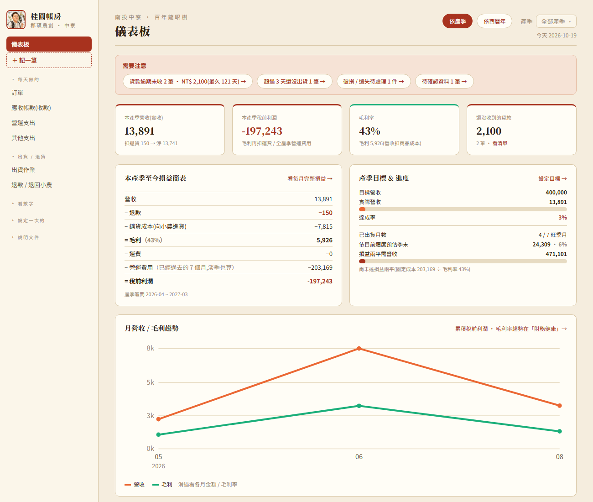

### 在 iPad / 手機上用(同一個 Wi-Fi)

App 跑在電腦上,iPad 只是「遠端的螢幕」——**電腦要開著、`啟動.bat` 要在跑**。

1. 電腦、iPad 連**同一個 Wi-Fi**。
2. 看 `啟動.bat` 黑視窗裡印出的 `http://192.168.x.x:8000`(那台電腦的區網位址)。
3. iPad 用 Safari 打那個網址。
4. Safari 分享鈕 →「**加入主畫面**」→ 桌面就有一顆「桂圓帳房」圖示,點開全螢幕,像 App 一樣。

> 第一次連,Windows 可能跳出防火牆詢問,選「允許」。
> 離開這個 Wi-Fi 就連不到;資料一直都只在那台電腦上。

---

## 二、畫面導覽(左側選單)

選單分四區,點區名可以收合展開(**你自己收合/展開的狀態,這台電腦、這個瀏覽器會記住**,
換頁不會彈回去):

| 區 | 選單 | 用途 |
|---|---|---|
| | **儀表板** | 一頁看營運全貌;最上面「需要注意」是今天該處理的事 |
| | **＋ 記一筆** | 要記哪一種交易的入口頁,七張卡片點進去就是對應的畫面(詳見第四節) |
| 每天做的 | **訂單** | 所有訂單清單;點「＋ 新增訂單」開單;點單號看 / 改一張訂單;可以勾選好幾張一次刪 |
| 每天做的 | **應收帳款(收款)** | 客人還沒付錢的訂單都在這裡;收到錢時勾選、按「收款」(第五節之 3) |
| 每天做的 | **營運支出** | 房租、郵電、運費、薪資、包材…營運相關的花費,每筆照發票記 |
| 每天做的 | **其他支出** | 利息費用、所得稅這類不屬於營運的支出,跟營運支出分開記 |
| 出貨 / 退貨 | **出貨作業** | 揀貨單、出貨標籤 / 送貨單、食品標示,都可列印;右上「物流異常處理」處理破損 / 遺失 / 退貨 |
| 出貨 / 退貨 | **退款 / 退回小農** | 只退錢不退貨、或貨退給小農的紀錄;在訂單頁登記(第五節之 7)。退貨又退款直接刪訂單 |
| 看數字 | **財務健康** | 每月從營收算到稅前利潤 + 累積稅前 + 毛利率趨勢(要先記每月營運支出) |
| 看數字 | **獲利報表** | 三個分頁:獲利分析 / 收款帳齡 / 跨產季比較,可匯出 Excel |
| 看數字 | **定價試算** | 抓成本、算單位成本、對照售價的估算工具;**純參考,不會動到帳上任何數字** |
| 看數字 | **全鏈路毛利** | 把付給小農的成本往前拆解,估算供應端大概賺多少(第十五節) |
| 看數字 | **總帳** | 系統依你填的業務資料自動組出的傳票,一行一筆;主要給同事核對帳務用,勾選刪除傳票也在這裡(見第四節) |
| 看數字 | **財務報表** | 同事做帳 / 報稅用的試算表 / 資產負債表 / 綜合損益表(第十三節) |
| 看數字 | **銀行帳戶明細** | 現金 / 各銀行帳戶各自的進出流水 + 累計餘額(第十二節) |
| 看數字 | **科目明細** | 選一個會計科目,看它每一筆交易跟累計餘額(第十二節) |
| 設定一次的 | **客戶資料庫** | 客戶名單、明細、新增、編輯、合併重複 |
| 設定一次的 | **商品目錄** | 你賣的每個品項規格跟售價 |
| 設定一次的 | **銷售管道** | 官網 / 市集 / 批發 / LINE… |
| 設定一次的 | **固定資產** | 焙灶 / 剝殼機 / 搖蜜機 / 冷藏 / 貨車… 建卡後系統每月自動提折舊,算進財務健康,也會記進總帳 |
| 設定一次的 | **銀行帳戶** | 各銀行帳戶的固定代碼,可以改名 / 併入重複的帳戶(第九節) |
| 設定一次的 | **會計科目設定** | 系統所有科目的來源,可以新增、改名、停用科目(第九節之二) |
| 說明文件 | **下載手冊** | 下載這份手冊、功能手冊、SOP 的最新版本,單一 .html 檔,離線也能看(第十九節) |

- **待確認**(系統提醒有資料沒填完整)、**產季目標**(設定整季營收目標)沒放在選單裡:
  待確認從儀表板「需要注意」的紅字進;產季目標從儀表板「產季目標 & 進度」卡點「設定目標」進。
- 右上角(儀表板、報表頁)可切 **產季**(可複選,預設最新一季)。
- 儀表板、財務健康、獲利報表這幾頁,**產季**旁邊還有「依產季 / 依西曆年」切換鈕——
  平常用產季看就好(配合龍眼生長週期);想用一般日曆年(1~12 月)看的時候切過去,
  數字會重新用西曆年算一次。這個切換**跟第十三節「財務報表」固定用西曆年不一樣**:
  財務報表不能選,這裡才是可以自己選的。

---

## 三、一個核心觀念:分開建檔

這套系統把資料分成兩種,**觀念對了,操作就順了**。

### 主檔 —— 建一次,之後一直用
像通訊錄和型錄。內容不常變,先建好放著。

| 主檔 | 就是 | 建的時機 |
|---|---|---|
| **銷售管道** | 官網 / 市集 / 批發 / LINE… | 一開始建好,很少再動 |
| **商品目錄** | 每個品項規格(桂圓乾 300g、龍眼肉 600g…)+ 售價 | 有新品或改價時 |
| **客戶** | 每一個買過的人 / 店 / 單位,含電話、地址、客戶分類(企業戶 / 個人戶) | 第一次跟這個客人往來時 |

### 交易 —— 每次發生就記一筆
就是 **訂單(+ 訂單明細)**。每賣一次記一張。

### 關鍵:訂單不是「重打一次資料」,是「挑」

開一張訂單時,你**不會**再輸入客戶的電話地址、也不會重打商品名稱和售價 ——
你只是從既有的客戶清單「挑一個人」、從商品目錄「挑幾樣東西」,填數量,系統自動帶價。

```
         ┌─ 客戶(挑一個)
訂單 ────┼─ 銷售管道(挑一個)
         └─ 訂單明細 ── 商品(挑) × 數量 × 單價
```

### 為什麼要這樣分

1. **不用重複輸入** —— 老客戶下第 10 張單,不用再打一次他的資料。
2. **資料一致** —— 客戶電話改一次,所有相關訂單都跟著對;不會這張寫對、那張寫錯。
3. **報表才算得出來** —— 因為每張訂單都連到「同一個客戶編號」「同一個商品編號」,系統才能把「這個客人買過幾次」「這支產品賣多少」串起來。名字打得不一樣,系統就當成不同人 / 不同東西,報表就亂了。

### 建立順序(第一次導入時)

**先** 銷售管道 → **再** 商品目錄(順便設售價)→ **再** 客戶 → **最後才** 開訂單。
(平常運作時,只有「客戶」會邊做邊補;商品和管道很少動。)

### 一個比喻

- 商品目錄 = 菜單
- 客戶資料庫 = 常客名冊
- 訂單 = 一張出貨單:寫「誰、點了菜單上的哪幾樣、幾份」,不會把整份菜單和客人的身家再抄一遍。

### 郡碩是「接單才跟小農買」的貿易公司(2026-10 起的做法)

郡碩**沒有存貨**:有客人下單,才跟小農買貨、轉手賣給客人,而且**接單當天就把錢付給小農**。
所以系統裡**沒有「進貨」「庫存」「付小農貨款」**這些畫面,一張訂單就記完:

- **開一張訂單** → 每個品項自己填「成本」(這些貨跟小農買花多少錢),再選「成本付給小農的帳戶」。
  存檔時系統同時記:客人欠我們多少(含稅)、這批貨的採購成本,以及當天已經付錢給小農。
- **客人付款** → 到「應收帳款」頁勾選收款;當場就收齊的,開單時直接選收到哪個帳戶。
- **售價都是含稅價**,每張訂單的「銷項稅額」由你自己填,系統不幫你算。
- 小農只有一個,不用分人。

---

## 四、記一筆 —— 要記帳,先看這頁

側邊選單「＋ 記一筆」是所有記帳動作的統一入口,七張卡片對應七種交易
(順序照同事的帳務設定表),點進去填,系統會自動組出分錄記進「總帳」(下一段說明)。

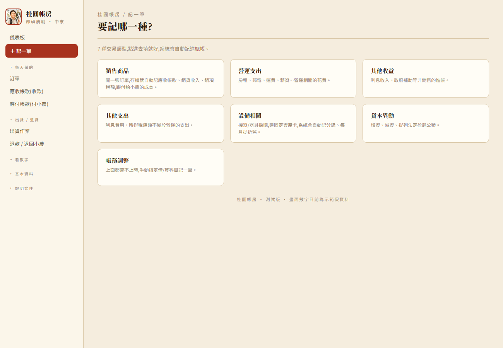

| 卡片 | 就是 | 多常用 |
|---|---|---|
| 銷售商品 | 開訂單 | 每天 |
| 營運支出 | 房租、郵電、運費、薪資、包材… | 常常 |
| 其他收益 | 利息收入、政府補助等不是賣東西賺來的錢 | 很少 |
| 其他支出 | 利息費用、所得稅 | 很少 |
| 設備相關 | 固定資產 | 買設備才會用到 |
| 資本異動 | 增資、減資、提列法定盈餘公積 | 幾乎不會用到,同事在管 |
| 帳務調整 | 其他類都套不上時,手動記一筆(要懂借貸科目)| 幾乎不會用到,同事在管 |

**營運支出、其他收益、其他支出、資本異動**這幾個畫面長得很像:上面填日期、備註,下面分成幾個
區塊,每個區塊左上角標著同事帳務設定表的分組字母(例如 VD 費用、C 付款帳戶、G 進項稅額),
各填自己那一塊就好。最下面「分錄預覽」會邊填邊顯示這筆會記成什麼,按「儲存」就記好了,
不用再另外確認一次。

### 總帳是什麼

**總帳**(選單「看數字 → 總帳」)是系統依你上面填的每一筆業務資料,自動組出來的
會計分錄明細,**一行一筆**——你不用懂「借方 / 貸方」是什麼,這頁主要是給比較懂記帳的同事核對
帳務對不對用的。你只要記得:**這裡的內容不能直接改,要改就點傳票號碼,回到原本那筆訂單 / 費用修改,
總帳會自動跟著更新**。

- 傳票號碼一律是 `GL` + 日期 + 當天流水號,例如 `GL20260921001`。
- 預設依傳票號碼由小到大排(也就是由舊到新)。**點欄位標題可以換排序**,再點一次反過來。
- 標題下面那一排可以篩選:傳票號碼可以用 `*`(任意多個字)跟 `?`(一個字),例如 `GL202609*`
  就是九月全部的傳票;科目用下拉選。
- 「識別碼」= 發票號碼;「解釋」欄用白話寫這一筆讓科目「增加」還是「減少」多少。
- **刪除傳票**:勾選任何一行,同一張傳票會整張一起勾(不能只刪其中一行),按「刪除勾選的傳票」。
  刪除會連同產生這張傳票的原始資料(那張訂單、那筆費用…)一起刪掉。
  設備取得 / 折舊要到「固定資產」處理,年度結轉要到「財務報表」撤銷,這裡不能勾。

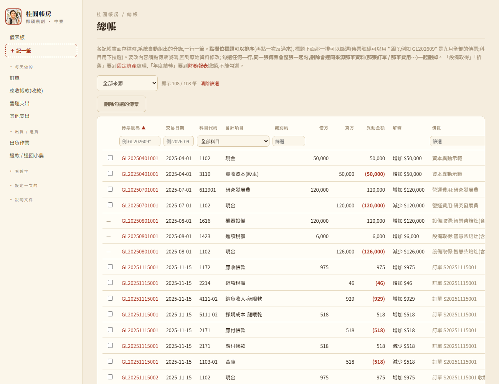

---

## 五、每天最常做的事

### 1. 開一張新訂單

**訂單** 選單點進去先看到清單,右上「＋ 新增訂單」開新單。

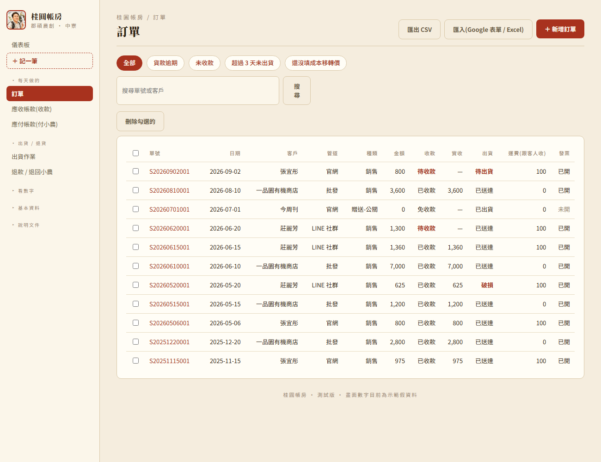

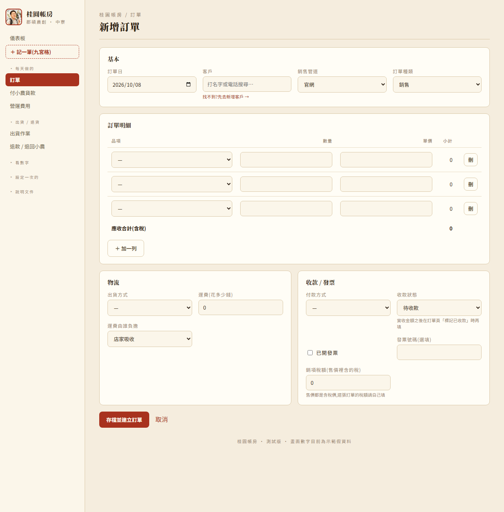

1. **訂單日**:預設今天,需要可改。
2. **客戶**:在框裡打名字或電話,下面會跳出清單。每筆會顯示「客戶分類 · 電話 · 最近購買 · 幾筆訂單」,**認清楚是哪一位再點**。
   - 選好後下方會出現一張小卡:電話、地址、最近 3 筆訂單、累計消費 —— 再確認一次沒選錯人。
   - **名單裡找不到** → 點「找不到?先去新增客戶 →」,把客戶建好會自動跳回來。
3. **銷售管道**:這張單從哪來(官網 / 市集 / 批發…)。
4. **訂單種類**:一般賣就是「銷售」;送人選「贈送-公關」;補寄選「理賠重寄」等。不是銷售的訂單一律免收款。
5. **訂單明細**:
   - 每列選品項、填數量。**單價留空會自動帶商品目錄的售價**;要特價就自己打。
   - **成本(這列總額)**:這一列的貨跟小農買花了多少錢,**自己填**(不是單價,是這一列的總額)。
   - 不夠填 → 點「＋ 加一列」;多的 → 點「刪」。
6. **成本付給小農的帳戶**:接單當天就付錢給小農,選從哪個帳戶付(現金 / 合庫…)。
7. **物流**:出貨方式、**運費(跟客人收)**——跟客人收的運費會算進應收合計;
   實際付給物流公司的運費,請到「營運支出」記一筆。
8. **收款**:
   - 還沒收到錢 → 選「**E 應收帳款(還沒收,之後再收)**」(預設),之後到「應收帳款」頁收款。
   - 當場就收齊 → 選「**C 當場收到:現金 / 合庫…**」,收款日就是訂單日。
9. **發票**:有開發票就勾「已開發票」——**勾了之後發票號碼欄位會變成必填**,沒填不給存檔;沒開發票就不用勾,發票號碼留空即可。
10. **銷項稅額**:售價都是含稅價,這張訂單含了多少稅**請自己填**,系統不會幫你算。
    填負數、或比商品金額還大會被擋下來。總帳會把客人付的錢拆成「銷貨收入」跟「銷項稅額」兩部分。
11. **存檔並建立訂單** → 會跳到這張訂單的明細頁。

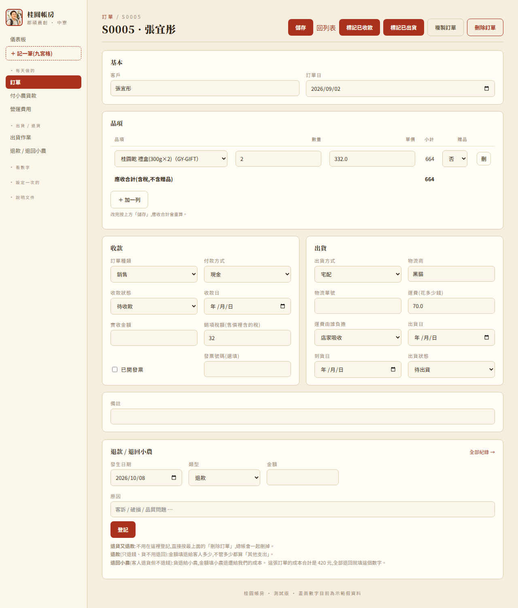

### 2. 一次匯入很多筆訂單(選用)

如果訂單是從 Google 表單收單、或是客人用 Excel 給你一批名單,不用一筆一筆手動開——
訂單清單頁右上角「匯入」,選「銷售管道」,上傳 `.csv` 或 `.xlsx` 檔案:

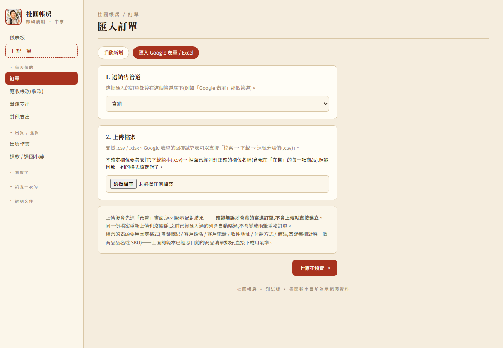

檔案表頭要用固定格式(時間戳記 / 客戶姓名 / 客戶電話 / 收件地址 / 付款方式 / 備註,
其餘每欄對應一個商品品名或 SKU,填數量)。**不確定欄位怎麼打,直接點畫面上「下載範本
(.csv)」**——系統會依照現在「在售」的商品清單,自動產生欄位名稱都排好的範本檔,打開
照第一列範例的格式往下填就對了(範例那一列記得刪掉再上傳)。上傳之後系統**先給你看
預覽**,不會直接建單:

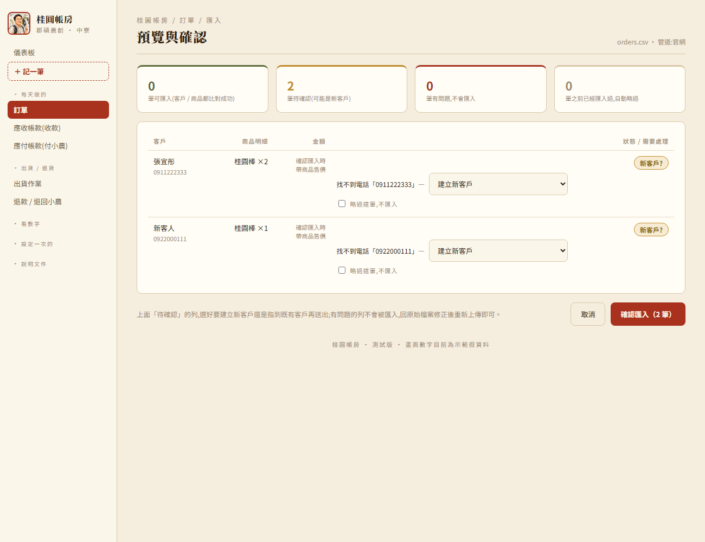

- **可匯入**:客戶、商品都比對成功,確認就會直接建單。
- **待確認**:電話找不到對應的既有客戶,系統會問你要「建立新客戶」還是指到既有客戶。
- **有問題**:格式不對、品項對不到商品的列,不會被匯入,回原始檔案修正後可以重新上傳。
- **之前已經匯入過**:同一份檔案重複上傳也沒關係,已經匯入過的列會自動略過,不會變成
  兩筆重複訂單。

看一輪沒問題,按「確認匯入」才會真的建立訂單。

> **匯入的訂單,銷項稅額是 0**,匯完記得一張張進訂單頁補填。

### 3. 收到貨款了

左側選單「**應收帳款(收款)**」:上半「尚未收回」是客人還沒付錢的訂單。收到錢時,
**勾選那幾筆、按「收款」**,選收到哪個帳戶、收款日,就變成已收款。下半是已經收回的紀錄。

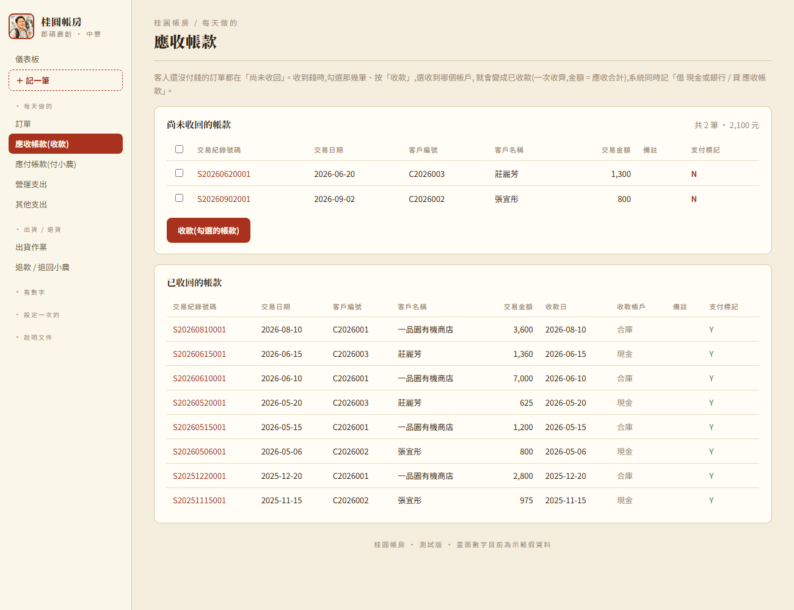

- 收款一定是**一次收齊**,金額 = 應收合計,不用另外填實收金額。
- 也可以打開那張訂單,在「收款」卡選收款帳戶、收款日,按右上「標記已收款」,效果一樣。
- **本產季營收算的是已經收到的錢**——還沒收款的訂單,再大都不會算進營收 / 毛利裡。
  系統也會同時在總帳記一筆收款,不用你管。

### 4. 出貨了

打開訂單,「出貨」卡裡先選**出貨方式**(宅配 / 超商店到店 / 自行配送…),出貨日沒填會
自動帶今天,再按右上角 **「標記已出貨」**(沒選出貨方式會提醒你,不會讓你直接按過去)。
要記物流單號 → 在「出貨」區填 **物流單號**、必要時改物流商、出貨狀態,按下方「儲存」。

### 5. 改一張已建立的訂單

打開訂單明細頁:
- **品項**:直接改品項 / 數量 / 單價 / 成本,加減列,按「儲存」→ 金額自動重算,總帳跟著更新。
- **改客戶**:上方「客戶」框重新搜尋、選一位,按「儲存」。
- **複製訂單**:右上「複製訂單」→ 同客戶、同品項、同稅額開一張新單(日期填今天),適合回頭客重複下同樣的東西。
- **刪除訂單**:右上「刪除訂單」,會問一次確認。刪掉後**沒辦法復原**,連同這張單的品項、退款紀錄、
  總帳傳票都會一起刪掉。建錯單,或是**客人退貨又退款**,都是用這個。
  要一次刪好幾張,在訂單清單勾選、按「刪除勾選的」。

### 6. 包裹破損 / 遺失

**物流異常** 頁:
- 找到那筆,選「處理方式」(重寄 / 退款 / 換貨 / 折讓),填說明。
- 要重寄 → 勾 **「一併建立理賠重寄單」**,系統會複製原訂單品項、開一張金額 0 的重寄單。
- 按「儲存」。

### 7. 客人退貨 / 退款

先分清楚是哪一種:

| 情況 | 怎麼做 | 系統怎麼記 |
|---|---|---|
| **退貨又退款**(貨退回來、錢也還給客人) | 直接按訂單右上「**刪除訂單**」 | 這張訂單跟它的傳票全部刪掉,就像沒發生過 |
| **只退款、不退貨**(貨不用退,補償客人一點錢) | 訂單頁最下方「退款 / 退回小農」,類型選「**退款**」,金額填退給客人多少、錢從哪個帳戶退 | 不管退多少,一律算「其他支出」(目前暫記 6188-99 其他費用-其他,待同仁確認) |
| **退貨但不退款**(客人退貨,錢不退) | 同上,類型選「**退回小農**」,金額填小農退回多少、退回哪個帳戶,再選扣哪一項採購成本 | 貨退給小農、小農把錢退回來,從那項採購成本扣掉 |

畫面上會顯示這張訂單的**成本合計**,如果貨全部退回小農,金額就填這個數字。
已經收過款的訂單,退款會記成真的從帳戶退錢出去;還沒收款的,會記成客人少付這筆(應收帳款減少)。
清單也可以勾選好幾筆一次刪除。


左側選單「退款 / 退回小農」可以看全部的紀錄,下方分別合計「退給客人多少」「小農退回多少」。

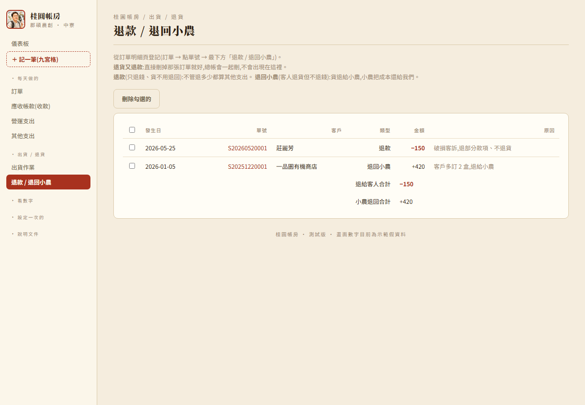

### 8. 付錢給小農

**不用另外記。** 郡碩接單當天就付錢給小農,開訂單時填每列的成本、選「成本付給小農的帳戶」,
存檔就一起記好了(原本的「付小農貨款」頁已經拿掉)。

### 9. 記一筆營運支出

**營運支出** 選單先看到清單(每筆的日期、科目、發票金額、進項稅額、付款帳戶),右上「＋ 新增一筆」。

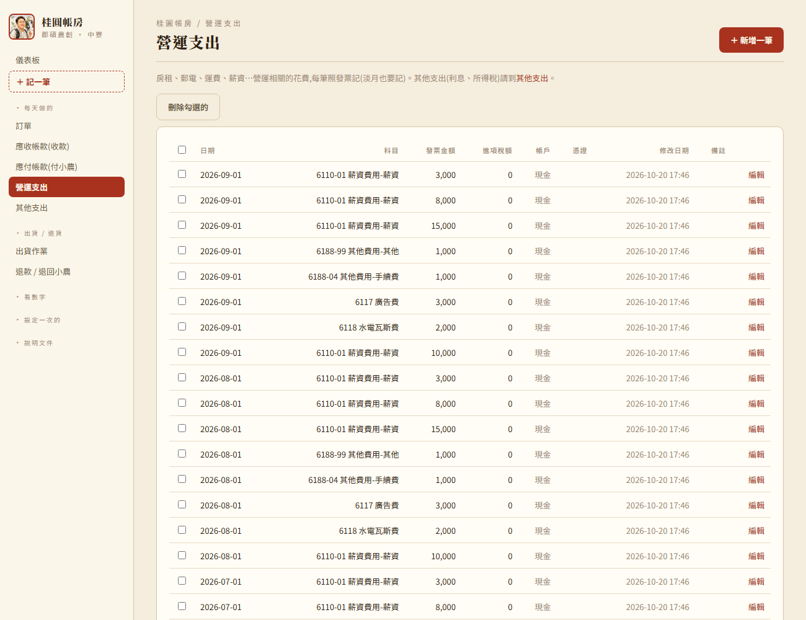

新增畫面一頁填完:

1. 最上面:**日期**(就是發票 / 付款那天,總帳也記這一天)、備註。
2. **VD 費用**:選科目(例如 6118 水電瓦斯費、6110-01 薪資),填**發票金額(支付金額)**
   = 發票上的總額,也就是實際付出去的錢(含稅)。
3. **C 付款帳戶**:從哪個帳戶付。
4. **G 進項稅額**:發票上的稅額(沒有就填 0)、憑證類型、發票號碼。**憑證類型選了「發票」,發票號碼一定要填。**
5. 最下面「分錄預覽」會顯示:費用 = 發票金額 − 進項稅額。確認沒問題按「儲存」。

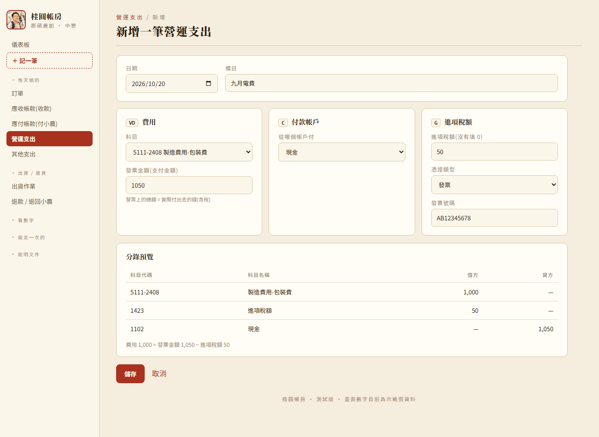

- 進項稅額不能大於或等於發票金額,會被擋下來。
- **一次性的大支出不再分月攤提**,整筆算在付款那個月(是否要恢復分月,待同仁確認)。
  如果是設備 / 機器,請改到「固定資產」登記,才會逐年提折舊。
- **包材、紙箱這類開銷也在這裡記**。系統沒有「進貨」頁。
- 清單可以勾選好幾筆一次刪除,總帳的傳票會一起刪掉。

### 10. 記一筆其他支出

利息費用、所得稅這類**不屬於營運**的支出,到左側選單「**其他支出**」記,填法跟營運支出一樣
(只是科目換成 VE 組)。其他支出**不會出現在營運支出清單,也不算進財務健康的營運費用**。

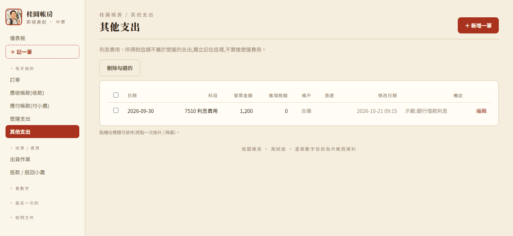

---

## 六、客戶

### 新增

**客戶資料庫 → ＋ 新增客戶**。填名稱(必填)、電話、**客戶分類**(企業戶 / 個人戶)、主要管道、發票抬頭 / 統編、單據需求、預設收件地址。
**客戶編號**系統自動編(C + 年份 + 流水號,例如 C2026001),不用填。客戶不分級,開單一律帶商品目錄的售價。

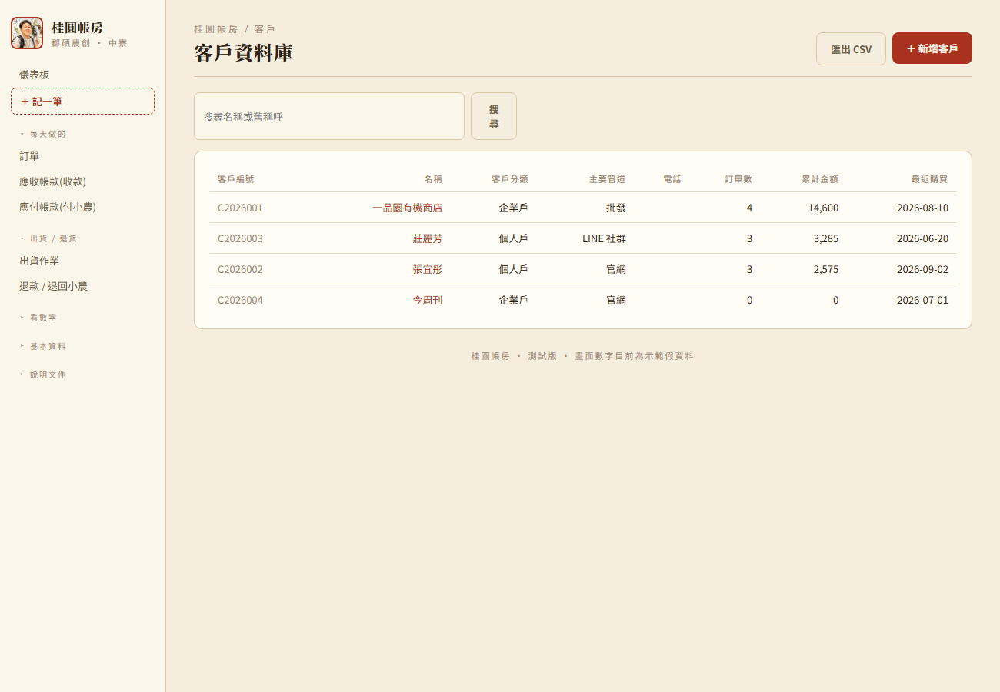

### 搜尋

清單上方搜尋框,可打名字、舊稱呼、電話。

### 重名怎麼辦

- 建檔時如果已有同名,系統會列出現有那幾位(含電話、最近購買、地址),請你判斷:
  - **同一人** → 按「取消」,回去選現有那位。
  - **不同人** → 名稱加個能區分的字(電話末碼、地區、來源,如 `陳美玲(0912…321)`),勾「確認這是不同的人,仍要新增」。
- 系統靠「客戶編號」認人,名字一樣也是不同資料、各自的訂單歷史。

### 合併重複客戶

不小心建重了 → 打開其中一位的明細頁 → 右上「**合併到其他客戶**」→ 搜尋要**保留**的那位 → 確認。
來源客戶的所有訂單、地址、舊稱呼都會搬過去,來源被刪除。**無法復原,請看清楚再按。**

### 刪除客戶

客戶編輯頁也能「刪除」,但只要這位客戶已經有訂單就會被擋下來(系統會直接說明原因)。
建錯、從沒下過單的客戶才刪得掉;已經有交易紀錄的客戶,想處理重複請用上面的「合併」。

---

## 七、主檔維護(商品 / 管道)

### 商品目錄
- 「＋ 新增商品」/ 每列「編輯」。
- **品項代碼**:系統自動編(F001、F002…),每種品項＋規格一個(桂圓乾 300g 一個、500g 另一個),所有訂單靠它連回商品。
- **售價**:新增訂單時會自動帶入這個價;實際賣得比這裡低,系統會把差額算成折扣。
- **成本不在這裡填**:每張訂單的成本由你開單時一列一列自己填(第五節之 1)。
- 商品編輯頁可以「刪除」,但如果已經有訂單用過它,系統會擋下來並具體說明卡在哪(例如「有 5 張訂單用過這個商品」)。

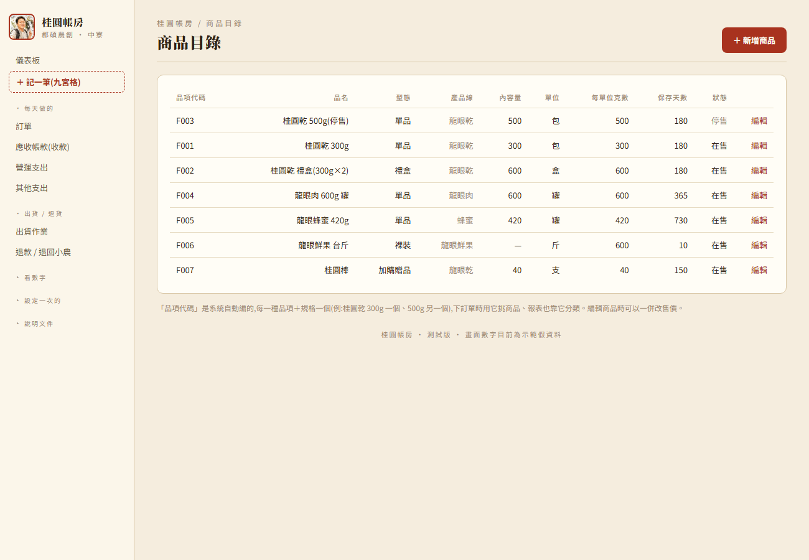

### 銷售管道
- 「＋ 新增管道」:代碼、名稱、分類、帳期天數。
- 同樣可以「刪除」,若已經被訂單、客戶(設為主要管道)或定價用過會被擋下並說明原因。

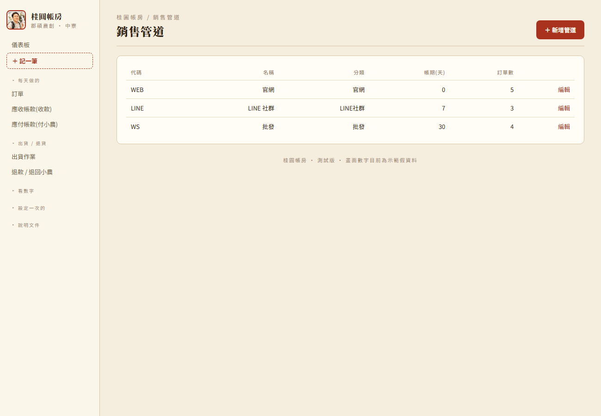

---

## 八、固定資產

**固定資產** 頁登記焙灶、剝殼機、搖蜜機、冷藏、貨車這類不是一次性費用、要逐年提折舊的設備。

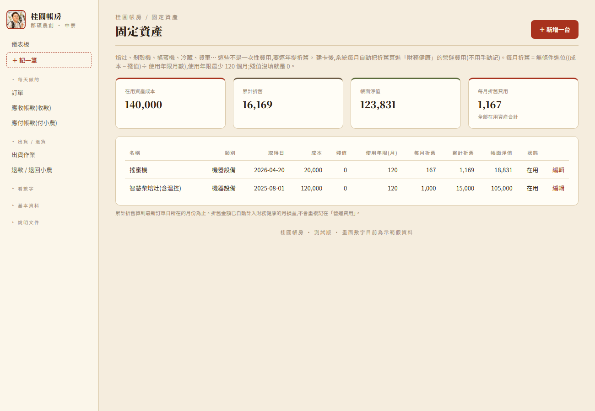

- 「＋ 新增一台」填名稱、類別、取得日、取得成本、進項稅額(沒有填 0)。
- **使用年限用「月」填,最少 120 個月(10 年)**,預設就是 120;填低於 120 會被擋下來。
- **殘值一律是 0**,不用填,畫面上也不能改。
- **付款帳戶用選的**:現金,或會計科目設定裡的銀行帳戶。
- 每月折舊 = 取得成本 ÷ 使用年限月數(無條件進位)。
- 存檔後系統會自動記一筆「設備取得」分錄,以後每個月你打開這頁,系統會順便把還沒記過的
  折舊月份補齊,不用手動一筆一筆記。
- 處分(賣掉 / 報廢)才填「處分日」,填了之後就不會再繼續提折舊。

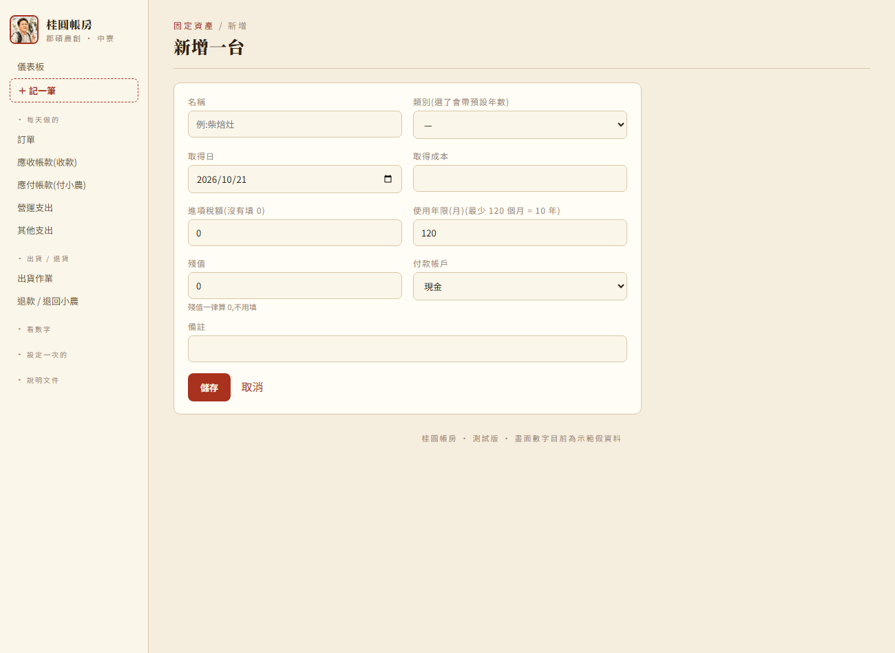

---

## 九、銀行帳戶(主檔)

銀行帳戶就是「會計科目設定」裡「現金 / 銀行」(C 組)那幾個 1103 科目(合庫 1103-01、凱基 1103-02、
台新 1103-03)。各畫面的付款 / 收款帳戶都是用下拉選的,選單就是從這裡來。

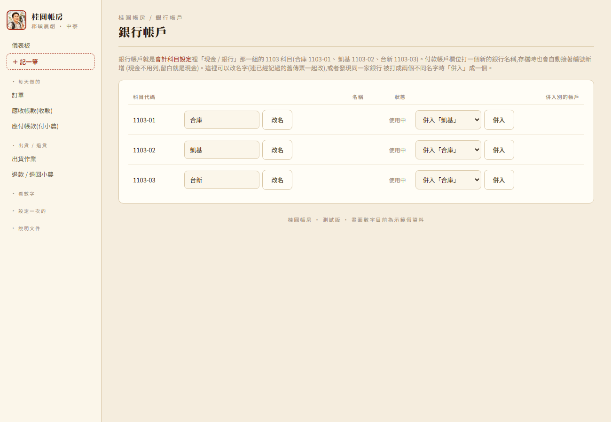

這頁能做的兩件事:

- **改名**:打錯字、或銀行名稱異動,直接改,連已經記過的舊傳票也會一起更新,不會拆成兩筆。
- **併入**:發現同一家銀行不小心被打成兩個不同名字(例如「合庫」「合作金庫」各記了幾筆),
  選「併入」把其中一個併進另一個,舊傳票會自動改成合併後的代碼,原本那個帳戶會被刪掉
  (**這個動作沒辦法復原**,按下去前系統會再跟你確認一次)。

代碼一旦指派就不會再變,所以這頁**沒有「刪除」**,不想用的帳戶放著不管就好,不影響任何東西。
要新增一個銀行帳戶,到「會計科目設定」的 C 組加一個 1103-xx 科目。

### 九之二、會計科目設定

系統所有記帳畫面的科目下拉都從這裡來,分組照同事 1015 版的「帳務設定表」
(C 現金銀行、E 應收帳款、VD 營運費用、VE 其他支出、UB 業外收入、T 權益…)。

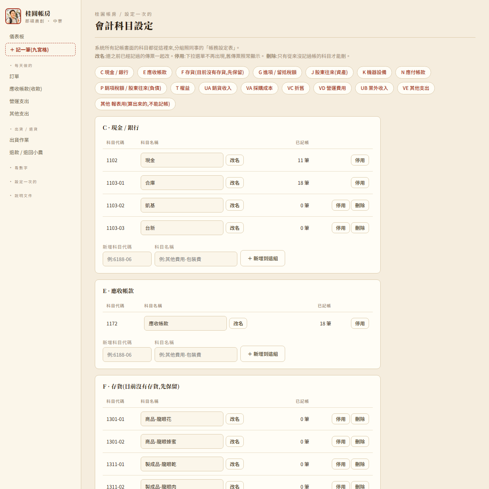

- **新增**:在那一組下面填科目代碼、科目名稱。
- **改名**:連之前已經記過的傳票一起改。
- **停用**:下拉選單不再出現,舊傳票照常顯示。
- **刪除**:只有從來沒記過帳的科目才能刪。
- 「本期損益」這類由系統算出來的科目不能拿來記帳。

---

## 十、出貨作業

**出貨作業** 頁把「今天要出的貨」整理成可列印的文件。

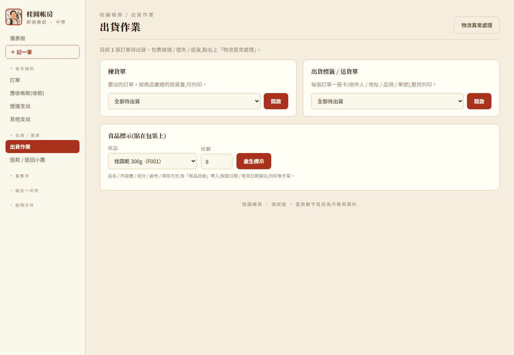

### 揀貨單
- 「全部待出貨的揀貨單」或選某個訂單日。
- 上半:**按商品彙總**(桂圓乾 300g 合計 40 包、禮盒 12 盒…)→ 拿著去備貨。
- 下半:逐張訂單的收件人與品項。
- 右上「列印」。

### 出貨標籤 / 送貨單
- 每張訂單一張卡:收件人、電話、地址、品項、單號、寄件人。整頁列印、剪下貼箱。
- 寄件地址 / 電話第一次要在程式的 `SENDER` 設定(main.py),現在是 `[寄件地址]` 佔位。

### 食品標示
- 選商品 + 份數 → 產生標示貼紙(品名 / 內容量 / 成分 / 產地 / 保存方式 / 製造日期 / 有效日期 / 製造商)。
- 內容量、成分、產地、保存方式在「商品目錄」編輯;製造日期、有效日期系統不會自動填,列印出來自己手寫上去。
- 食品業者登錄字號、營養標示等法規細項請自行確認補上。

---

## 十一、看儀表板

整理過後,儀表板只留「一眼要看的」:

- **需要注意**(橘色區):今天該處理的事,每個標籤可點進去處理(逾期未收 / 待出貨超時 / 破損遺失 / 待確認資料)。
- **4 個 KPI**:本產季營收(**已經實收的錢,扣掉銷項稅額**,還沒收到的訂單不算)、**本產季稅前利潤**、毛利率、還沒收到的貨款。
- **本產季至今損益簡表**:營收(不含稅)→ −退款 → −銷貨成本 → 毛利 → −運費 → −營運費用 → **稅前利潤**,一次看完,右上連到財務健康看每月明細。進行中的產季,營運費用只算「已經過去的月份」,不會預先把還沒發生的費用也算進去,避免季初看起來嚇人的赤字。
- **產季目標 & 進度**:目標營收 / 實際 / 達成率 / 依速度預估季末 / 損益兩平需營收(先點卡上「設定目標」到產季目標頁設定)。
- **月營收 / 毛利趨勢**:儀表板唯一一張圖,滑過看各月金額與毛利率。
- 右上角可複選 **產季**(那個產季有訂單、或你登錄過那季的營運費用,就會出現在下拉),預設選最新一季。「逾期幾天」一律用**今天**的日期算,不用另外切。

> 更深入的看法搬到別頁:累積稅前利潤、毛利率趨勢 → 財務健康;各通路 / 品項 / 新客回頭 / Top 客戶 → 報表「獲利分析」。

---

## 十二、看報表

### 三個分頁

| 分頁 | 看什麼 |
|---|---|
| **獲利分析** | 每個商品 / 每個管道的營收、折扣、成本、**毛利、毛利率**;品項營收佔比;新客 vs 回頭客;本產季 Top 客戶 |
| **收款帳齡** | 未收款金額分 0–15 / 16–30 / 31 天以上;逐筆清單可點進去追款;下面還有「最近已收回」清單,可以回頭核對 |
| **跨產季比較** | 2024 vs 2025 的營收 / 訂單 / 毛利對照;產季內各月營收疊圖 |

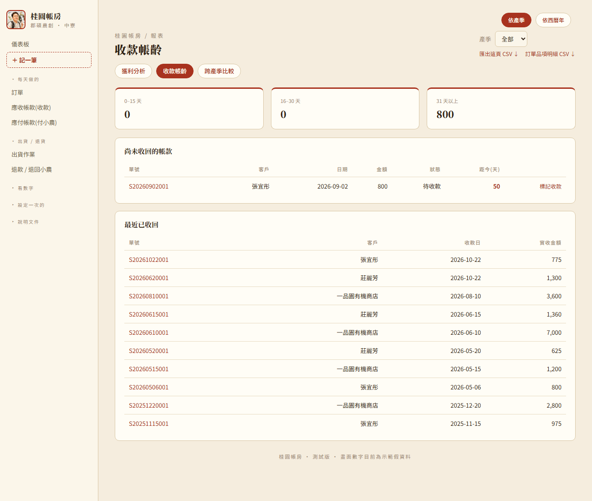

每個分頁右上角有 **「匯出這頁 CSV ↓」**,會帶入目前選的產季,用 Excel 打開中文正常。
訂單、客戶清單頁也各有匯出鈕。

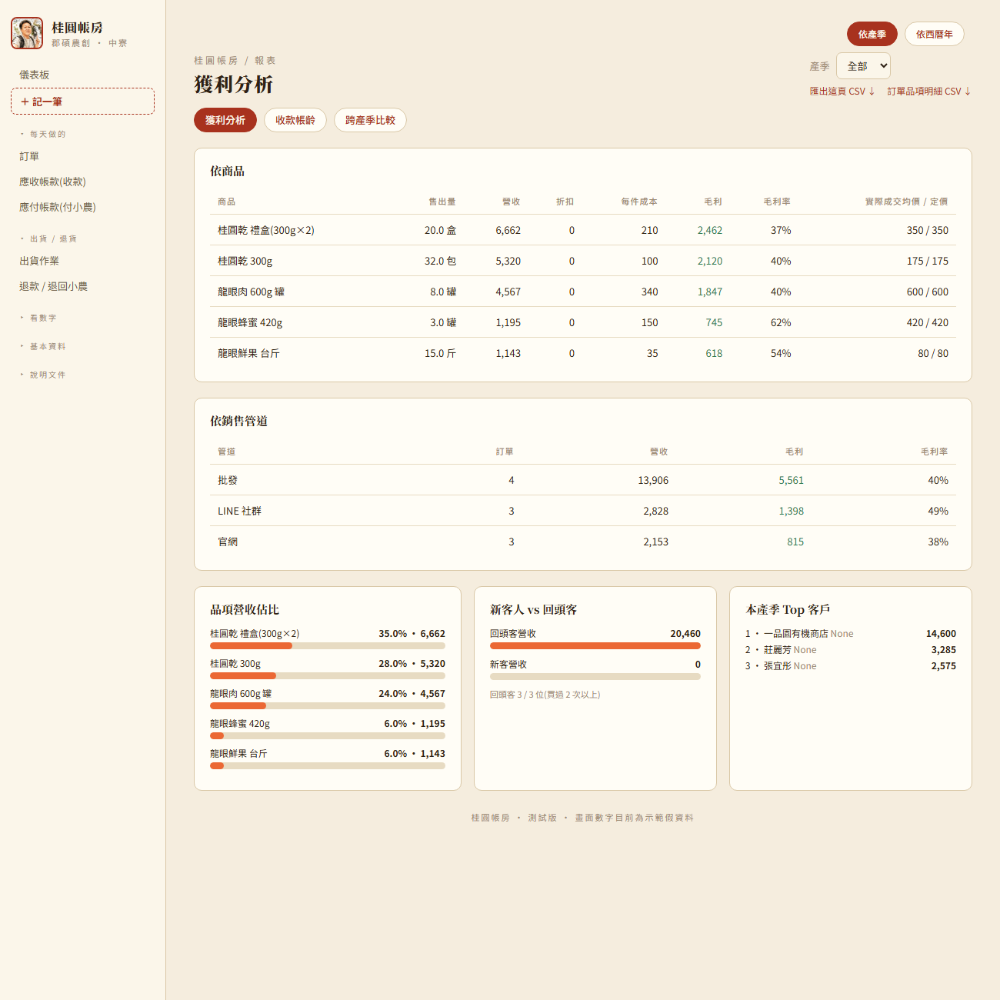

### 財務健康(月損益)

報表看的是「毛利」;**財務健康** 這頁再往下算到 **稅前利潤**。

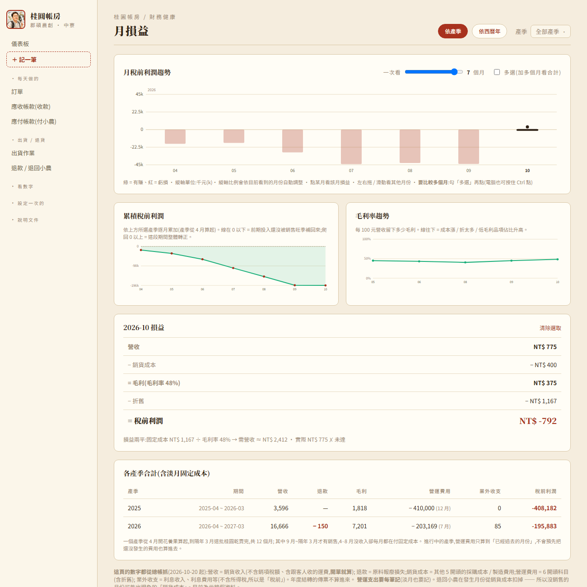

- 上方選月份。表格由上到下:營收 → −銷貨成本 → 毛利 → −運費 → −各項營運費用 → **= 稅前利潤**(綠色代表有賺、紅色代表虧)。
- **營收、成本、毛利、運費** 由系統的實際訂單自動算,營收算的是**已收到的實收金額扣掉銷項稅額**。
  退款從營收扣掉;小農退回的成本從銷貨成本扣掉。
- **營運費用要你每筆記進去** —— 點右上「維護營運費用」(就是「營運支出」頁)→「＋ 新增一筆」。
  項目就是會計科目設定裡營運費用(VD)那一組的科目;其他支出(VE,利息 / 所得稅)不算在這裡。
  營運費用算的是**不含稅**的金額(發票金額 − 進項稅額)。
- **損益兩平點**:固定成本 ÷ 毛利率 = 每月營收要做到多少才不虧;和本月實際營收比對。
- **月稅前利潤趨勢**:一眼看出哪幾個月在賺、哪幾個月被固定支出吃掉。**淡月(4–8 月是開花養果期、幾乎沒收入)照樣有人事房租,所以是紅的** —— 這正是要盯的地方,營運費用淡月也要記。
- **各產季合計**:已經結束的產季,拿整季收入減掉整年 12 個月的開銷,回答「這批桂圓到底賺不賺」;還在進行中的產季,只減掉「已經過去的月份」的開銷,不會預先算進還沒發生的支出。

> 沒填營運費用的月份,稅前利潤會等於毛利(偏高、不準)。要準,每個月都要把開銷填進去。

### 銀行帳戶明細

**銀行帳戶明細**(選單「看數字」)是依帳戶(現金 / 各家銀行)整理出來的進出流水,
逐筆算累計餘額。上方分開顯示這個帳戶的科目代碼跟科目名稱。帳戶名單就是「銀行帳戶」頁(第九節)那幾個,
加上現金。

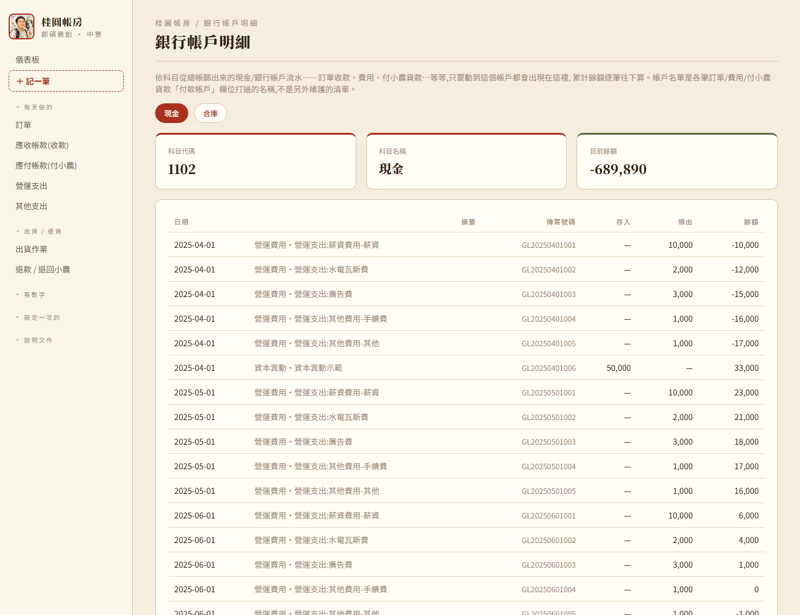

### 科目明細

**科目明細**(選單「看數字」)選一個會計科目跟日期區間,看它的每一筆交易跟累計餘額——
例如應收帳款、進項 / 銷項稅額、各產品線的採購成本、業外收益。累計餘額的正負號跟財務報表一樣:
這個科目「正常增加的方向」是正數。

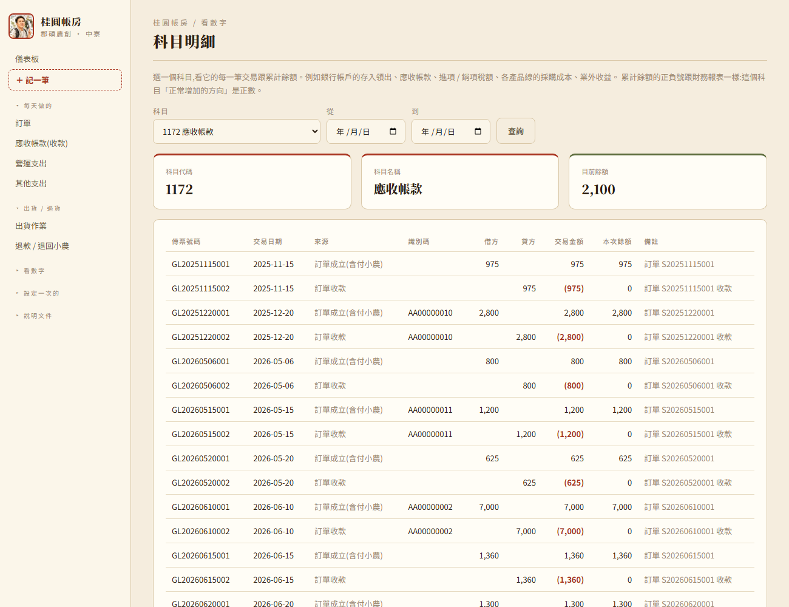

### 產季目標

側邊欄「分析 → 產季目標」:每個產季填一個整季營收目標,存檔後儀表板的「產季目標 & 進度」卡就會算達成率、
依速度預估季末、損益兩平需營收。**還沒開賣、只有前期投入費用的產季**(例如 4–8 月剛登錄完營運費用、還沒下第一筆訂單)
也會出現在這頁和產季下拉裡,方便你提早設目標、看前期燒了多少。

---

## 十三、財務報表

這是給同事做帳 / 報稅用的**正式會計報表**,跟前面「看報表」「財務健康」那些給自己看
經營狀況的報表不是同一回事——這裡的數字直接從總帳算出來,一分一毫要對得起來;前面
那些是方便自己看生意好不好的估算版,兩邊口徑本來就不會完全一樣,不用覺得奇怪。

側邊欄「看數字 → 財務報表」,右上角選年度(**這裡固定用西曆年 1~12 月**,跟系統其他
地方「產季」4 月到隔年 3 月不是同一條時間軸——這也是刻意的,報稅本來就要用西曆年)。
三個分頁:

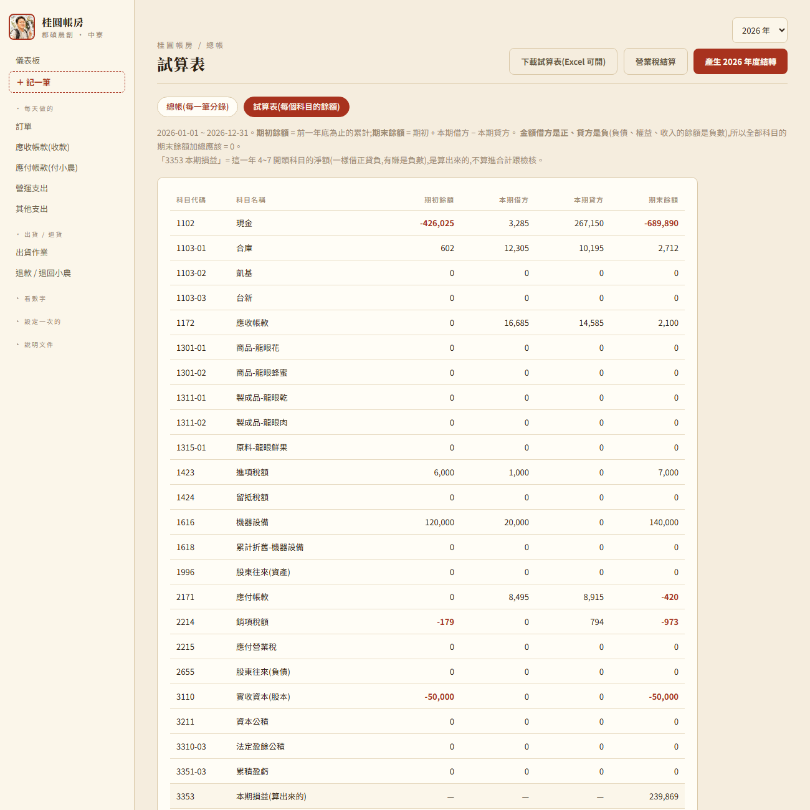

- **試算表**:**所有科目**累計到這一年底為止的借貸餘額,沒有金額的科目也會列出來、顯示 0。
  右下角有一個檢核值,正常情況下永遠是 0。上方「**下載試算表(Excel 可開)**」可以下載成檔案,
  用 Excel 直接打開,中文不會亂碼。
- **資產負債表**:資產 / 負債 / 權益,截至年底的餘額。
- **綜合損益表**:這一年(進行中的年份只算到今天)的收入 / 成本 / 費用明細,分段小計:
  營業收入 − 營業成本 = 營業毛利;營業毛利 − 營業費用 + 業外收入 − 業外支出 = 本期損益。

三張表都是固定欄寬,科目代碼、科目名稱、金額各一欄,視窗放大也不會被拉長。

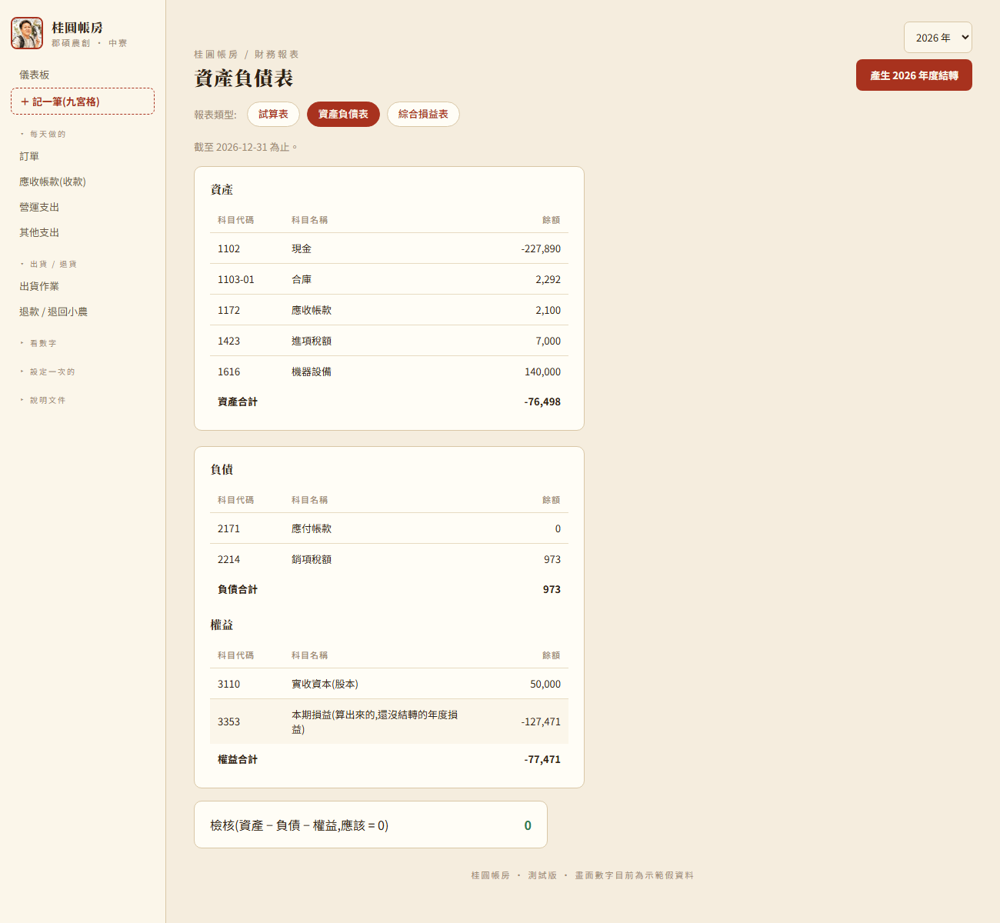
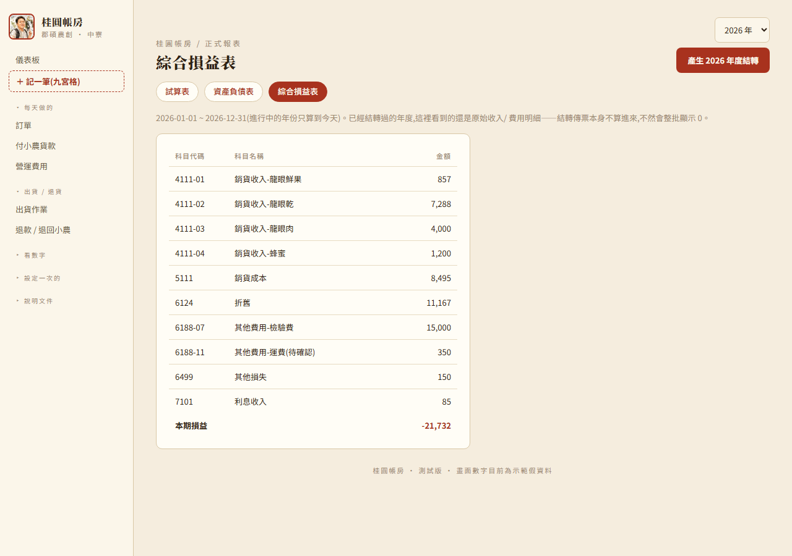

年度結束後,按右上角「產生 OOOO 年度結轉」,系統會真的貼一筆傳票,把這一年收入/成本/
費用科目的餘額歸零、淨額轉進「累積盈虧」——這樣下一年的試算表才會正確疊加。按錯了可以
「撤銷結轉」。**這個動作同事應該比較熟悉什麼時候該按,平常不用主動去按。**

---

## 十四、定價試算

**定價試算** 頁是給你估算「這個東西賣多少錢才划算」的工具——填材料成本、人工、製造費用,
系統算出建議售價。**這一頁純粹是參考估算,存的數字不會動到訂單、成本、營收裡任何一個數字。**

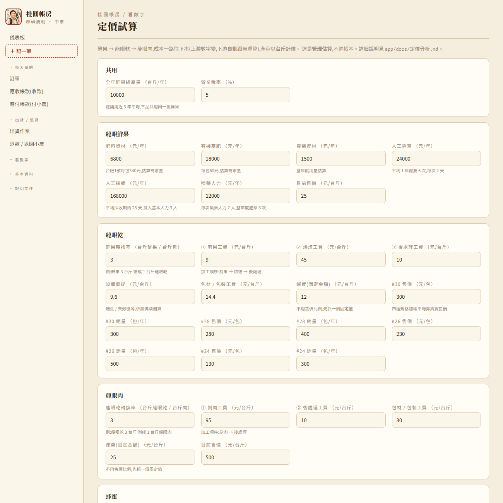

---

## 十五、全鏈路毛利分析

郡碩沒有自己的果園,但老闆（家易）自己有果園——郡碩是跟他買鮮果或加工品,買鮮果可能
自己加工再賣、也可能買加工品直接包裝賣。儀表板、總帳、這份手冊前面講的所有報表,**都是
公司角度**:從公司付給小農的錢開始算,不會看到供應端自己種 / 自己加工花了多少成本。

**全鏈路毛利分析**(選單「看數字」)就是另外補這一塊——把付給小農的成本**往前拆解**,
估算裡面大概多少是供應端自己的成本、供應端大概賺多少,給自己決策參考用。**不是多算
一筆錢**,金額不會因為這頁而改變,總帳跟財務報表都不會被這頁影響。

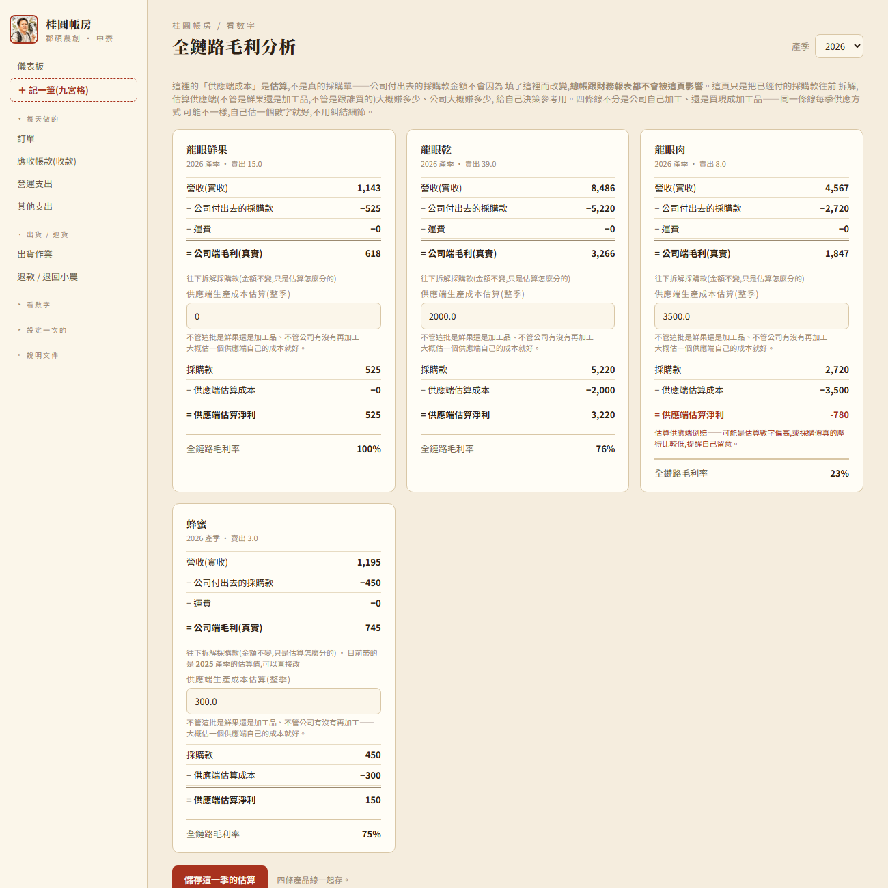

- 上半是真實數字(營收、付給小農的成本、運費、公司端毛利),系統自動算好,不用填。
- 中間「供應端生產成本估算」是你自己填的——不管這批是鮮果還是加工品,大概估一個供應端
  自己的成本就好,不用糾結細節。
- 下半自動算出「供應端估算淨利」「全鏈路毛利率」。估出來供應端倒賠(紅字)不是系統錯了,
  是提醒你:可能是估算數字偏高,或採購價真的壓得比較低。

這個估算**依產季分開存**,換一季預設會帶上一季的數字,改完記得按「儲存這一季的估算」。

---

## 十六、資料安全

- **每次啟動會自動備份**一份當天的資料庫到 `app\備份\` 資料夾,保留最近 30 天。
- 想還原到某天:**關掉 App** → 到 `備份\` 找到那天的檔 → 複製到 `app\` 底下、改名成 `guiyuan_ledger.db`(蓋掉現有的)→ 重新啟動。
- 建議**每隔一陣子把整個 `app` 資料夾複製到隨身碟或雲端**,電腦壞了才有得救。

---

## 十七、名詞小辭典

| 詞 | 意思 |
|---|---|
| **產季** | 一批桂圓的完整週期:當年 4 月初開花養果 → 隔年 3 月底賣完,以起始年命名(如 2026 產季 = 2026-04 ~ 2027-03)。銷售集中在 9 月~隔年 2 月。不是單純的西元年。 |
| **毛利** | 營收扣掉訂單上填的成本後剩下的。毛利率 = 毛利 ÷ 營收。 |
| **實收金額** | 這張訂單實際收到的錢。收款一定一次收齊,所以收款後 = 應收合計;還沒收款就是 0,系統算營收 / 毛利都用這個。 |
| **運費** | 訂單上的「運費(跟客人收)」會算進應收合計、也算收入;實際付給物流公司的運費到「營運支出」記。 |
| **折扣** | 賣得比「定價」低的差額(系統即時算,不影響訂單應收金額本身)。 |
| **客戶分類** | 企業戶 / 個人戶。客戶不分級,開單一律帶商品目錄的售價。 |
| **待確認** | 系統發現的不完整資料,補完後標記處理。 |
| **理賠重寄** | 包裹出事後重新寄一份,金額算 0,不算營收。 |
| **已開發票** | 訂單 / 費用上的一個勾選(或憑證類型選「發票」)+ 發票號碼欄位,**勾了 / 選了就一定要填發票號碼**。 |
| **銷項稅額** | 售價裡含的稅。每張訂單由你自己填,系統不算;總帳會把它跟銷貨收入分開記。 |
| **應付帳款** | 欠小農的錢。郡碩接單當天就付給小農,所以開單時記了之後馬上沖掉,永遠是 0。 |
| **退款 / 退回小農** | 只退錢不退貨 = 退款(算其他支出);貨退給小農、錢不退客人 = 退回小農(小農退成本)。退貨又退款直接刪訂單。 |
| **傳票號碼** | `GL` + 日期 + 當天流水號,例如 `GL20260921001`。 |
| **總帳 / 分錄 / 傳票** | 系統依你填的業務資料自動組出的會計記錄,平常不用管,看第四節。想深入了解看 [功能手冊.md](功能手冊.md)。 |
| **付款帳戶 / 收款帳戶** | 各畫面「用哪個帳戶收付款」,都用下拉選(現金或銀行帳戶),選單來自會計科目設定的 C 組。 |
| **應收帳款** | 客人還沒付的錢。開單選「E 應收帳款」就是先欠著,收到錢到「應收帳款」頁勾選收款。 |
| **模組 / 分組字母** | 同事帳務設定表的科目分組(C 現金銀行、G 進項稅額、P 銷項稅額、VD 營運費用、VE 其他支出、UB 業外收入、T 權益…),記帳畫面的區塊左上角會標。 |

---

## 十八、常見問題

**Q:我改了東西,畫面沒變?**
A:如果只是新增 / 修改資料(開訂單、改客戶),重新整理頁面即可。如果是請人改了程式,要關掉黑視窗、重跑 `啟動.bat`。

**Q:客戶下拉找不到人?**
A:先確認拼字;真的沒有就點「找不到?先去新增客戶」。

**Q:訂單金額怎麼算的?**
A:各列(數量 × 單價)加總,再加上「運費(跟客人收)」= 應收合計,這是**含稅**的金額。改品項後按「儲存」會重算。

---

**Q:一張訂單想整個作廢?**
A:訂單明細頁右上角有「刪除訂單」,會問一次確認,刪掉後連同品項、退款紀錄、總帳傳票都會一起清掉,**無法復原**。客人退貨又退款也是用這個。

**Q:勾了「已開發票」但發票號碼不給我存檔?**
A:這是故意設計的——開了發票就一定要有發票號碼,系統會擋下沒填號碼的存檔。真的還沒拿到號碼,先不要勾「已開發票」,等拿到號碼再回來勾、填上去、存檔。

**Q:黑視窗出現紅色錯誤?**
A:把整段訊息截圖或複製給維護人員。

---

## 十九、下載手冊

左側選單「說明文件 → 下載手冊」,可以下載這份使用手冊、功能手冊、營運流程 SOP、建置資料
SOP 四份文件的**最新版本**——每次點下載,系統都是現場從目前的文件內容重新產生,不是哪天
包裝時固定好的舊檔案,文件改過之後下載到的一定是新的。

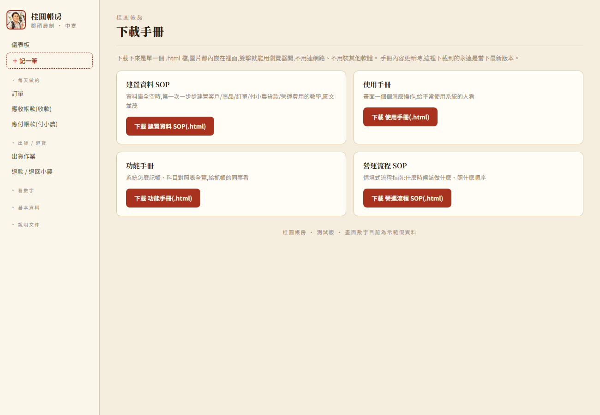

下載下來是**單一個 .html 檔**,圖片都包在裡面,不用連網路、不用裝其他軟體,電腦上直接雙擊
用瀏覽器打開就能看,也方便印出來或傳給別人。
