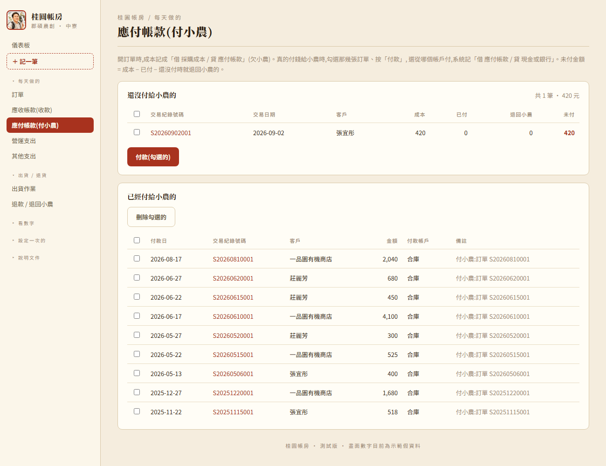
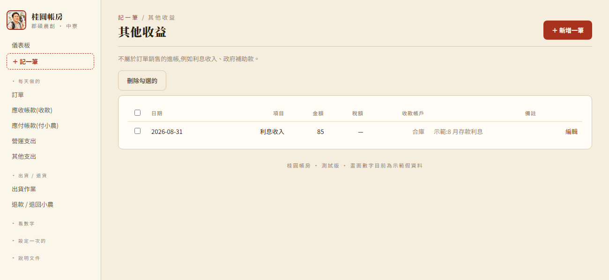
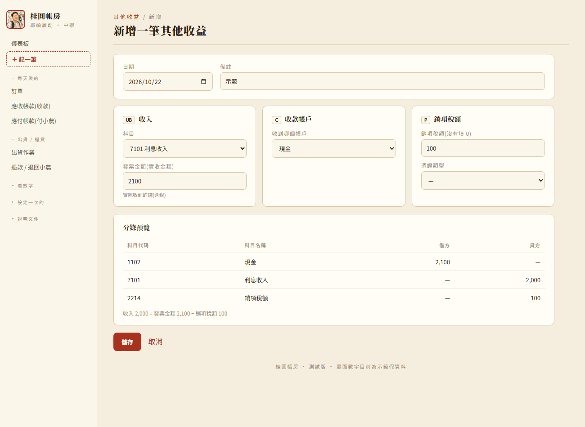
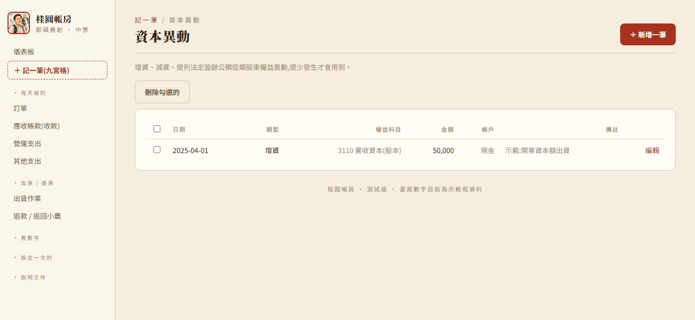
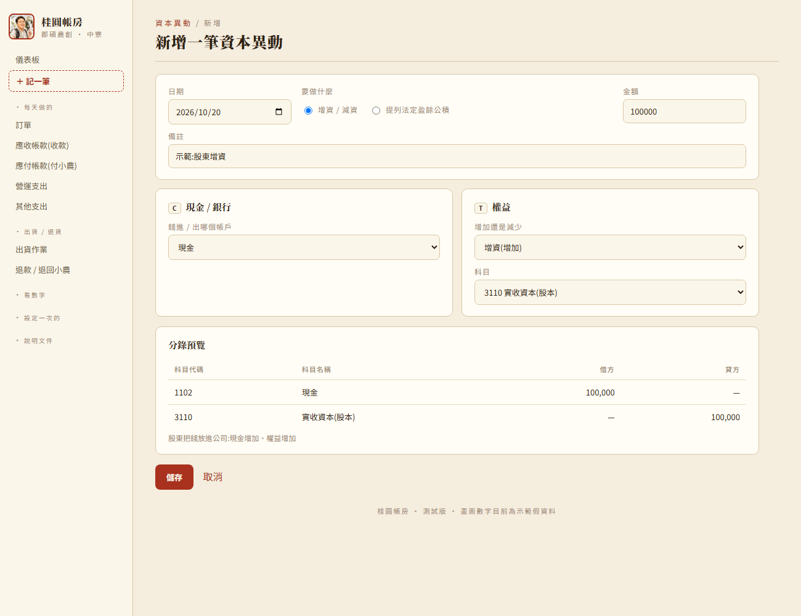
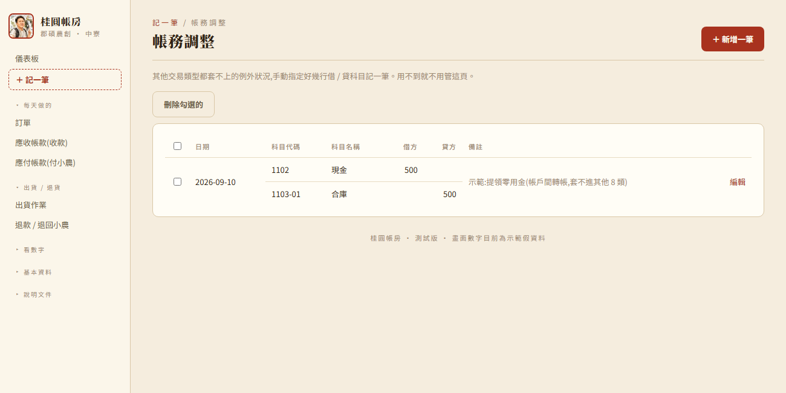
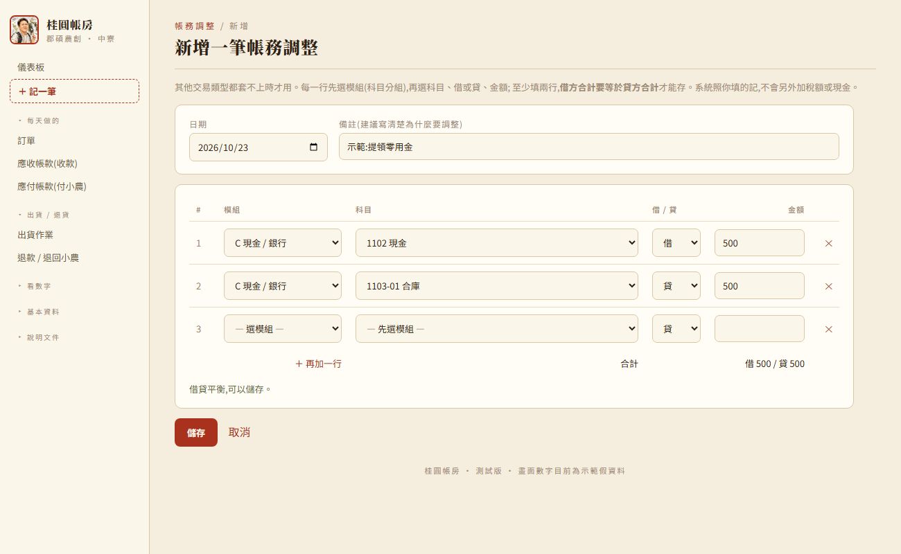

# 桂圓帳房 — 功能手冊

給想完整了解系統怎麼記帳的人看(同事)。日常操作流程的白話版說明見
[使用手冊.md](使用手冊.md);資料庫欄位 / 路由等程式細節見 [系統文件.md](系統文件.md)。

> 這一版(2026-10-17)依同事的「郡碩農創_記帳系統_1015.xlsx」(帳務設定表、總帳)、
> 「郡碩農創_會計場景對應分錄表_1015.xlsx」(會計場景對應分錄-公司(調整後))跟
> 「【修改意見】桂圓帳房_功能手冊_有調.xlsx」(0921、1001 兩張工作表)改寫。
> 還沒有答案的問題集中在 [待同仁確認.md](待同仁確認.md)。

---

## 一、系統怎麼運作:兩層資料

系統把資料分成兩層,**家易只填業務表單,總帳是系統依帳務設定表自動組出來的**,不用另外
手動記帳:

```
業務表單(訂單 / 營運支出 / 其他收益 / 退款 / …)
        │  存檔時,依 app/ledger.py 的 compose_* 規則組成複式分錄
        ▼
總帳(ledger_entry)── 借方合計一定等於貸方合計
```

### 會計科目表存在資料庫,可以自己維護

2026-10-16 起,科目不再寫死在程式裡,而是存在資料庫的 `account` 表,初值照 1015 版帳務設定表
(`app/chart.py` 的 `DEFAULT_CHART`,共 63 個科目、16 組)。「會計科目設定」頁(`/accounts`)
可以新增、改名(連舊傳票一起改)、停用、刪除(沒記過帳才能刪)。

每種交易畫面的下拉選單,只列它在帳務設定表用得到的那幾組:

| 分組 | 內容 | 用在 |
|---|---|---|
| C | 現金 / 銀行(`1102` 現金、`1103-01` 合庫、`1103-02` 凱基、`1103-03` 台新) | 各畫面的付款 / 收款帳戶 |
| E | `1172` 應收帳款 | 訂單 |
| F | 存貨(`1315-01`、`1311-01/02`、`1301-01/02`)——**目前沒有存貨功能,科目先保留** | — |
| G | `1423` 進項稅額、`1424` 留抵稅額 | 營運支出、其他支出、設備 |
| J | `1996` 股東往來(資產) | 帳務調整 |
| K | `1616` 機器設備、`1618` 累計折舊-機器設備 | 設備相關 |
| N | `2171` 應付帳款 | 訂單(欠小農)、應付帳款頁(付小農)、退回小農(還沒付時) |
| P | `2214` 銷項稅額、`2215` 應付營業稅(2026-10-20)、`2655` 股東往來(負債) | 訂單、其他收益、營業稅結算 |
| T | `3110` 實收資本(股本)、`3211` 資本公積、`3310-03` 法定盈餘公積、`3351-03` 累積盈虧、`3353` 本期損益 | 資本異動、年度結轉 |
| UA | `4111-01`~`05` 銷貨收入-龍眼鮮果 / 乾 / 肉 / 花 / 蜂蜜 | 訂單 |
| VA | `5111-01`~`05` 採購成本-同上五條產品線;`5111-2150-03` 原料報廢損失(2026-10-20) | 訂單、退回小農;原料報廢損失只給「退款」用 |
| VC | `6124` 折舊 | 每月折舊 |
| VD | 營運費用:`6110-01~03` 薪資 / 獎金 / 退休金、`6112` 文具、`6113` 旅費、`6114` 運費、`6115` 郵電、`6116` 修繕、`6117` 廣告、`6118` 水電瓦斯、`6119` 保險、`6120` 交際、`6121` 捐贈、`612901` 研究發展、`6188-01~05、98、99` 其他費用;2026-10-20 加 `6111` 租金支出、`5111-2408` 製造費用-包裝費、`5111-2417-01` 製造費用-其他消耗材料及工具(這兩個是 5 開頭,損益表放在營業成本) | 營運支出 |
| UB | 業外收入:`7101` 利息收入、`7250` 生物資產淨FV利益、`7190-01` 政府補助、`7190-98` 盤盈、`7190-99` 其他 | 其他收益 |
| VE | 其他支出:`7510` 利息費用、`7950` 所得稅費用 | 其他支出 |
| 其他 | `5950` 營業毛利(報表算出來的,不能記帳) | — |

`3353` 本期損益、`5950` 營業毛利是算出來的科目(`chart.COMPUTED_CODES`),不會出現在記帳下拉選單。

### 郡碩是貿易公司:沒有存貨

- 有客人下單才跟小農買貨、轉手賣出,**沒有存貨**;進貨、庫存、生產入庫、銷貨退回 / 折讓這些功能都拿掉了。
- 小農只有一個。**開單時成本記應付帳款(欠小農)**,真的付錢時在「應付帳款(付小農)」頁付款
  (2026-10-20 依同仁 1019 問題清單第 1 條改;10/16~10/19 是接單當天就付,舊資料開機時自動轉換,餘額不變)。
- 售價含稅,`2214` 銷項稅額由家易在訂單上**手動填**,系統不算。
- 成本**由家易在每個品項自己填「成本移轉價」(每單位)**(畫面欄名 2026-10-22 起叫「成本移轉價」,表單欄位 `unit_cost`,可填小數),
  系統算「數量 × 成本移轉價」(到小數 2 位)存進 `order_line.line_cost`(這一列的總額,分錄用的仍是這個);輸入的每單位原值存
  `order_line.unit_cost`,編輯畫面帶回原值(對不上 `line_cost` 的舊資料改用 `line_cost ÷ 數量`,留 6 位小數,存回去總額不變)。
  商品目錄不再有單位成本。
- **自動帶入上次的成本移轉價**(2026-10-23):`queries.last_unit_costs()` = 每個商品訂單日期最新、`line_cost` > 0 的那一筆(同一天取 line_id 大的),不分客戶 / 訂單種類;新增訂單選商品就帶入,不一樣時提醒「上次 → 這次 ↑↓」。訂單明細頁不算自己這張,只帶入新加的列 / 換了商品的列。歷史在「看數字 → 成本移轉價紀錄」(`/cost-history`,`queries.cost_history`)。只讀資料,不碰總帳。
- **必填規則**(`main._cost_missing`):`order_kind='銷售'` 的訂單每一列都要 > 0;贈送 / 樣品 / 理賠重寄等非銷售訂單
  總帳本來就不記成本,可以是 0。前端送出前先檢查(框紅 + 提醒,不送出),後端再擋一次(`?err=cost`)。
  訂單匯入建的訂單成本是 0(匯入範本沒有成本欄),要人工補,補之前那張訂單沒有「欠小農」分錄。
  儀表板「需要注意」提醒還沒補的張數(`queries.NOCOST_O`),訂單頁分頁「還沒填成本移轉價」(`?filter=nocost`)列出來。
- **發票**:新增**銷售**訂單發票號碼必填(2026-10-23,畫面 + `order_create` 都擋,`?err=invoice`),填了號碼 `invoiced` 就是 1;非銷售訂單不用填。編輯訂單維持「勾了已開發票才必填」,避免沒號碼的舊訂單改不動;匯入的訂單沒有發票號碼欄,一樣要人工補。

### 選單結構

側邊選單分五個可收合的群組(每天做的 / 出貨・退貨 / 看數字 / 基本資料 / 說明文件),
最上面固定有「儀表板」跟「＋ 記一筆」兩個入口。


### 記一筆九宮格

「記一筆」頁的卡片順序照 1015 版帳務設定表的交易類型(0921 修改意見第 5 條),共 7 張:
**銷售商品、營運支出、其他收益、其他支出、設備相關、資本異動、帳務調整**。


### 「同一頁分模組區塊」的畫面

營運支出、其他支出、其他收益、資本異動(0921 修改意見第 3、4、9~12 條)都改成一頁填完:
上面是共用欄位(日期、備註),下面每個區塊對應帳務設定表的一個分組字母,區塊左上角會標
(例如 VD / C / G)。最下面「分錄預覽」邊填邊顯示,按「儲存」直接記總帳,**不再經過確認頁**。

---

## 二、記一筆逐一說明

### 1. 銷售商品(訂單)

訂單存檔背景自動記,不經過確認畫面。一張訂單對到**兩張獨立傳票**:

| 傳票 | 記帳時機 | 分錄 |
|---|---|---|
| `order_sale` | 訂單存檔當下 | ① 借 `1172` 應收帳款(含稅全額 + 跟客人收的運費)/ 貸 `2214` 銷項稅額(家易填的稅額)+ 貸 `4111-0x` 銷貨收入(依產品線拆)<br>② 借 `5111-0x` 採購成本(依產品線,每列家易填的成本)/ 貸 `2171` 應付帳款(欠小農;付錢在應付帳款頁) |
| `order_payment` | 收款那一刻 | 借 收款帳戶(C 組)/ 貸 `1172` 應收帳款(一次收齊,金額 = 應收合計) |

- **營收拆分**:運費依各線金額佔比分攤進收入、稅額依佔比扣掉,尾差併進金額最大的那條線。
  例:兩條線 600 + 450、運費 100、稅額 50 → 收入合計 1,100。
- **運費**(`shipping_fee_charged`):訂單上的運費是**跟客人收的**,算進應收、也算收入。
  實際付給物流的運費由家易從營運支出記(`6114` 運費),訂單不再自動記運費支出。
- **收款**(0921 修改意見第 6 條,2026-10-17):新增訂單**沒有「付款方式」「收款狀態」欄位**,
  改成一個「收款」下拉——「E 應收帳款(還沒收)」(預設)或「C 當場收到:某帳戶」。
  選 C 時收款日 = 訂單日,同時記 `order_payment`。贈送 / 樣品等非銷售訂單一律「免收款」。
  訂單明細頁的「收款帳戶」下拉第一個選項也是「E 應收帳款(還沒收)」;選了 C 就要填收款日。
  收款狀態(`payment_status`)由系統推出來,不讓人選。
- **收款一次收齊**,沒有部分收款。
- 金額或品項改變、複製訂單、收款,對應傳票都**整張重開**(先刪舊列再插新列)。刪除訂單時兩張傳票一起清掉。
- **訂單匯入**(Google 表單 / Excel)走同一組傳票。**匯入的訂單銷項稅額是 0**,要家易進訂單補填。


### 應付帳款頁(付小農)(2026-10-20)

`/payables`:上半「還沒付給小農的」列出每張銷售訂單的 成本 / 已付 / 退回小農 / 未付
(未付 = 成本移轉價 − 已付 − 還沒付時就退回小農沖掉的)。勾選、按「付款」選帳戶跟日期 →
每張訂單記一筆 `goods_purchase`(`order_id` 連到訂單)跟傳票:借 `2171` / 貸 現金或銀行。
下半是付款紀錄,可以勾選刪除(`/bulk-delete`,kind=goods_purchase)。刪訂單時,它的付款紀錄一起刪。



### 應收帳款頁(收款)

`/receivables`:上半「尚未收回」列出待收款的銷售訂單,勾選幾筆、按「收款」,在彈出視窗選
收到哪個帳戶、收款日,就一次記好每張的 `order_payment`。下半是已收回的紀錄。


### 2. 營運支出(VD)

一頁三個區塊:

| 區塊 | 欄位 |
|---|---|
| (共用) | 日期、備註 |
| VD 費用 | 科目、**發票金額(支付金額)**= 含稅實付 |
| C 付款帳戶 | 從哪個帳戶付 |
| G 進項稅額 | 稅額、憑證類型(發票 / 收據)、發票號碼(選發票就必填) |

分錄:借 VD 科目(= 發票金額 − 進項稅額)+ 借 `1423` 進項稅額(有稅才加)/ 貸 付款帳戶(= 發票金額)。

- 「月份」改成**日期**(`op_expense.expense_date`),傳票日期就是這一天。
- 資料庫存的 `amount` 是不含稅的費用,`tax_amount` 另存;編輯時畫面顯示回發票金額。
- 進項稅額不能 ≥ 發票金額。
- **拿掉「攤提月數」**:一次性大支出整筆算在付款那個月(同仁 2026-10-20 確認:依法規不論金額大小都在當月全額認列)。
  如果是設備 / 機器,請走「設備相關」。
- 包材、紙箱也從這裡記。


### 3. 其他收益(UB)

| 區塊 | 欄位 |
|---|---|
| (共用) | 日期、備註 |
| UB 收入 | 科目、**發票金額(實收金額)**= 含稅實收 |
| C 收款帳戶 | 收到哪個帳戶 |
| P 銷項稅額 | 稅額、憑證類型、發票號碼 |

分錄:借 收款帳戶(= 發票金額)/ 貸 UB 科目(= 發票金額 − 銷項稅額)+ 貸 `2214` 銷項稅額(有稅才加)。




### 4. 其他支出(VE)

利息費用、所得稅。畫面跟營運支出一樣(VE + C + G 三個區塊),分錄也一樣。
資料跟營運支出共用 `op_expense` 表,用科目分組區分。**不算進財務健康的營運費用**(`queries.opex_rows` / `opex_cats` 排除 VE)。

**2026-10-22 起沒有清單頁、也不在左側選單**(1019 同仁問題第 10 條,使用者決定直接拿掉):新增從「＋ 記一筆」的
「營運支出」「其他支出」卡片進;記過的到總帳,「來源」選「營運支出 / 其他支出」(`/ledger?source=op_expense`),
點傳票號碼回到編輯畫面改或刪。存檔 / 刪除後也回到這個篩好的總帳。舊網址 `/finance/expenses`、`/other-expenses`
會自動轉到這裡。

### 5. 設備相關(固定資產)

**買入**:借 `1616` 機器設備(取得成本)+ 借 `1423` 進項稅額(有稅才加)/ 貸 付款帳戶(C 組)。
K 組只有機器設備一個科目,「類別」只是描述用,全部記 `1616`(同仁 2026-10-20 確認)。沒有政府補助欄位。

- **使用年限用月填,最少 120 個月**(`main.ASSET_MIN_MONTHS`),預設 120,畫面跟存檔都會擋。
- **殘值**:2026-10-23 起可以填(`fixed_asset.salvage`,0 ≤ 殘值 < 成本,不然 `?err=salvage`)。每月折舊 = 無條件進位((取得成本 − 殘值)÷ 使用年限月數)。
- 折舊傳票由 `queries.sync_depreciation_vouchers()` 對帳(開 `/assets`、存檔固定資產後都會跑):每台設備逐月比對「該記多少」跟總帳已記的,沒記的補、金額不對或月份不該有的重記 / 刪掉,**已結轉年度不動**、金額沒變的月份不碰(傳票號碼不會亂跳)。所以改了成本 / 殘值 / 年限 / 取得日 / 處分日,總帳跟清單的累計折舊馬上一致。

**折舊**:沒有「存檔」這種觸發點,改成**開 `/assets` 頁時,系統順便把還沒記過的月份補上**
(已經記過的月份不動)。借 `6124` 折舊 / 貸 `1618` 累計折舊-機器設備。

> 第一次上線打開 `/assets` 頁,會把每台資產從取得月到當月**所有欠的月份一次補齊**,
> 總帳會一次出現好幾張折舊傳票,這是正確的,不是重複記帳。

處分(填處分日)之後不再產生新的折舊月份;處分日比已經補過的月份早,已記過的月份不會自動回沖。
處分損益目前沒有做。刪除資產卡,買入 + 所有折舊傳票一次清掉。


### 6. 資本異動(T)

先選「要做什麼」(2026-10-17):

| 類型 | 區塊 | 分錄 |
|---|---|---|
| 增資 | C 帳戶 + T 權益科目(選「增加」,預設 `3110`) | 借 C / 貸 T |
| 減資 | 同上(選「減少」) | 借 T / 貸 C |
| 提列法定盈餘公積 | T 從哪裡提(預設 `3351-03`)+ T 轉入(預設 `3310-03`) | 借 T(從)/ 貸 T(轉入),兩個不能同一科目,不動現金 |

`equity_txn` 欄位:`txn_type`、`payment_account`(C,增減資才有)、`equity_account`、`source_account`(提列才有)。
舊資料的「現金增資」「盈餘轉列公積」開啟時會自動轉成新格式。




### 7. 帳務調整

其他類都套不上時的例外出口(2026-10-17 改成多行):

- **預設 3 列**,每一列可以按 ✕ 刪掉,也可以按「＋ 再加一行」往下加,不限幾列
  (2026-10-20 依 1019 問題清單第 8 條;10/19 曾改成「先選 2 或 3 項」,同仁改回這個做法)。
  每列先選**模組**(科目分組)→ 科目 → 借或貸 → 金額。
- 至少兩行、**借方合計 = 貸方合計**才能存(畫面即時顯示差多少,伺服器也再檢查一次)。
- 系統照填的記,不會另外加稅額或現金。每一行存在 `manual_entry_line`。

這個畫面需要自己判斷科目跟借貸方向,**定位上比較適合同事用**。




---

## 三、退貨 / 退款

系統**沒有「折讓」**。客人退貨 / 退款分三種:

| 情況 | 怎麼做 | 分錄 |
|---|---|---|
| 退貨又退款 | 直接刪訂單 | 訂單的兩張傳票整張刪掉 |
| 只退款、不退貨 | 訂單頁「退款 / 退回小農」,類型「退款」,選錢從哪個帳戶退 | 借 `5111-2150-03` 原料報廢損失(同仁 2026-10-20 回覆;在損益表算營業成本)/ 貸 現金銀行(已收款,真的退錢)或 `1172` 應收帳款(還沒收款,少收) |
| 退貨但不退款 | 同上,類型「退回小農」,選扣哪一項採購成本(已付過小農才要選帳戶) | 還沒付小農:借 `2171` 應付帳款 / 貸 `5111-0x`;已經付過:借 現金銀行 / 貸 `5111-0x` |

- 只退款不管退多少都算其他支出。
- 退回小農的金額由家易填,畫面上會顯示這張訂單的成本合計當參考。
- 經營報表上:退款從營收扣掉,小農退回的從成本扣掉,都認列在**發生日**的月份 / 產季。


---

## 四、勾選刪除

### 總帳(0921 修改意見第 17 條)

總帳每一行前面有勾選框,**勾任何一行,同一張傳票整張一起勾**(不能只刪其中一行),
按「刪除勾選的傳票」→ `POST /ledger/delete`。刪除會**連同來源那筆業務紀錄一起刪**,
重用各來源自己的刪除邏輯(`_LEDGER_DELETERS`)。「設備取得」「折舊」「年度結轉」「營業稅結算 / 繳納」不能勾:
要回「固定資產」「試算表」「營業稅結算」處理。已結轉年度的傳票也不能刪(第六節)。

### 各清單(2026-10-17)

訂單、營運支出、其他支出、其他收益、資本異動、帳務調整、退款 / 退回小農這幾個清單,
最左邊也有勾選框(表頭可全選),「刪除勾選的」一次刪好幾筆 → `POST /bulk-delete`
(`_BULK_DELETERS`,一樣重用各自的刪除邏輯,總帳傳票一起刪)。編輯頁裡的單筆「刪除」按鈕保留。

---

## 五、總帳頁

**一行一筆分錄的大表格**,欄位順序照同仁給的「總帳明細」格式(2026-10-21):

| 欄位 | 說明 |
|---|---|
| 傳票號碼 | `GL` + 日期 8 碼 + 當天流水號 3 碼,共 13 碼(例 `GL20260921001`),不分來源。點了回到原始資料修改 |
| 帳務日期 | |
| 科目代碼 / 科目名稱 | 分兩欄 |
| 備註 | 使用者填的備註會帶進來 |
| 借方金額 / 貸方金額 / 異動金額(借減貸) | 異動金額 = 借 − 貸,負數加括號 |
| 識別碼 | 發票號碼 |
| 解釋 | 白話說明這一筆讓科目「增加 / 減少 $x」(1001 第 3 條要的,格式裡沒有,放最後) |

- 預設依傳票號碼由小到大;**點標題排序**,再點一次反過來。
- 標題下面一排篩選:傳票號碼可用 `*`、`?` 萬用字元(`GL202609*` = 九月全部);科目用下拉選(完全相同);
  其他欄是「包含」。最下面合計跟著篩選結果變。
- 上方「來源」下拉可以只看某一種交易。右上「下載總帳(Excel 可開)」→ `GET /ledger.csv`(跟畫面同欄位)。
- 總帳跟試算表是同一頁的兩個分頁(2026-10-20,1019 問題清單第 7 條)。


---

## 六、試算表 + 年度結轉 + 已結轉年度鎖住

2026-10-20 依同仁 1019 問題清單:總帳、試算表合併成一頁(`/ledger?tab=trial`,舊的 `/statements` 轉過來),
**拿掉資產負債表、綜合損益表**。直接從 `ledger_entry` 彙總,**西曆年(1~12 月)**,預設今年。

### 試算表(第 2、3、5 條)

`queries.trial_balance(year)`:會計科目表每個科目一列(不含算出來的科目,沒金額也列)——
| 欄 | 算法 |
|---|---|
| 期初餘額 | 前一年底為止 Σ(借 − 貸) |
| 期別 | 年度 |
| 借方金額 / 貸方金額 | 這一年的分錄(含年度結轉) |
| 期末餘額 | 期初 + 借 − 貸 |

- **借方是正、貸方是負**:負債、權益、收入的餘額是負數。檢核 = 全部科目期末加總,應該 = 0。
- 「3353 本期損益」= 這一年 4~7 開頭科目的淨額(不含年度結轉傳票,所以結轉前後都看得到當年損益;借正貸負,
  有賺是負數),不算進合計跟檢核。
- 下載:`GET /statements/trial.csv?year=`(期別、科目代碼、科目名稱、期初餘額、借方金額、貸方金額、期末餘額)。
- 欄位照同仁給的「試算表」格式(2026-10-21 使用者提供的截圖)。


### 年度結轉

右上角「產生 OOOO 年度結轉」:把該年度 4~7 開頭科目的餘額全部沖平,淨額轉入 `3351-03` 累積盈虧。
防重複貼;總帳不能勾選刪除,要撤銷在試算表按「撤銷結轉」。
(要不要改成不用按、系統自動結轉,0921 第 22 條使用者決定先不做。)

### 已結轉年度鎖住(第 6 條)

某年做過年度結轉,任何畫面都不能再新增 / 修改 / 刪除那一年的交易:
- 畫面上的日期選不到那一年(`base.html` 依 `lock_min()` 設 `min`;科目明細的查詢日期不受限)。
- 送出時 `main._year_lock` middleware 檢查表單裡的日期欄位(訂單日、費用日、收款日、付款日…),落在已結轉年度就擋下,
  回上一頁顯示「這一年已經做過年度結轉」。
- 修改 / 刪除既有資料,各路由用 `_source_locked()` 看那筆資料原本的傳票日期;總帳勾選刪除、清單勾選刪除會略過。
- 折舊自動補分錄時,已結轉年度的月份不補。營業稅結算期末在已結轉年度也不能結。
- 要改已結轉年度的資料:先到試算表「撤銷結轉」。

### 營業稅結算(2026-10-20)

同仁回覆待同仁確認第 6 題:要一個按鈕自動結算營業稅。試算表右上「營業稅結算」→ `/vat`。(1019 問題清單第 12 條「結帳時進銷項互抵,做出留抵或應付稅捐」就是這個功能。)

- **每兩個月一期**(1–2 月 … 11–12 月)。按「結算」時看到期末那天為止的 `2214` 銷項稅額、`1423` 進項稅額、
  `1424` 留抵稅額餘額:**本期應納 = 銷項 − 進項 − 上期留抵**。
- 分錄:借 `2214`(銷項歸零)/ 貸 `1423`(進項歸零);
  應納 > 0 → 貸 `1424`(用掉全部留抵)+ 貸 `2215` 應付營業稅;應納 ≤ 0 → 差額留在 `1424` 給下一期。
- 繳稅後按「繳納」,選日期跟帳戶:借 `2215` / 貸 現金或銀行。
- 要照順序結;撤銷只能撤最後一期、還沒繳納的。總帳上這兩種傳票(營業稅結算 / 營業稅繳納)不能勾選刪除,要回這頁撤銷。
- 還沒結算的期別,頁面上的數字是「現在按結算會記的金額」(預估),總帳還沒有這筆。

---

## 七、科目明細、銀行帳戶、會計科目設定

### 科目明細(`/account-ledger`)

選一個科目跟日期區間,看每一筆交易(傳票號碼、日期、來源、識別碼、借貸、交易金額)跟本次餘額。
餘額正負號:科目正常增加的方向是正數(`queries._is_debit_normal`);試算表則是借正貸負。


### 銀行帳戶(`/bank-accounts`)

就是 C 組裡 `1103-xx` 的科目。可以改名(連舊傳票一起改)、把重複的帳戶「併入」另一個。
代碼不會重新指派,所以沒有刪除。各畫面的付款 / 收款帳戶都是下拉選 C 組。


### 銀行帳戶明細(`/cash`)

依 C 組科目從總帳篩出來,逐筆算累計餘額。


### 會計科目設定(`/accounts`)

依分組列出全部科目,可以新增(代碼不能重複)、改名、停用、刪除(只有沒記過帳的)。


---

## 八、財務健康(從總帳抓,2026-10-20)

1019 問題清單第 13 條:財務健康(`/finance`)跟儀表板的損益簡表改成從總帳抓(`queries._ledger_pnl`):
營收 = 4 開頭(貸 − 借,不含稅、含跟客人收的運費,**開單就算**);退款 = `5111-2150-03`;銷貨成本 = 其他 5 開頭;
營運費用 = 6 開頭,依科目(含 `6124` 折舊);業外收支 = 7 開頭(不含 `7950` 所得稅);排除年度結轉傳票。
稅前利潤 = 營收 − 退款 − 銷貨成本 − 營運費用 + 業外收支。
儀表板「本產季營收」KPI 卡 2026-10-22 起也改用同一個數字(`finance_summary().revenue`,開單就算),
小字列「其中已收到」(`kpi().revenue`:已收款訂單的實收 − 銷項稅額)跟「還沒收(含稅)」(`kpi().ar_amount`:
應收餘額,含稅)。後兩者相加會比卡片大數字多出「還沒收款訂單的銷項稅額」,是口徑差(含稅 / 不含稅),不是錯帳。
「毛利率」卡片同時改成 `finance_summary().margin / gross_profit`(跟損益簡表一致,營收扣退款、銷貨成本)。

---

## 九、其他管理報表

以下是業務表算法,跟第六節「試算表」不同用途。

### 應收帳款帳齡(獲利報表 → 收款帳齡分頁)

分桶(0–15 / 16–30 / 31 天以上)+ 未收款清單 + 最近已收回清單。
資料來源是 `order.payment_status`,不是查總帳的應收帳款科目餘額。


---

## 十、已知限制

| 項目 | 說明 |
|---|---|
| 固定資產處分損益 | 處分當下沒有計算帳面淨值轉列處分損益的分錄 |
| 折舊回溯 | 處分日設定得比已補過的折舊月份早,已記過的月份不會自動回沖 |
| 訂單匯入沒有稅額 | 匯入的訂單 `sales_tax` 是 0,要手動補 |
| 存貨科目 | F 組科目保留,但沒有存貨功能 |

---

## 十一、想改科目或分錄規則,從哪裡下手

- **科目名稱 / 新增科目**:直接在「會計科目設定」頁改,不用動程式。
- **各交易用哪幾組科目**:各路由裡 `chart.accounts([...])` 傳的分組。
- **分錄規則**:`app/ledger.py` 的 `compose_*` 函式;固定用到的科目代碼是檔案上方的常數
  (`AR_ACCOUNT`、`AP_ACCOUNT`、`REFUND_LOSS_ACCOUNT`、`REVENUE_ACCOUNTS`、`COST_ACCOUNTS`…)。
- **科目表初值**:`app/chart.py` 的 `DEFAULT_CHART`(只在建新資料庫時灌入,之後以資料庫為準)。
- 改完建議重跑一次 `python seed.py --force` 重灌示範資料,再打開幾個畫面確認分錄長相正確、
  總帳每張傳票借貸平衡。
