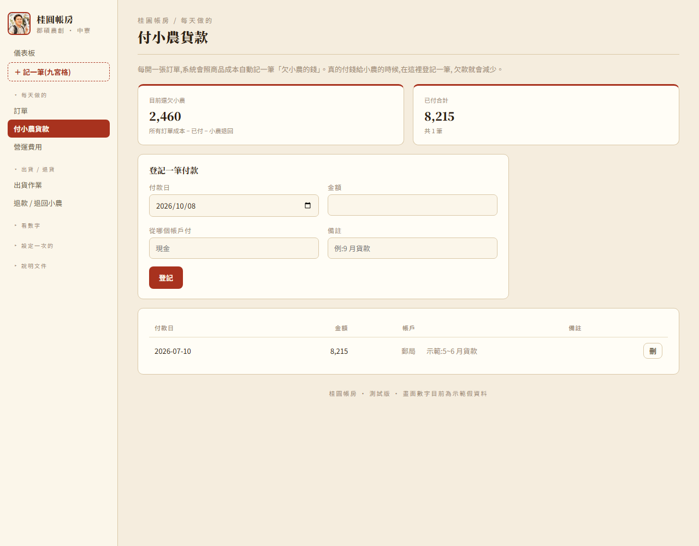
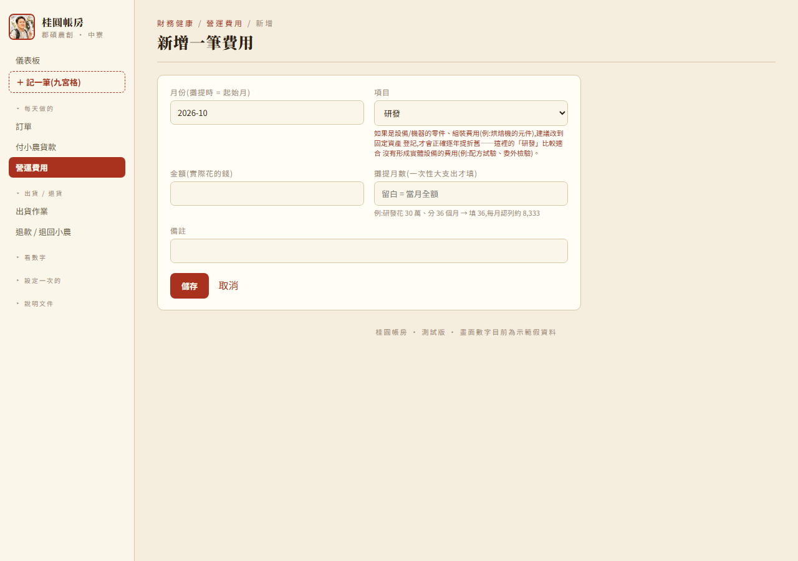
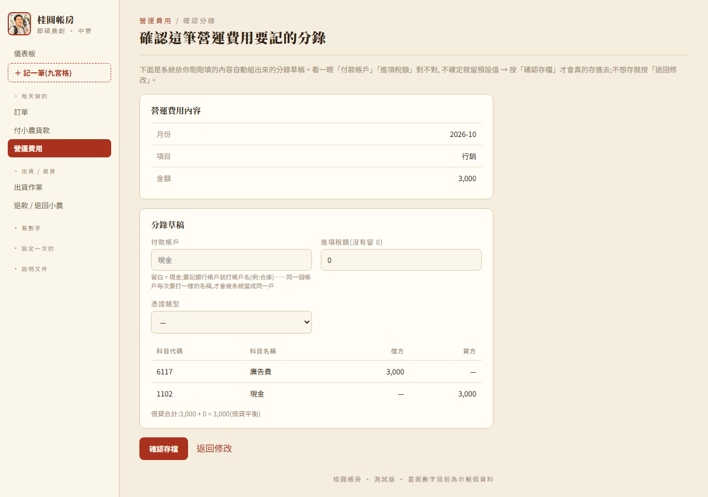

# 桂圓帳房 — 功能手冊

給想完整了解系統怎麼記帳的人看(同事)。日常操作流程的白話版說明見
[使用手冊.md](使用手冊.md);資料庫欄位 / 路由等程式細節見 [系統文件.md](系統文件.md)。

---

## 一、系統怎麼運作:兩層資料

系統把資料分成兩層,**家易只填業務表單,總帳是系統依對照表自動組出來的**,不用另外
手動記帳:

```
業務表單(訂單 / 付小農貨款 / 費用 / 退款 / …)
        │  存檔時,依 app/ledger.py 的對照表自動組成複式分錄
        ▼
總帳(ledger_entry)── 借方合計一定等於貸方合計
```

對照表(哪個類別記哪個會計科目)全部集中在 `app/ledger.py`,想調整科目代碼直接改那個
檔案的常數就好,不用動其他程式。這份對照表是**第一版、依常理判斷的猜測**,已經對照過
「會計科目表」正式版逐一核對修正,但還有幾個正式表沒有列出對應科目的項目,標成「待確認」
(見第九節)。

### 2026-10-08 起:貿易公司模式

同仁試用後確認:**郡碩沒有存貨**,接到訂單當下才向小農進貨、轉手賣給客人。所以:

- 訂單成立時,成本直接記「借 `5111` 銷貨成本 / 貸 `2171` 應付帳款」(欠小農),不再沖存貨。
- 售價含稅,`2214` 銷項稅額由家易在訂單上**手動填**,系統不算。
- 付錢給小農另外記(借應付帳款 / 貸現金或銀行),小農只有一個,不分人。
- 進貨、庫存、生產入庫、銷貨退回 / 折讓這幾個功能**整批拿掉**。退貨的處理改成三種情況(第三節)。
- 訂單的成本在**開單當下**從商品目錄抄一份存進訂單明細(`order_line.unit_cost`),
  之後改商品目錄的成本不會回頭改到舊訂單的應付帳款。

### 選單結構

側邊選單分四個可收合的群組(每天做的 / 出貨・退貨 / 看數字 / 設定一次的),
最上面固定有「儀表板」跟「＋ 記一筆(九宮格)」兩個入口。


### 記一筆九宮格總覽

「記一筆」頁把交易類型攤開成卡片,對應同事原本設計的「帳務設定表」9 宮格分類。
2026-10-08 改成貿易公司模式後,「採購物料」換成「付小農貨款」,「生產入庫」拿掉,現在是 8 張:
銷售/出貨、付小農貨款、營運支出、設備相關、其他收益、其他費用、資本異動、帳務調整。
「其他費用」是併進「營運支出」既有畫面的類別選單,沒有另開新畫面。


---

## 二、記一筆逐一說明

### 1. 銷售 / 出貨(訂單)

家易熟悉的訂單畫面,**不經過確認畫面,存檔背景自動記**——訂單是最高頻操作,不想多插
一個步驟。一張訂單對到**兩張獨立傳票**:

| 傳票 | 記帳時機 | 分錄 |
|---|---|---|
| `order_sale` | 訂單存檔當下,不管收沒收到錢 | 借:`1172` 應收帳款(含稅全額,運費由客戶付時含運費)/ 貸:`2214` 銷項稅額(家易填的稅額)+ 貸:銷貨收入(依產品線拆多筆,`4111-01`~`04`,沒歸屬產品線用通用 `4110`;每條線依含稅金額佔比扣掉稅額)+ 借:`5111` 銷貨成本 / 貸:`2171` 應付帳款(成本 = 開單當下存的單位成本 × 數量)+ 運費 > 0 時再加借:6188-11 其他費用-運費(待確認)/ 貸:1102 現金 |
| `order_payment` | 標記已收款那一刻,實收金額 > 0 才記 | 借:現金 / 銀行存款(依訂單的付款帳戶)/ 貸:應收帳款 |

**運費由誰負擔(`ship_payer`,2026-10-03)**:訂單「出貨方式」區塊可選「店家吸收」(預設)或
「客戶付」。「店家吸收」時運費只是家易自己花的錢,不跟客人收,`order_total`/應收帳款不含運費,
分錄只有上面那組借 6188-11 運費/貸現金。「客戶付」時客人要付的錢本來就含運費(錢收齊才出貨),
`order_total`/應收帳款也跟著多算這筆,分錄會多一組「借應收帳款(運費金額)/ 貸 6188-11 運費」把
運費科目沖平——家易還是要真的付錢給物流商(借運費/貸現金那組不變),但運費科目借貸相消後淨額
歸零,對公司損益沒有影響,正確反映「這筆錢只是幫客人代收代付,不是公司的收入或費用」。經營報表
(`queries.py` 的營收/運費支出)算的時候,客戶付訂單的運費也已經排除,不會灌水營收或支出。
金額或品項改變、複製訂單、標記部分收款,對應傳票都會**整張重開**(先刪舊列再插新列,
不是疊加)。刪除訂單時,兩張傳票跟著清掉。

**銷項稅額(`order.sales_tax`,2026-10-08)**:售價一律含稅,稅額由家易在訂單上填,系統只擋
負數、或稅額大於等於商品金額。營收拆分範例:兩條產品線含稅 600 + 450、稅額 50,
`4111-02` 貸 571.43、`4111-04` 貸 428.57,合計 1,000,尾差併進金額最大的那條線。
經營報表(儀表板、財務健康、獲利報表、產品線損益)的營收也都扣掉這個稅額。

**成本固定在開單當下(`order_line.unit_cost`,2026-10-08)**:新增訂單、匯入、複製、理賠重寄時,
從商品目錄抄一份單位成本存進明細。編輯訂單時,原本就在單上的商品沿用存下來的成本,
新加的商品才用目前成本。所以換季調整商品成本後,舊訂單即使重存(例如標記已收款),
應付帳款也不會變。

**訂單匯入**(選單「訂單」頁「匯入(Google 表單 / Excel)」):上傳 .csv/.xlsx、預覽確認後
批次建立的訂單,記的也是上面同一組 `order_sale`/`order_payment` 傳票,不是另一套邏輯——
差別只在訂單資料從哪裡來(手動打,還是從表單/Excel 解析)。`GET /orders/import/template`
(2026-10-02 新增)依目前「在售」商品現抓一份範本 .csv,欄位名稱永遠跟商品清單同步,不用
手動維護一份靜態範本檔。詳細設計見 `docs/系統文件.md` §3.20。**匯入的訂單銷項稅額是 0**,要家易進訂單補填。


### 2. 付小農貨款(取代原本的「採購物料 / 進貨」)

`/farmer-payments`,2026-10-08 新增。訂單成立時已經記了「貸 `2171` 應付帳款」,真的付錢給小農時
在這裡登記:借 `2171` 應付帳款 / 貸現金或銀行存款(依付款帳戶)。小農只有一個,不分人。

頁面上方「目前還欠小農」直接讀總帳 `2171` 的餘額(貸方 − 借方),等於所有訂單成本 − 已付 −
小農退回。從這頁按「刪」或從總帳刪除,付款紀錄跟傳票會一起刪。



> **原本的「進貨」頁已經拿掉**。跟小農買農產品改成訂單成立時自動記;包材、紙箱這類開銷
> 改從營運費用記(類別「其他費用-包裝費」`6188-06`)。

### 3. 營運支出

一樣先看確認畫面再存檔。類別 → 科目對照(第一版猜測,`ledger.EXPENSE_ACCOUNTS`):

| 類別 | 科目 |
|---|---|
| 直接人工 | `6110-01 薪資支出-直接人工` |
| 人事 | `6110-02 薪資支出-人事` |
| 場地・倉儲 | `6111 租金支出` |
| 行銷 | `6117 廣告費` |
| 設備維護 | `6116 修繕費` |
| 培訓 | `6131 訓練費` |
| 金流手續費 | `6188-04 其他費用-手續費` |
| 驗證費 | `6188-07 其他費用-檢驗費` |
| 研發 | `6188-12 其他費用-研發`(**留給真正沒有形成實體設備的費用用**——申報表那筆 78 萬研發費已確認是烘焙機器零件成本,該走固定資產,不是這裡;畫面選到這個類別會提醒使用者) |
| 其他 | `6188 其他費用` |
| 其他費用-什項購置 / 勞務費 / 設計費 / 手續費 / 交通費 / 包裝費 / 檢驗費 / 印刷費 / 規費 / 燃料費 | `6188-01`~`10`(直接對應正式科目表) |
| 文具用品 | `6112 文具用品` |
| 交際費 | `6120 交際費` |
| 捐贈 | `6121 捐贈` |
| 伙食費 | `6127 伙食費` |
| 職工福利 | `6128 職工福利` |
| 佣金支出 | `6130 佣金支出` |
| 進出口費用 | `6132 進出口費用` |
| 產品保固費用 | `613501 產品保固費用` |
| 利息費用 | `7510 利息費用` |

以上 9 項是同事「會計科目表」2026-09-23 更新檔補的獨立費用科目,已對應好、直接對照
正式表代碼,不用等確認(「利息費用」是同一天給正式三表範例時連帶補的代碼)。原本
「田間管理」在這份清單裡,**2026-10-01 已經整個拿掉**——不是找到代碼了,是這個類別
在公司帳上根本不該存在,見第九節「已拿掉的科目」。

「攤提月數」欄位**只影響財務健康頁的月損益顯示**(分月認列),總帳記的是存檔當下現金
真正流出的全額——這是刻意的:總帳反映真實現金流,財務健康頁是另一套管理用的估算,
兩者用途不同、數字本來就不會一樣。



存檔前的「確認分錄」畫面,科目代碼跟科目名稱分兩欄。銀行帳戶的代碼依 `bank_account` 主檔即時帶出,
還沒用過的新帳戶顯示「存檔後編號」(存檔時才自動指派)。



### 4. 設備相關(固定資產)

買入跟折舊分兩條路記帳:

**買入**——存檔整張重開,借設備科目(全額成本)/ 貸現金銀行存款(= 成本 − 政府補助款)/
貸 `7190-01 其他收入-政府補助`(補助款 > 0 才加這筆,重用「其他收益」的科目)。

**2026-10-08 同仁回饋的三條規則**:
- **耐用年數最少 10 年**(`main.ASSET_MIN_LIFE`),預設 10 年,房屋建築 30 年。畫面跟存檔都會擋低於 10 年的數字。
- **殘值一律 0**,畫面不能填。所以每年折舊 =(成本 − 補助)÷ 年數。
- **付款帳戶用下拉選單**選(現金 + 銀行帳戶主檔);新帳戶選「其他帳戶(手動輸入)」再打名稱。

| 類別 | 科目 |
|---|---|
| 機器設備 | `1616 機器設備` |
| 房屋建築 | `1611 房屋` |
| 電腦設備 / 生財器具 | `1691 辦公設備`(併記) |
| 運輸設備 | `1616-02`(**待確認**,正式表沒有運輸設備科目) |

**折舊**——沒有「存檔」這種天然觸發點(是時間流逝就該發生的事),改成**開 `/assets`
頁時,系統順便把還沒記過的月份補上**,已經記過的月份不動(不是整張重開,是缺的月份才
補)。借 `6124 折舊` / 貸 `1616-99 累計折舊`(共用科目,不分資產類別;正式表沒有專門
對應,比照正式表自己的 `1405`/`1406`生產性生物資產那組命名模式類推)。

> 第一次上線打開 `/assets` 頁,會把每台資產從取得月到當月**所有欠的月份一次補齊**,
> 總帳會一次出現好幾張折舊傳票,這是正確反映現實,不是重複記帳。

處分(填處分日)之後不再產生新的折舊月份,但**如果處分日設定得比系統已經補過的月份
早,已經記過的未來月份不會自動回沖**(這種情況正常使用下很少見,真遇到用「帳務調整」
手動沖銷)。資產處分當下的損益(帳面淨值轉列處分損益)目前沒有做,留到之後真的有處分
案例再看。

刪除資產卡,買入 + 所有折舊傳票一次清掉。


### 5. 其他收益

新畫面,借現金(含稅)/ 貸收入 + 貸 `2214 銷項稅額`(有稅才加)。

| 類別 | 科目 |
|---|---|
| 利息收入 | `7101 利息收入` |
| 政府補助收入 | `7190-01 其他收入-政府補助` |
| 其他 | `7190-99 其他收入-其他` |


### 6. 其他費用

**沒有獨立畫面**——正式科目表裡「其他費用」就是 `6188` 系列,跟營運支出同一個費用
區間,所以併進「營運支出」既有畫面的類別選單(見上面第 3 項的 `6188-01`~`10`)。
九宮格卡片點進去會導去營運支出畫面。

### 7. 資本異動

新畫面,兩種類型:

| 類型 | 分錄 |
|---|---|
| 現金增資 | 借現金(依付款帳戶)/ 貸 `3110 普通股股本` |
| 盈餘轉列公積 | 借 `3351 累積盈虧` / 貸 `3310 法定盈餘公積`(**待確認**——同事草稿有這個科目,正式表沒列,先沿用草稿代碼) |


### 8. 帳務調整

新畫面,其他類都套不上時的例外出口——直接指定一組借方科目 + 貸方科目 + 金額,
系統記這一借一貸,不會另外加稅額或現金腳。借 / 貸科目下拉選單列出系統目前**所有**
已知的科目(`ledger.ALL_ACCOUNTS`,攤平所有對照表常數、去重、依代碼排序)。清單頁的借方 / 貸方
各分成「代碼」「科目」兩欄;下拉選單因為每個選項只有一行字,還是寫成「1102 現金」。

這個畫面需要使用者自己判斷「這筆該記哪個科目、放借方還是貸方」,**定位上比較適合同事
用**,不是家易日常操作的一部分。


---

## 三、退貨 / 退款(2026-10-08 起,取代銷貨退回 / 折讓)

系統**沒有「折讓」這回事了**。客人退貨 / 退款分三種情況:

| 情況 | 怎麼做 | 分錄 |
|---|---|---|
| 退貨又退款 | 直接刪訂單 | 訂單的 `order_sale` / `order_payment` 傳票整張刪掉,應付帳款也一起消失 |
| 只退款、不退貨 | 訂單頁「退款 / 退回小農」,類型「退款」 | 借 `6499` 其他損失 / 貸現金銀行存款(已收款或部分收款,真的退錢)或 `1172` 應收帳款(還沒收款,少收) |
| 退貨但不退款 | 同上,類型「退回小農」 | 借 `2171` 應付帳款 / 貸 `5111` 銷貨成本(貨退給小農、小農退採購成本) |

- 只退款不管退多少都算其他支出。同事會計科目表沒有「其他支出」,先用最接近的 `6499 其他損失`
  (`ledger.REFUND_LOSS_ACCOUNT`),等完整科目表來了再改。
- 退回小農的金額由家易填,畫面上會顯示這張訂單的成本合計當參考。
- 一樣不經過確認畫面,存檔背景自動記;刪除紀錄或刪除整張訂單,傳票跟著清掉。
- 經營報表上:退款從營收扣掉,小農退回的成本從銷貨成本扣掉,都認列在**發生日**的月份 / 產季。
  產品線損益依原訂單各線營收佔比分攤。


---

## 四、總帳頁

頁面名稱是「總帳」。預設依傳票號碼由小到大排列(傳票號碼含日期,所以也是由舊到新),
科目代碼跟科目名稱分兩欄。


### 篩選(瀏覽用)

- **來源下拉**:依交易類型篩(營運費用 / 訂單成立 / 訂單收款 / 付小農貨款 / 其他收益 /
  資本異動 / 帳務調整 / 設備取得 / 折舊 / 退款・退回小農 / 年度結轉)。
- **日期範圍 + 關鍵字**(科目代碼 / 名稱 / 備註):純前端即時篩選,不用重新整頁查詢。

### 刪除 / 編輯傳票(2026-10-08 改)

**一定要先篩出「指定日期的指定傳票」才能刪除或編輯**,一次只處理一整張,不能批次勾選:

1. 上方「刪除或編輯傳票」先選日期,傳票號碼下拉只列出那一天的傳票。
2. 按「篩選」後頁面只剩那一張,才出現「刪除整張傳票」「編輯(到原始資料修改)」兩個按鈕。
3. 刪除時後端再核對一次:`date` 跟 `voucher_no` 要對到同一張傳票才會刪(`POST /ledger/delete`),
   對不上就什麼都不刪。

**刪除會連同來源那筆業務紀錄(那張訂單 / 那筆費用…)一起刪掉,而且會重用該來源自己原本的
刪除邏輯**,不會繞過既有的檢查規則。訂單的成立或收款傳票,刪除會把**整張訂單**刪掉
(確認視窗會提醒)。編輯是回到產生傳票的原始資料頁修改,存檔後傳票自動重開。

**「設備取得」「折舊」「年度結轉」這三類只有編輯連結、沒有刪除**——折舊一台設備會對到很多張
月份傳票,刪一張沒辦法只刪那個月、又不能整台資產跟著刪掉,要管理一律回「固定資產」頁操作;
年度結轉要撤銷,回「正式報表」頁操作(見第五節)。

> 同事會再給一版「總帳明細」的規格(一行一筆分錄的大表格、點欄位標題排序、類似 Excel 的篩選),
> 到時候版面會改,但「先篩選再刪除」的規則會保留。

### 傳票號碼

一律是 `GL` + 傳票日期(年月日 8 碼)+ 當天流水號 3 碼,共 13 碼,例如 `GL20260921001`。
不分來源(訂單、付小農貨款、營運費用……都用同一組),同一天的傳票從 001 開始往上累加。
想知道某張傳票是從哪裡來的,看總帳上每張傳票號碼旁邊的來源標示。

---

## 五、正式三表(試算表 / 資產負債表 / 綜合損益表)+ 年度結轉

這三張是給同事做帳 / 報稅用的**正式報表**,直接從 `ledger_entry` 彙總,口徑要跟總帳
分毫不差——跟「財務健康」「獲利報表」那套業務表算法是分開的兩套,**不共用邏輯**,
數字本來就不用對得起來。**年度一律用西曆年(1~12 月)**,跟系統其他地方的「產季」
(4 月~隔年 3 月)是兩條不同時間軸,這頁**不提供切換**。


### 試算表

`queries.trial_balance(as_of, all_accounts=True)`:**所有科目**累計到 `as_of`(含)為止的借貸合計,
沒有金額的科目也列出來(借貸都是 0)。科目清單 = `ledger.ALL_ACCOUNTS` + 銀行帳戶主檔;
同事完整會計科目表裡系統還沒用到的科目,要等科目表來了加進 `ledger.py` 才會出現。
畫面上方「下載試算表(Excel 可開)」→ `GET /statements/trial.csv?year=`,欄位同畫面,
最後附借方合計 / 貸方合計 / 檢核三列,有 BOM,Excel 直接開中文不亂碼。
資產負債表**不**列 0 的科目。
**含已經貼過的年度結轉傳票**——結轉會把已結束年度的 4~7 開頭科目沖平、餘額留在
累積盈虧,試算表才會對。下方的檢核值比照同事的分組規則(1、5、6 開頭 + 7500 以後的
7 開頭,減去 2、3、4 開頭 + 7500 以前的 7 開頭),理論上永遠是 0——這不是新的驗證邏輯,
只是因為每張傳票本來就借貸相等,顯示出來給同事一個熟悉的核對數字。「3353 本期損益」
那一列是算出來的(`queries._unclosed_pnl`,還沒結轉的年度損益),底下沒有真的傳票,
檢核值不含這列。

### 資產負債表


試算表篩代碼開頭 1/2/3 的列,權益區額外附上「本期損益」顯示行(算法同上,讓資產負債表
結轉之前也能配平)。**一個設計上的小坑**:這個顯示行最早只抓 `as_of` 當年的損益,
如果前面有年度沒結轉,資產負債表會對不起來——後來改成抓「所有還沒結轉過的年度」
才解決,細節見 `app/docs/工作日誌.md` 2026-10-01 條目。

### 綜合損益表


`queries.income_statement(year)`:只抓當年度(進行中的年份只算到今天)、代碼開頭
4/5/6/7,**排除年度結轉傳票本身**——結轉會把這些科目沖平,不排除的話已經結轉過的
年度會整批顯示 0。

### 年度結轉

右上角「產生 OOOO 年度結轉」按鈕(`ledger.compose_year_closing_entries`):把該年度
4~7 開頭科目的餘額全部沖平,方向相反的沖銷腿貼成一張傳票,淨額(=本期損益)轉入
`3351 累積盈虧`。存檔前會檢查這一年是否已經結轉過(`source_id=year`),防重複貼;
`year_closing` 不進 `_LEDGER_DELETERS`、總帳頁沒有刪除按鈕,要撤銷要在這頁按「撤銷結轉」。

三張表都是固定欄寬(科目代碼 / 科目名稱 / 金額),不會隨視窗拉寬,資產負債表、綜合損益表的
科目代碼跟科目名稱也分兩欄。

---

## 六、銀行帳戶主檔

2026-09-23 起,每家銀行有自己的固定子代碼(`1103-01`/`02`/`03`…),不再像以前全部
共用 `1103`(只靠科目名稱分)。第一次在「付款帳戶」欄位打一個系統沒看過的名字,
`ledger._cash_account()` 會自動在 `bank_account` 主檔新增一筆、指派代碼——**不用
先手動開戶**。代碼一旦指派就永久不變,這張表沒有刪除功能。


- **改名**:`bank_account_save()` 除了改名稱,也會
  `UPDATE ledger_entry SET account_name=? WHERE account_code=?` 回填所有舊傳票,
  `/cash` 不會被拆成兩行。改成跟別的帳戶撞名會被擋下來,提示改用「併入」。
- **併入**:`POST /bank-accounts/merge`——把來源帳戶底下所有傳票的 `account_code`/
  `account_name` 全部改成目標帳戶的,再刪掉來源帳戶主檔。代碼刪除後不會被重新指派
  (`_cash_account()` 用 `MAX(id)+1` 發號)。

---

## 七、全鏈路毛利分析

`/chain-margin`——**管理視角估算,不進總帳、不寫回任何真實帳目**,跟上面的正式三表
是完全獨立的機制,金額不會因為這頁而改變。


郡碩沒有自有果園,但老闆(家易)自己有果園,郡碩跟他買鮮果或加工品——買鮮果可能自己
加工再賣、也可能買加工品直接包裝賣,同一條產品線每季供應方式都可能不同,系統不判斷
是哪一種。`queries.chain_margin(season)` 直接重用 `product_line_pnl(season)` 回傳的
`revenue`/`direct_material`/`ship_cost`(刻意不碰 `profit`/`shared_alloc`,那些含共同
費用分攤跟折舊,混進來會讓估算淨利失去意義),加上 `chain_cost_param` 表存的「供應端
生產成本估算」(整季總額,不是單價 × 數量——鮮果以外的產品線沒有乾淨的換算率),算出
`supply_profit`(供應端估算淨利)、`company_profit`(公司端毛利,簡化版只扣付給小農的成本
跟運費)。估算值**依產季分開存**,查不到當季資料時往回帶最近一季的值當預設,不自動
補列、不會動到已經存過的資料。

---

## 八、其他管理報表

以下是家易 / 同事實際會打開來核對進度、判斷該不該催款的報表——不是總帳
分錄本身,跟上面第五節「正式三表」是不同用途(**別搞混了:這裡的「報表」是業務表算法,
第五節才是真的從總帳算出來的正式報表**)。

### 應收帳款帳齡(獲利報表 → 收款帳齡分頁)

分桶(0–15 / 16–30 / 31 天以上)+ 未收款清單(可直接點「標記收款」)+ 最近已收回清單。
資料來源是 `order.payment_status`,不是查總帳的應收帳款科目餘額。


### 銀行帳戶明細

依科目(`1102 現金` / `1103-XX 銀行存款-X`,見第六節「銀行帳戶主檔」)從總帳篩出來,
逐筆算累計餘額,上方分開顯示科目代碼跟科目名稱。`Q.cash_accounts()` 用 `LIKE '1103%'` 抓整組子代碼,不是只比對舊的
共用代碼 `1103`。帳戶名單直接從總帳裡實際用過的科目抓,不是另外維護的固定清單——
**同一個帳戶每次填的「付款帳戶」名稱要一致**,不然會自動建成兩個不同代碼的帳戶;
真的打錯了,第六節的「併入」功能可以合併回去,不用重打舊傳票。


---

## 九、科目對照表全覽

以下是 `app/ledger.py` 目前所有的科目對照常數,**這是第一版、依常理判斷的猜測**,
已對照同事「會計科目表」逐一核對過,標「待確認」的項目正式表完全沒有對應科目,
需要同事確認怎麼處理。要調整代碼,直接改 `app/ledger.py` 對應常數就好,不用改其他
程式(銀行帳戶的 `1103-XX` 子代碼例外,那是 `bank_account` 主檔自動指派的,見第六節)。

這份表整理到 2026-10-08(貿易公司模式:加 `2171`、`6499`,拿掉存貨 / 進貨 / 生產入庫 / 銷貨退回折讓相關科目),中間經過幾輪跟同事核對的修正(2026-09-23 確認了 6188-01~10
那組子科目、新增 8 個獨立費用科目;同一天同事給了正式三表的範例,連帶換了一批新代碼
7101/7190/7250/7510,取代原本代打用的 4881-01/02/09、6498;2026-10-01 確認「田間管理」
不是漏掉代碼,是這個科目在公司帳上根本不該存在,整個拿掉——郡碩是跟小農/合作社採購,
不是自己種,見下面「已拿掉的科目」)。

| 科目代碼 | 科目名稱 | 用在哪裡 |
|---|---|---|
| `1102` | 現金(正式表叫「零用金」) | 各類現金收付的預設帳戶 |
| `1103-01`、`1103-02`… | 銀行存款-X | 付款帳戶不是「現金」時,每家銀行各自固定子代碼(第六節) |
| `1172` | 應收帳款 | 訂單成立(借)/ 收款(貸)/ 未收款訂單的退款(貸) |
| `1423` | 進項稅額 | 營運費用有稅額時 |
| `1611` | 房屋 | 固定資產類別「房屋建築」 |
| `1616` | 機器設備 | 固定資產類別「機器設備」「其他」(通用) |
| `1616-02` | 機器設備-運輸設備(**待確認**) | 固定資產類別「運輸設備」 |
| `1616-99` | 累計折舊(**比照正式表模式類推**) | 每月折舊分錄貸方 |
| `1691` | 辦公設備 | 固定資產類別「電腦設備」「生財器具」 |
| `2171` | 應付帳款(欠小農) | 訂單成立(貸)/ 付小農貨款(借)/ 退回小農(借) |
| `2214` | 銷項稅額 | 訂單成立(家易填的稅額)、其他收益有稅額時 |
| `3110` | 普通股股本 | 資本異動「現金增資」 |
| `3310` | 法定盈餘公積(**待確認**) | 資本異動「盈餘轉列公積」 |
| `3351` | 累積盈虧 | 資本異動「盈餘轉列公積」、年度結轉淨額轉入(`3351-03` 子碼含意待確認,目前一律用 `3351` 總碼) |
| `4110` | 銷貨收入(通用) | 訂單,沒歸屬產品線的商品 |
| `4111-01`~`04` | 銷貨收入-各產品線 | 訂單,依商品的產品線拆(`REVENUE_ACCOUNTS`) |
| `5111` | 銷貨成本 | 訂單成立(借方,單一科目不拆產品線)、退回小農(貸) |
| `6110-01`/`02` | 薪資支出-直接人工 / 人事 | 營運費用 |
| `6111` | 租金支出 | 營運費用「場地・倉儲」 |
| `6112` | 文具用品 | 營運費用「文具用品」 |
| `6116` | 修繕費 | 營運費用「設備維護」 |
| `6117` | 廣告費 | 營運費用「行銷」 |
| `6120` | 交際費 | 營運費用「交際費」 |
| `6121` | 捐贈 | 營運費用「捐贈」 |
| `6124` | 折舊 | 每月折舊分錄借方 |
| `6127` | 伙食費 | 營運費用「伙食費」 |
| `6128` | 職工福利 | 營運費用「職工福利」 |
| `6130` | 佣金支出 | 營運費用「佣金支出」 |
| `6131` | 訓練費 | 營運費用「培訓」 |
| `6132` | 進出口費用 | 營運費用「進出口費用」 |
| `613501` | 產品保固費用 | 營運費用「產品保固費用」 |
| `6188` | 其他費用(通用) | 營運費用「其他」 |
| `6188-01`~`10` | 其他費用子項 | 營運費用(什項購置 / 勞務費 / 設計費 / 手續費 / 交通費 / 包裝費 / 檢驗費 / 印刷費 / 規費 / 燃料費) |
| `6188-04` | 其他費用-手續費 | 營運費用「金流手續費」 |
| `6188-07` | 其他費用-檢驗費 | 營運費用「驗證費」 |
| `6188-11` | 其他費用-運費(**待確認**) | 訂單的運費 |
| `6188-12` | 其他費用-研發 | 營運費用「研發」(真正沒有形成實體設備的費用) |
| `6499` | 其他損失(**暫代「其他支出」**) | 只退款不退貨(借) |
| `7101` | 利息收入 | 其他收益「利息收入」 |
| `7190-01` | 其他收入-政府補助 | 其他收益「政府補助收入」;設備買入的補助款也用這個 |
| `7190-99` | 其他收入-其他 | 其他收益「其他」 |
| `7510` | 利息費用 | 營運費用「利息費用」(目前系統沒有「借款」畫面,先併進營運費用選) |

### 已拿掉的科目

- **存貨相關**(`1300`、`1301-01`、`1311-01`/`02`、`1315-01`)、**進貨相關**(`1314` 在製品、
  `1315` 原料)、**生產入庫**(`7250` 生物資產淨FV利益)、**銷貨退回 / 折讓**(`4170`、`4190`)——
  2026-10-08 改成貿易公司模式後都用不到了:郡碩沒有存貨,接單當下才向小農進貨。
- **田間管理**(原本暫掛 `6188-11`)——2026-10-01 確認:郡碩沒有自有果園,跟小農/
  合作社採購鮮果,田間管理是供應端自己的成本,已經包含在採購價裡,公司帳上不會有
  這筆費用。`EXPENSE_ACCOUNTS`、`queries.OPEX_CATS` 都已經移除這個類別。

### 待同事確認的科目問題

1. **運輸設備**(`1616-02`)——正式表沒有對應科目,先掛在機器設備底下。
2. **法定盈餘公積**(`3310`)——同事草稿有這個科目,正式表沒列,先沿用草稿代碼。
3. **`3351-03`**——同事試算表範例裡「去年的 3351-03 + 去年的 3353 = 今年的 3351-03」
   這條滾存公式提到的子碼,含意不確定,目前年度結轉淨額一律轉入 `3351` 總碼,沒有
   細分子科目。
4. ~~研發費用~~ —— 已解決:申報表那筆 78 萬研發費是烘焙機器零件成本,該走固定資產,
   不是營運費用的「研發」類別。
5. ~~田間管理~~ —— 已解決,見上面「已拿掉的科目」。
6. **其他支出**——只退款不退貨要記「其他支出」,正式表沒有這個科目,先用 `6499 其他損失`。
   使用者說同事會給一份完整會計科目表,到時候改 `ledger.REFUND_LOSS_ACCOUNT`。

---

## 十、已知限制

| 項目 | 說明 |
|---|---|
| 固定資產處分損益 | 處分當下沒有計算 / 記錄帳面淨值轉列處分損益的分錄 |
| 折舊回溯 | 處分日設定得比系統已經補過的折舊月份早,已經記過的未來月份不會自動回沖 |
| 部分收款退款 | 部分收款的訂單退款一律記成退現金,不會拆成部分退現金 + 部分沖應收 |
| 付款帳戶一致性 | 「付款帳戶」除了固定資產是下拉選單,其他畫面還是自由輸入 + 自動完成建議,同一帳戶打字不一致還是有可能發生——發生了可以在「銀行帳戶」頁用「併入」修正,不用重打舊傳票(第六節) |
| 訂單匯入沒有稅額 | 匯入的訂單 `sales_tax` 是 0,要手動補 |
| 全鏈路毛利分析的公司端毛利 | 簡化版,只扣付給小農的成本 + 運費,不含共同費用分攤跟折舊,刻意跟 `/lines`(各產品線損益完整版)的口徑分開(第七節) |

---

## 十一、想改科目對照,從哪裡下手

- 訂單 / 費用等類別 → 科目的對照:`app/ledger.py` 裡對應的常數(例如 `EXPENSE_ACCOUNTS`、
  `REVENUE_ACCOUNTS`、`AP_ACCOUNT`、`REFUND_LOSS_ACCOUNT`),直接改值即可,不用動任何路由或模板。
- 營運費用的類別清單本身:`app/queries.py` 的 `OPEX_CATS`。
- 改完建議重跑一次 `python seed.py --force` 重灌示範資料,再打開幾個畫面確認分錄長相
  正確、`/ledger` 每張傳票借貸還是平衡。
