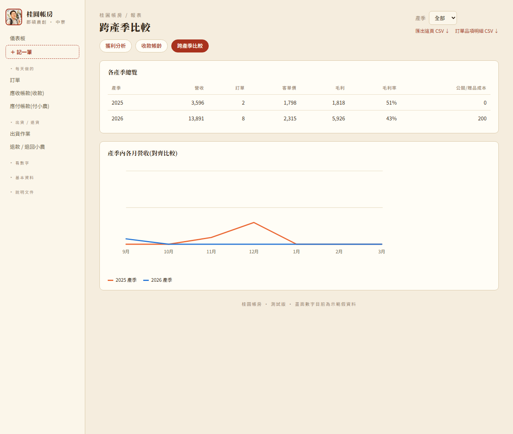
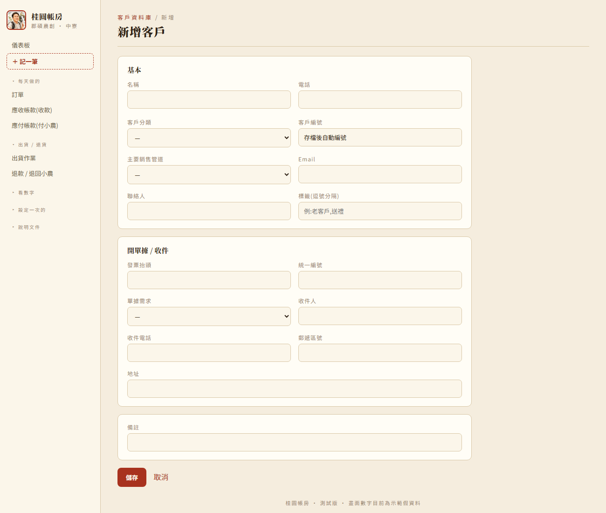
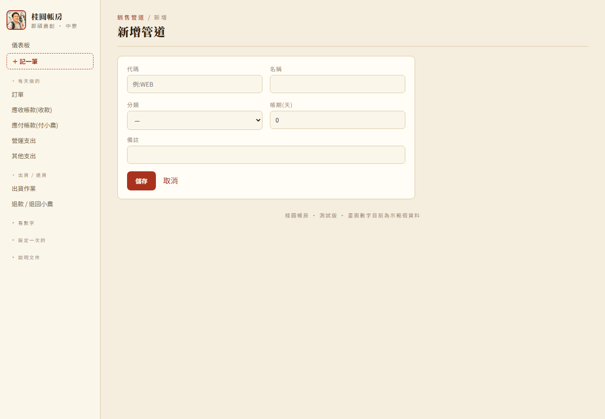

# 展示腳本(給郡碩農創 demo 前自己先跑一遍)

用途:demo 前照這份走一次 —— ①每個功能都點過確認正常、②對一下數字、③練一下怎麼講。
全部是 `seed.py` 產生的**示範假資料**,重點是「結構對不對、能不能回答老闆的問題」,不是數字本身。

**2026-09-17 全部重寫**:配合這幾天的畫面簡化(拿掉產品線分類、批次功能、費用/進貨的稅務欄位),
舊版腳本裡「各產品線賺不賺」「產品線設定」「焙製批次」這些畫面已經不在導覽選單裡了,照舊版走會
在 demo 現場找不到路。

**2026-10-08 再改一版**:同仁試用後改成「貿易公司模式」——郡碩沒有存貨,接單才跟小農買。
進貨、供應商、庫存、退貨折讓這幾段拿掉,換成「付小農貨款」「退款 / 退回小農」,也補上總帳 /
正式報表。截圖改用 `screenshots/manual/` 裡跟使用手冊同一套最新的圖。

**2026-10-17 再改一版**:依同事 1015 版 Excel 跟修改意見改版——接單當天就付小農(沒有「付小農貨款」頁)、
每張訂單每列自己填成本、商品單一售價、客戶不分級、新增「應收帳款」收款頁、營運支出 / 其他支出 /
其他收益改成同一頁分區塊、會計科目設定、總帳一行一筆、各清單可勾選刪除。

啟動:關掉舊的黑視窗 → 雙擊 `啟動.bat` → 瀏覽器開 http://127.0.0.1:8000
demo 前建議先 `python seed.py --force` 重灌一次乾淨的假資料,數字才會跟這份文件一致。

---

## 0. 一句開場(給家易)

> 「這是拿假資料做的樣子。重點不是這些數字,是想跟你確認:①這套『怎麼分類、怎麼算』對不對;
> ②有沒有漏掉你會在意的成本;③如果你想看到這個程度,我們就一起把你的真資料整理進來。」

---

## 1. 儀表板(首頁)

**點:** 左上「儀表板」

**應該看到:**
- 頂端「需要注意」幾個橘色標籤(貨款逾期未收、超過 3 天還沒出貨、破損/遺失待處理、待確認資料)
- 4 個 KPI 卡:本產季營收(開單就算,跟損益簡表一致,小字列已收到 / 還沒收)、本產季稅前利潤、毛利率、還沒收到的貨款
- 「本產季至今損益簡表」卡:營收(不含稅)→ −退款 → −銷貨成本 → 毛利 → −運費 → −營運費用 → 稅前利潤
- 「產季目標 & 進度」卡:目標營收、實際營收、達成率、已出貨月數、依速度預估季末、損益兩平需營收
- 「月營收 / 毛利趨勢」圖(滑鼠移上去看各月)

**怎麼講:** 「一頁看完:這季賣多少、扣掉所有開銷剩多少、目標達成沒。」

**要注意:** 剛開季(4 月)或旺季還沒到的月份,「稅前利潤」看起來會是一大包負的——這是因為
營運費用(人事、房租…)每個月都要付,但銷售旺季通常集中在後幾個月。這不是算錯,是「前期
投入還沒被賣出去的量補回來」,demo 時可以順帶說明,不然數字看起來會嚇人。

**順手確認:** 右上「產季」切換,數字要跟著變;橘色標籤點下去會跳到對應頁。

---

## 2. 開一張訂單(每天做的核心)

**點:** 左側「每天做的 → 訂單」→「＋ 新增訂單」

**示範:** 打客戶名字搜尋 → 點選 → 品項選一個商品(單價自動帶售價)→ 填數量 →
**每列填成本**(這列的貨跟小農買花多少)→「收款」先選應收帳款 →
填「銷項稅額」(售價含稅,稅額自己填)→ 存檔

存檔後進訂單明細,示範「標記已出貨」:

**怎麼講:** 「賣出去就開一張訂單。開單時填成本,系統就把『客人欠多少、成本多少、欠小農多少』一次記好,
不用另外記進貨。真的付錢給小農時,到『應付帳款』勾一勾就好。」

**順手確認:** 訂單清單可篩「貨款逾期 / 未收款 / 超過 3 天未出貨」、可搜尋單號或客戶;
右上可匯出 CSV。

---

## 3. 應收帳款(收款)

**點:** 「每天做的 → 應收帳款(收款)」

**應該看到:** 上半「尚未收回」列出還沒付錢的訂單(交易紀錄號碼、日期、客戶編號、客戶名稱、金額),
下半是已收回的紀錄。

**示範:** 勾兩筆 →「收款」→ 選收到哪個帳戶、收款日 → 確定,兩筆一起移到「已收回」。

**怎麼講:** 「收到錢就來這裡勾,一次收齊,系統會同時記好收款。還沒收的都在上面,一眼看到誰還欠。」

---

## 4. 營運支出(每筆照發票記)

**點:** 左上「＋ 記一筆」→「營運支出」卡片

**示範:** 日期 → **VD 費用**選科目(例如 6118 水電瓦斯費)、填發票金額 → **C 付款帳戶** →
**G 進項稅額**填稅額、選憑證、填發票號碼 → 看下面分錄預覽 → 儲存 → 自動回到總帳(只列營運支出 / 其他支出),剛記的就在裡面。

**怎麼講:** 「營收、成本、毛利是訂單自動算的;營運支出要每筆照發票記,淡季也要記,才看得出
真實的損益。畫面分三塊,每塊對應同事帳務設定表的一組科目;發票金額含稅,系統自己拆出稅額。」

**順手確認:** 利息、所得稅到「其他支出」記,不會混進營運支出。

---

## 5. 財務健康

**點:** 「看數字 → 財務健康」

**應該看到:** 月稅前利潤趨勢(綠=賺 紅=虧)、累積稅前利潤、毛利率趨勢、選定月份的完整損益
明細、各產季合計表。

**順手確認:**
- 趨勢圖**點某個月** → 下面損益明細列出那月的完整損益;勾「多選」再點幾個月 → 看合計
- 淡月是紅的 —— 沒收入還是要付固定成本 + 折舊

**怎麼講:** 「這頁看『這個月/這幾個月賺不賺』,跟儀表板算法一致,只是可以拆到月份細看。」

---

## 6. 獲利報表(3 個頁籤)

**點:** 「看數字 → 獲利報表」

**頁籤一:獲利分析**(依商品 / 依銷售管道毛利,品項營收佔比,新客 vs 回頭客,本產季 Top 客戶)

**頁籤二:收款帳齡**(還沒收到的貨款,依逾期天數分桶)

**頁籤三:跨產季比較**(今年 vs 去年同期,各項數字並排)

**怎麼講:** 「這裡回答『哪個商品/哪個通路賺、客戶回不回購、錢卡在誰那裡、今年比去年好不好』。」

---

## 7. 固定資產 + 折舊

**點:** 「設定一次的 → 固定資產」

**應該看到:** 目前示範資料 2 台(搖蜜機、智慧柴焙灶);上方四格:
在用資產成本、累計折舊、帳面淨值、每月折舊。

**示範新增:** 「＋ 新增一台」→ 填名稱、選類別、取得日、取得成本、進項稅額、付款帳戶(用選的)→
存。**使用年限用月填,最少 120 個月**(填 100 會被擋),**殘值**可以填(不確定填 0),每月折舊會照「成本 − 殘值」算。

**怎麼講:** 「焙灶、機器、貨車這種不是一次性費用,要逐年提折舊。建卡後系統每月自動把折舊算進
財務健康,也記進總帳,不用手動記。」

---

## 8. 客戶資料庫

**點:** 「設定一次的 → 客戶資料庫」

**應該看到:** 清單欄位——客戶編號、名稱、客戶分類、主要管道、電話、訂單數、累計金額、最近購買;
右上「＋新增客戶」「匯出 CSV」;上方可搜尋名稱或舊稱呼。

**示範新增:** 「＋新增客戶」→ 填名稱(必填)、電話、客戶分類(企業戶 / 個人戶)、主要銷售管道、Email、聯絡人、
標籤;下面「開單據 / 收件」區塊填發票抬頭、統一編號、單據需求、收件人、收件電話、郵遞區號、
地址;最後備註 → 存。

**怎麼講:** 「每個客戶開一張檔,客戶編號系統自動編。客戶不分級,開單一律帶商品的售價。」

**順手確認:** 點進客戶明細可以看往來紀錄、累計消費;新增時如果名稱跟既有客戶同名,系統會
提醒是不是同一人,避免重複建檔。

---

## 9. 商品目錄

**點:** 「設定一次的 → 商品目錄」

**應該看到:** 每個品項的品項代碼(F001…)、品名、型態、內容量、單位、每單位克數、保存天數、狀態
(在售/停售)。

**示範新增:** 「＋新增商品」→ 品名(必填)、型態、產品線、舊稱呼/原代號、內容量、每單位克數、
計價單位、包裝型態、保存天數/條件、原料成分、國際條碼、狀態、備註、**售價** → 存。品項代碼自動編。

**怎麼講:** 「商品只要填售價;成本每張訂單自己填,因為每次跟小農買的價錢可能不一樣。
產品線要選對,總帳的收入、成本會照它分。」

---

## 10. 銷售管道

**點:** 「設定一次的 → 銷售管道」

**示範新增:** 「＋新增管道」→ 代碼(必填,例:WEB)、名稱(必填)、分類、帳期(天)、備註 → 存。

**怎麼講:** 「客戶下單時選的管道,也是獲利報表『依銷售管道』拆分毛利的依據。」

**順手確認:** 銷售管道可以刪除,系統會先擋掉還有訂單引用的管道。

---

## 11. 出貨作業

**點:** 「每天做的 → 出貨作業」

**應該看到:** 「揀貨單」(要出的訂單 + 按商品彙總的備貨量,可列印)、「出貨標籤 / 送貨單」
(每張訂單一張卡,可整頁列印)、「食品標示」(選商品 + 份數,產生貼在包裝上的標示——品名/
內容量/成分/產地/保存方式從商品目錄帶入,製造日期/有效日期留白手寫)。

**怎麼講:** 「訂單標記已出貨前,先來這頁印撿貨單、出貨標籤;食品標示每包都要貼,法規要求的。」

**順手確認:** 右上「物流異常處理」——包裹破損/遺失/退貨,點右上這顆鈕處理,可以一鍵產生
「理賠重寄」訂單。

---

## 12. 退貨 / 退款

**點:** 「出貨 / 退貨 → 退款 / 退回小農」

**應該看到:** 每筆紀錄的發生日、單號、客戶、類型(退款 / 退回小農)、金額、原因,下面分別合計
「退給客人」「小農退回」。

**示範登記:** 這頁本身**沒有「新增」按鈕**——從訂單明細頁最下方「退款 / 退回小農」卡登記:

| 情況 | 怎麼做 |
|---|---|
| 退貨又退款 | 直接按訂單右上「刪除訂單」 |
| 只退款、不退貨 | 類型選「退款」,金額填退給客人多少、錢從哪個帳戶退(算其他支出) |
| 退貨但不退款 | 類型選「退回小農」,金額填小農退回多少、退回哪個帳戶、扣哪項採購成本(畫面上有這張單的成本合計) |

**怎麼講:** 「我們把郡碩當成貿易公司:退貨退款就當這張單沒發生、直接刪;只退錢就是一筆其他支出;
貨退回去就退給小農,小農把錢退回來。」

---

## 13. 總帳 / 試算表 / 會計科目(同事看的)

**點:** 「看數字 → 總帳 / 試算表」、「設定一次的 → 會計科目設定」

**應該看到:** 總帳一行一筆,傳票號碼都是 `GL` + 日期 + 流水號,預設由小到大;點標題可以排序,
標題下一排可以篩選(傳票號碼可用 `GL202609*`);勾一行同一張傳票整張一起勾,可以刪除。
切到「試算表」分頁:每個科目的期初 / 本期借貸 / 期末(借正貸負),可以下載;結轉過的年度就鎖住、不能再改。總帳也可以下載。
會計科目設定照同事的帳務設定表分組,可以自己加科目、改名、停用。

**怎麼講:** 「這幾頁是給會計同事核對的,平常不用管。前面每個畫面存檔,系統就自動記好帳了;
科目要調整也不用改程式,在會計科目設定改就好。」

---

## 14. 定價試算

**點:** 「看數字 → 定價試算」

**應該看到:** 上面幾張卡「共用」「龍眼鮮果」「龍眼乾」「龍眼肉」「蜂蜜」,每張卡是一組成本
參數(改了旁邊數字,下面立刻重算);下面「龍眼鏈・成本一路串下去」是三階段成本堆疊圖——
原料鮮果 → 在製品龍眼乾 → 製成品龍眼肉,每個階段自動把上一階段的成本轉進來、加上自己那段的
加工費,算出「可售成本」,跟目前售價比出毛利率;蜂蜜是獨立一張卡,不接龍眼鏈。

**示範:** 改任一個參數(例如龍眼乾的「烘焙工資」)→ 下面數字即時重算 → 想固定住這組參數就
按「儲存參數」,或按「還原預設值」退回系統內建的估計值。

**怎麼講:** 「這是抓成本、抓售價用的估算工具,改參數看毛利率會不會太低,純試算,不會動到
真的訂單或帳。」

**順手確認:** 改完記得跟同仁說要按「儲存參數」,不然重新整理頁面就不見了。

---

## 15. 收尾:要跟家易確認 / 請他去問的事

**營運事實(他答得出):**
- 設備清單:每台大概買價、什麼時候買的、有沒有政府補助
- 申報表「研發費」的內容是什麼(新品?委外?其實是設備?)
- 「薪資支出」有沒有包含他自己下田 / 顧焙灶 / 剝肉的工
- 蜂蜜是自己養蜂採,還是收購生蜜回來瓶裝?
- 跟小農買的價錢是不是每次都不一樣(現在是每張訂單自己填成本)

**跟他說清楚:**
- 這些數字全是假的,換成真資料要一起做「切轉日盤點」(設備、現金、應收)
- 目前系統不處理報稅,只算「賣出後實際收到多少錢」——如果之後真的需要報稅底稿,是另一個
  獨立的專案

---

## 16. demo 前自己檢查清單

- [ ] 舊的伺服器視窗有關掉(不然看到的是舊版)
- [ ] `python seed.py --force` 重灌過一次乾淨假資料
- [ ] 每頁都打得開、沒有 500 錯誤
- [ ] 左側選單完整(現在應該是:儀表板・記一筆 / 訂單・應收帳款(收款)・應付帳款(付小農)・營運支出・其他支出 / 出貨作業・退款退回小農 /
  財務健康・獲利報表・定價試算・總帳 / 試算表・銀行帳戶明細・科目明細 /
  客戶資料庫・商品目錄・銷售管道・固定資產・銀行帳戶・會計科目設定 / 下載手冊)
- [ ] 儀表板「需要注意」標籤都點得動、跳得到對應頁
- [ ] 財務健康趨勢圖點得動、損益明細會出來
- [ ] 開一張測試訂單能存、能在應收帳款收款、能標記已出貨(demo 完記得刪掉或重灌 `seed.py --force`)
- [ ] 營運支出、固定資產 各記一筆能存
