# 建置資料 SOP — 從零開始,一步步把自己的資料建起來

這份文件是給**第一次使用桂圓帳房、資料庫還是空的**的人看的——不是看著別人填好的假資料
學畫面,而是照著這份文件,**一步一步把自己真正會用到的資料親手建一遍**。建完之後,
日常怎麼操作請改看 [營運流程SOP.md](營運流程SOP.md);想查某個畫面某個欄位是什麼意思,
查 [使用手冊.md](使用手冊.md)。這份文件只負責「從無到有」這一段。

## 為什麼要照這個順序

資料彼此有關聯,**有些東西要先建好,後面的畫面才選得到**。例如開一張訂單要挑客戶、挑
商品;客戶要挑銷售管道。如果順序反過來,畫面會出現空的下拉選單,卡住。
這份文件照以下順序走:

1. 銷售管道(一個很快的小設定)
2. 客戶
3. 商品(品名跟售價)
4. 訂單(開單 + 收款 + 付小農)
5. 營運支出

> 郡碩是「接單才跟小農買」的貿易公司,沒有存貨,所以**不用建供應商、也不用記進貨**:
> 開訂單時每個品項自己填成本,系統記成欠小農的錢(應付帳款);真的付錢給小農時到「應付帳款(付小農)」付款。
>
> 會計科目跟銀行帳戶(合庫 / 凱基 / 台新)系統已經照同事的帳務設定表建好了,不用自己建;
> 要加銀行帳戶或科目,到「基本資料 → 會計科目設定」。

每一步都只示範**一筆**,你知道怎麼做之後,自己的其他客戶 / 商品 / 訂單照著同樣步驟
一直加就好。

---

## 開工前:一個小設定

### 銷售管道

這是「客人從哪裡來的」分類(官網、LINE 社群、批發…),等一下建客戶的時候會用到。

側邊選單「基本資料」→「銷售管道」→「＋ 新增管道」:

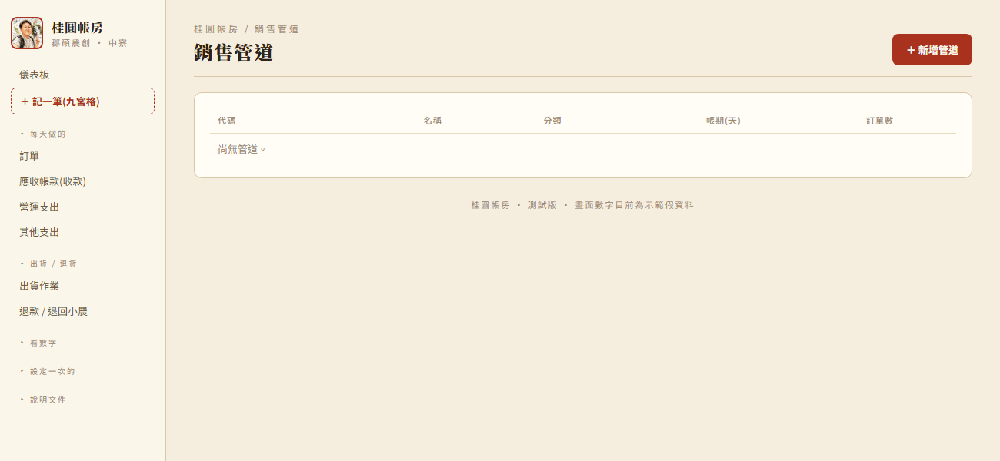

填「代碼」(隨便取一個好記的英文簡稱,例如 WEB)、「名稱」、「分類」選最接近的:

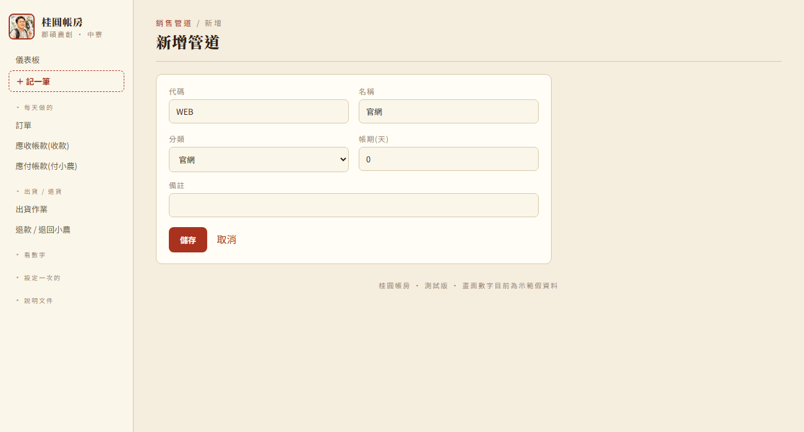

按「儲存」,清單就會出現這一筆:

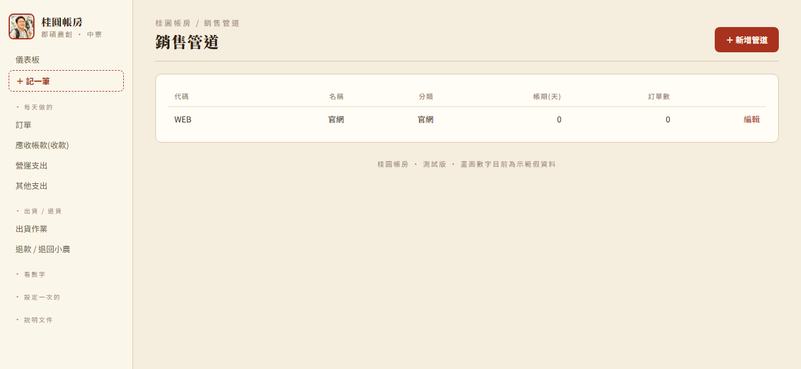

---

## 第 1 步:客戶

側邊選單「基本資料」→「客戶資料庫」→「＋ 新增客戶」:

必填的只有「名稱」。其他(電話、客戶分類〔企業戶 / 個人戶〕、主要銷售管道)建議順手填,之後開訂單、
看報表會比較好用,但不填也能存檔。「主要銷售管道」這裡就會出現你剛剛建好的「官網」。
**客戶編號**(例 C2026001)系統自動編,不用填。

填好之後存檔,客戶資料庫就有這一筆了:

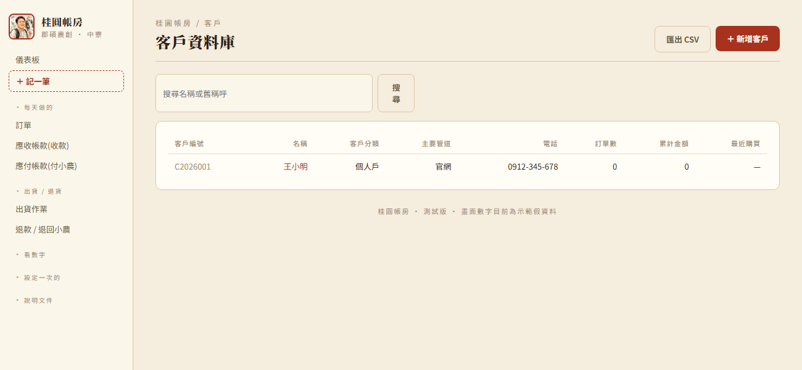

**接下來你的所有真實客戶,都照這個步驟一個一個加進來就好。**

---

## 第 2 步:商品

側邊選單「基本資料」→「商品目錄」→「＋ 新增商品」。這張表單欄位比較多,但真正
**必填**的只有「品名」和「產品線」,其他都可以先留空、之後再補:

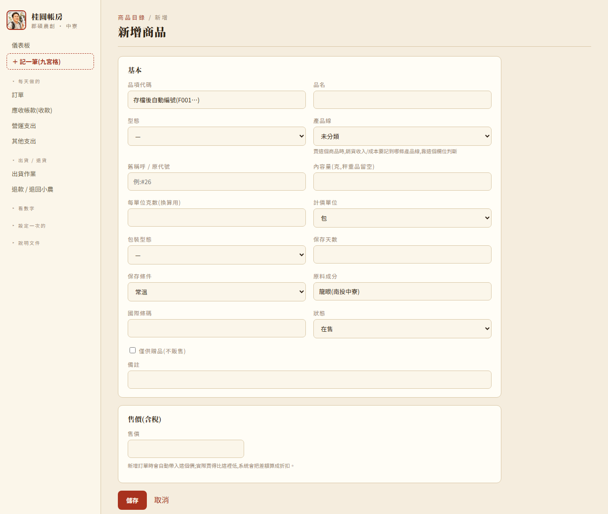

建議至少順手填這幾個:

- **品名**:客人看得懂的名字。
- **產品線(必填)**:龍眼鮮果 / 龍眼乾 / 龍眼肉 / 龍眼花 / 蜂蜜,總帳的收入、成本會照這個分。
  打完品名系統會**依品名建議**一個(例如「桂圓乾 300g」→ 龍眼乾、「龍眼蜂蜜」→ 蜂蜜),下面小字寫
  「依品名建議…」,不對就自己改。這五條產品線系統一開始就建好,不用另外設定。
- **售價**:含稅的售價,開訂單時系統會自動帶這個價。
- **品項代碼**(F001、F002…)系統自動編,不用填。**成本不在這裡填**,開訂單時每列自己填。

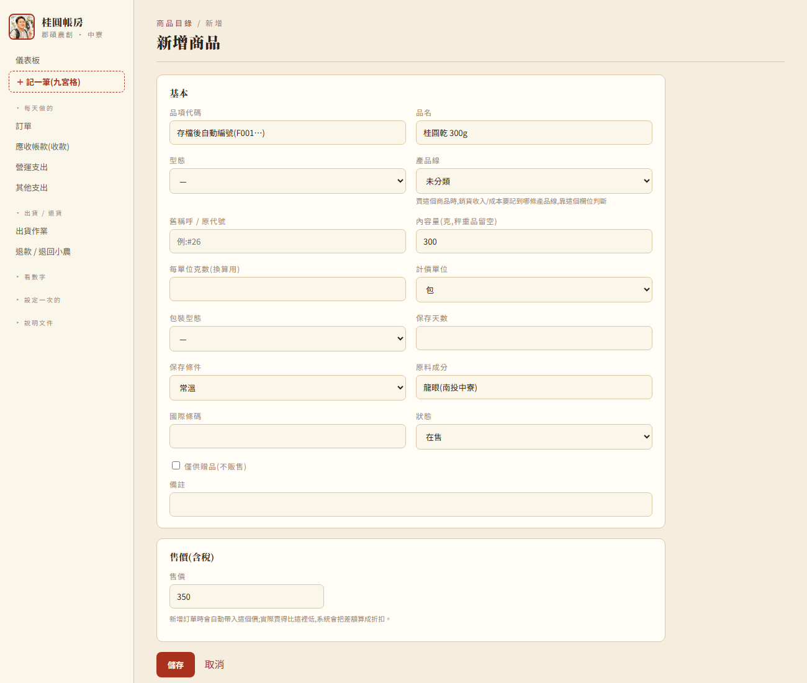

存檔後,商品目錄就有這一筆了:

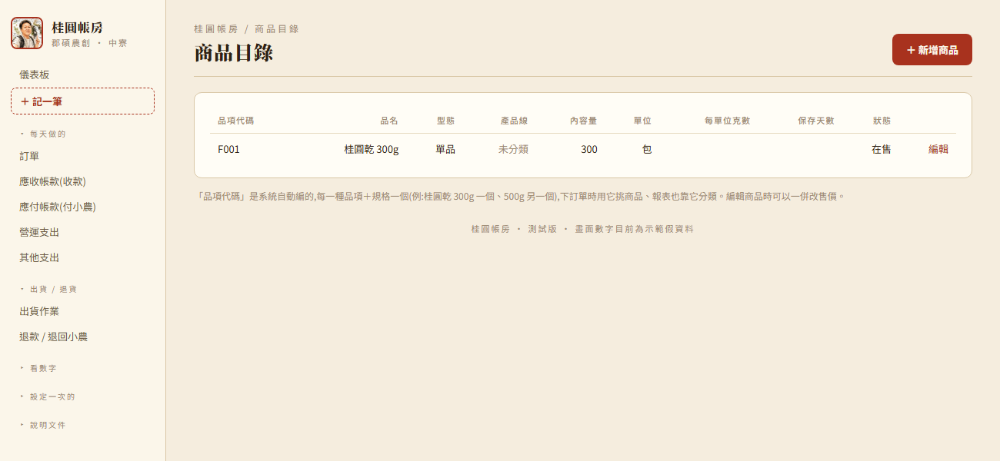

**接下來你賣的每一種商品、每一種規格,都照這個步驟各自建一筆。**

---

## 第 3 步:訂單(開單 + 收款)

這是最常用的畫面,分兩段:**先開訂單,之後客人真的付錢了再到「應收帳款」收款。**

### 3-1 開訂單

側邊選單「訂單」→「＋ 新增訂單」。打客戶名字會自動跳出剛剛建的那個客戶,點一下選它:

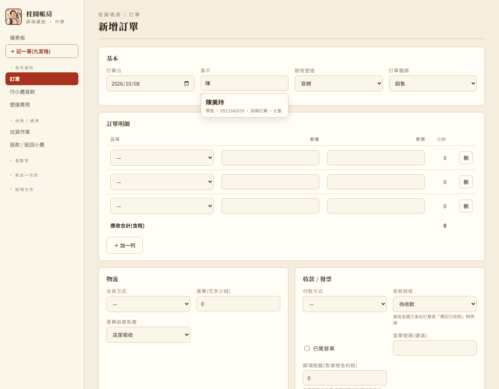

訂單明細那一列:

- 「品項」選剛剛建的商品,「數量」填多少,單價會自動帶出剛剛設定的售價。
- 「**成本移轉價(每單位,必填)**」填這個商品跟小農買**一個單位**多少錢(例如每包 180 → 填 180),旁邊「成本移轉價小計」會自動算成 2 × 180 = 360。可以填小數。不能留空或填 0,按存檔時會跳提醒、把格子框紅。第一次賣的商品要自己填;之後再開這個商品的訂單,系統會自動帶入上一次填的單價。
- 「**收款**」先選「E 應收帳款(還沒收,之後再收)」;如果客人當場就付清,選收到哪個帳戶。
- 「**發票號碼**」**必填**——銷售訂單一定要開發票(贈送、樣品這類訂單才不用)。
- 「**銷項稅額**」填這張訂單含了多少稅(售價都是含稅價,系統不幫你算;例如含稅 700 元,稅額大約 33 元)。

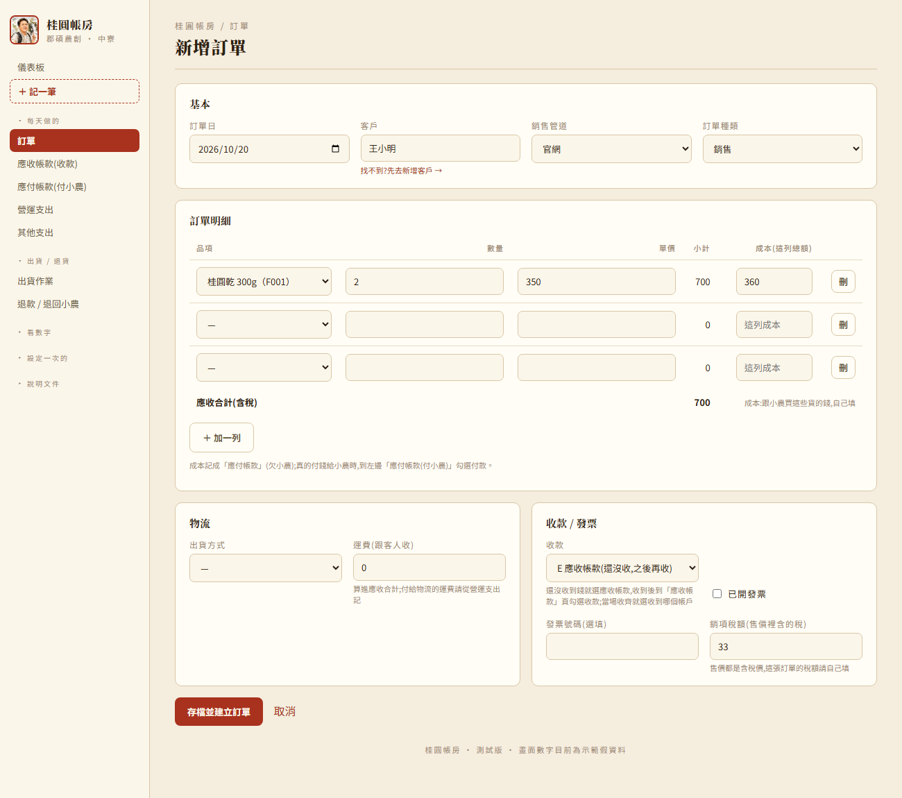

按「存檔並建立訂單」。存檔的同時,系統會自動記下「客人欠我們 700」「這批貨成本 360」
「我們欠小農 360」:

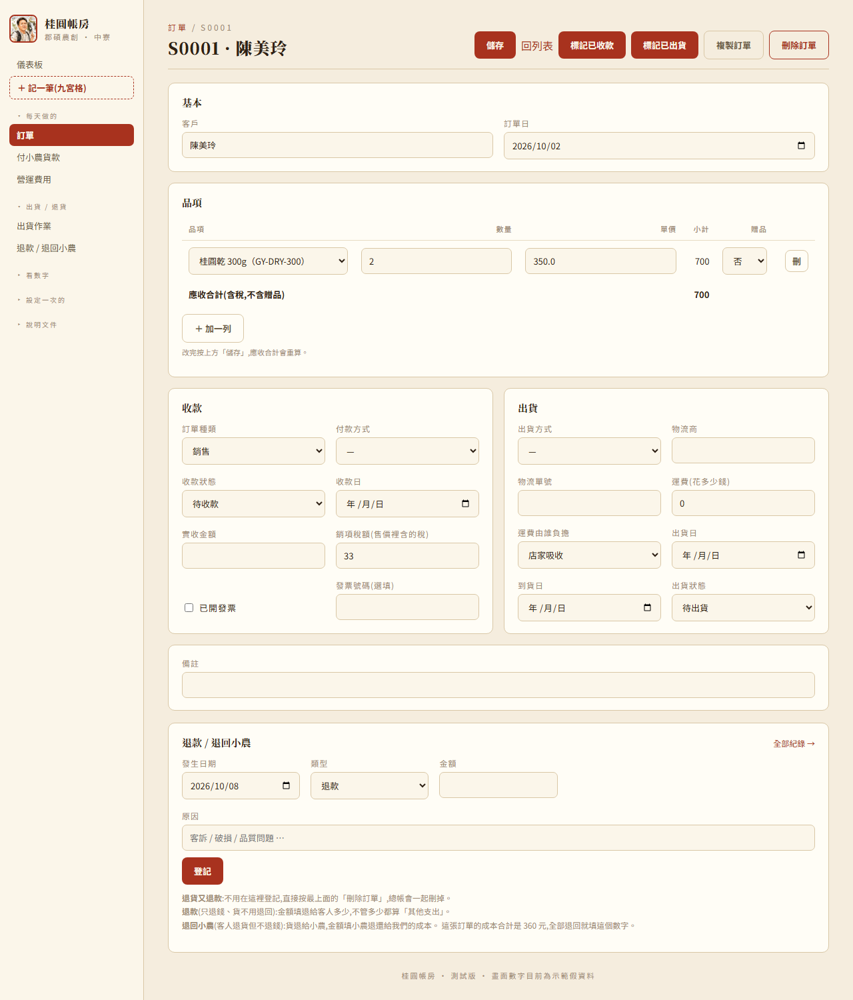

### 3-2 客人付款後:到應收帳款收款

側邊選單「應收帳款(收款)」,上面「尚未收回」會列出這張訂單。勾選它、按「收款」,
選收到哪個帳戶、收款日:

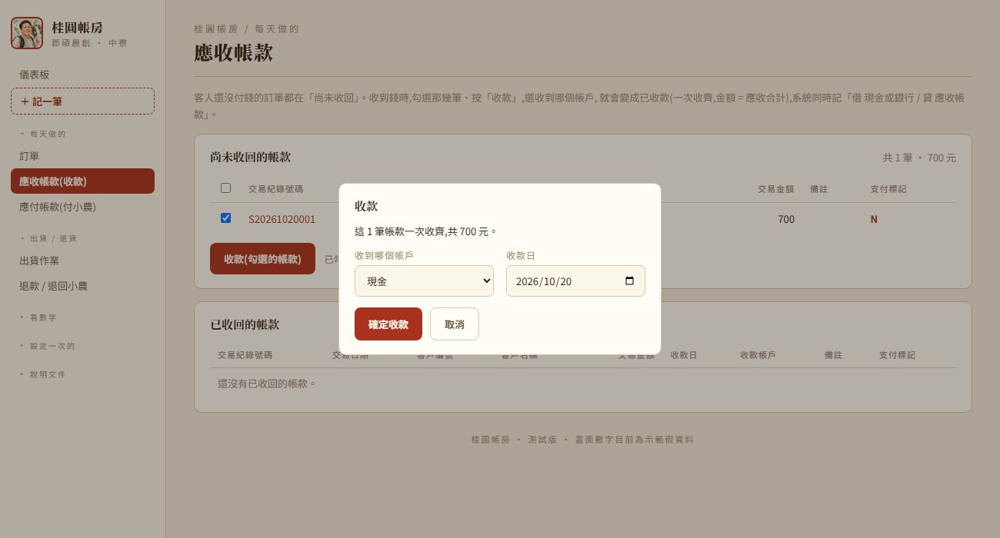

確定後,這張訂單就移到下面「已收回」:

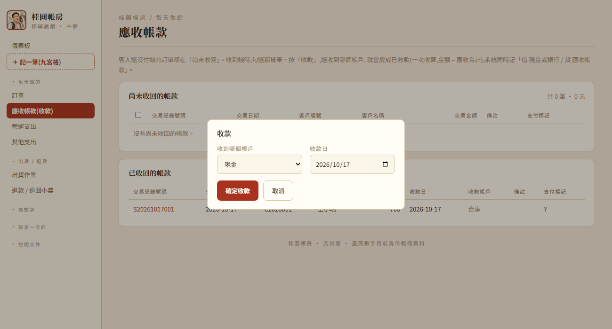

收款一定一次收齊,金額就是應收合計,不用另外填。

**為什麼開單跟收款要分兩步?** 因為很多時候訂單成立的當下客人還沒付錢(例如批發客戶
月結、客人選貨到付款)。系統讓你「訂單先開著」,錢真的進來的那天再收款——這樣
「還有誰沒付錢」這種清單才會準。

### 3-3 付錢給小農:到應付帳款付款

側邊選單「應付帳款(付小農)」,上面「還沒付給小農的」會列出這張訂單的成本。勾選它、按「付款」,
選從哪個帳戶付、付款日:

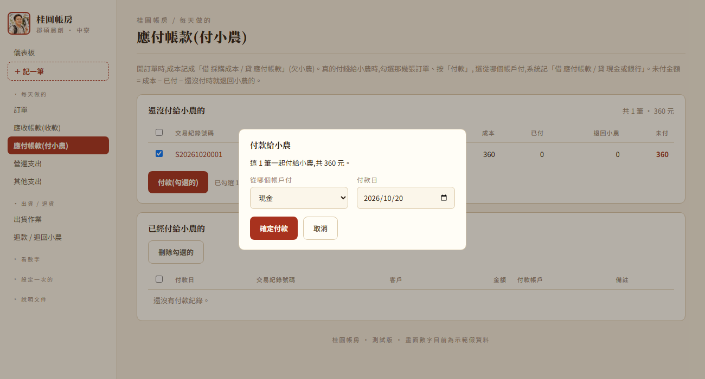

確定後,這筆就移到下面「已經付給小農的」。

**接下來每一張新訂單都照這個步驟:開單 →(之後)應收帳款收款 →(之後)應付帳款付小農。**

---

## 第 4 步:營運支出

左上「**＋ 記一筆**」→ 點「**營運支出**」卡片。一頁填完:

- 最上面「**日期**」(發票 / 付款那天)。
- **VD 費用**:選科目(例如 6118 水電瓦斯費),填「**發票金額(支付金額)**」= 發票上的總額(含稅)。
- **C 付款帳戶**:從哪個帳戶付。
- **G 進項稅額**:發票上的稅額(沒有填 0)、憑證類型;選「發票」就要填發票號碼。

最下面「分錄預覽」會邊填邊顯示這筆怎麼記(費用 = 發票金額 − 進項稅額):

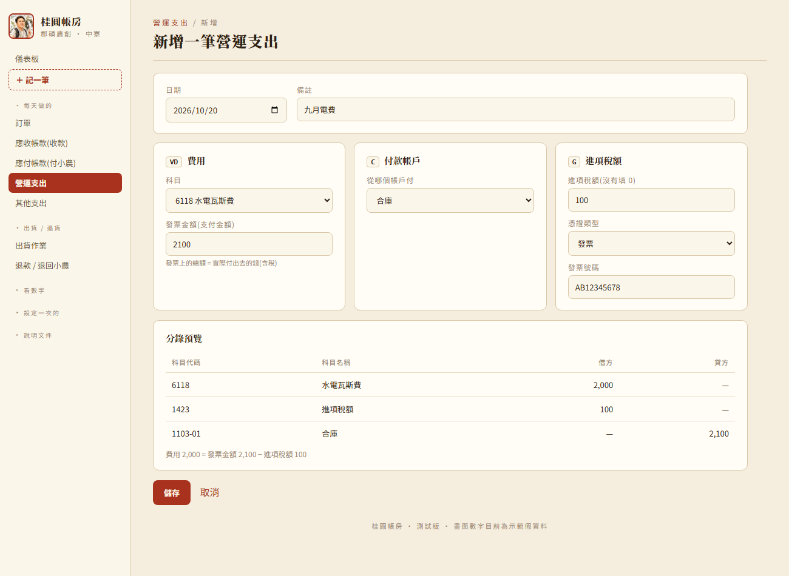

按「儲存」,會回到「總帳」,只列營運支出 / 其他支出的傳票,剛記的這一筆就在裡面(之後要改,點傳票號碼回去改):

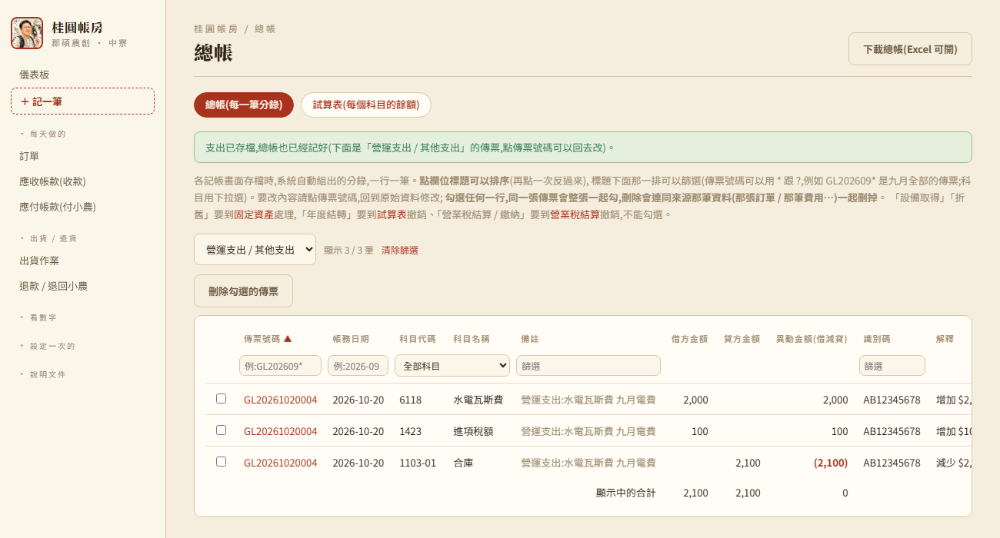

**接下來每筆營運相關的花費都照這個步驟記,淡季(沒收入的月份)也要記,不然月損益會失真。**
利息、所得稅這類不屬於營運的支出,從「＋ 記一筆」的「其他支出」卡片記,填法一樣。

---

## 建完之後,看一眼儀表板

以上幾類資料都建好一筆之後,回到儀表板,就會看到真的數字跑出來了(不再是全部 0):

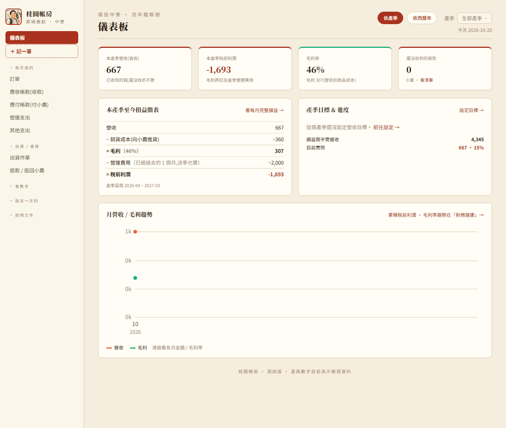

## 接下來呢

這份文件到這裡結束——剩下的日常操作(出貨、退貨 / 退款、報表怎麼看…)請改看
[營運流程SOP.md](營運流程SOP.md);想查某個畫面某個欄位是什麼意思,查
[使用手冊.md](使用手冊.md)。固定資產、銀行帳戶、會計科目設定、總帳 / 試算表、營業稅結算
這些比較進階的功能,也都在使用手冊裡有說明,之後用到
再查就好,不用現在一次學完。
