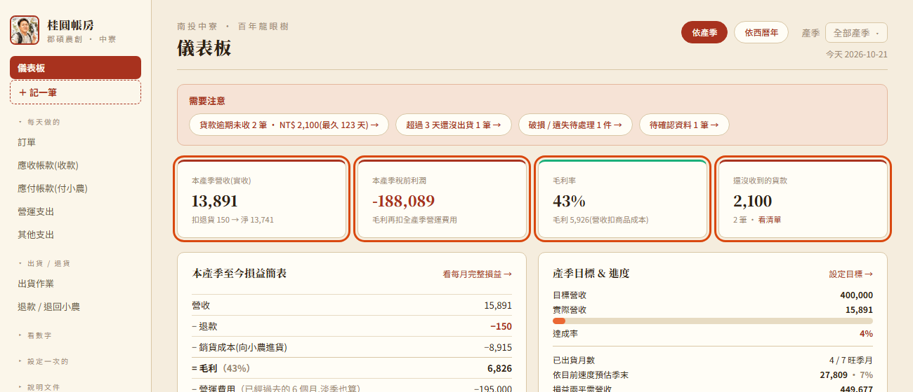
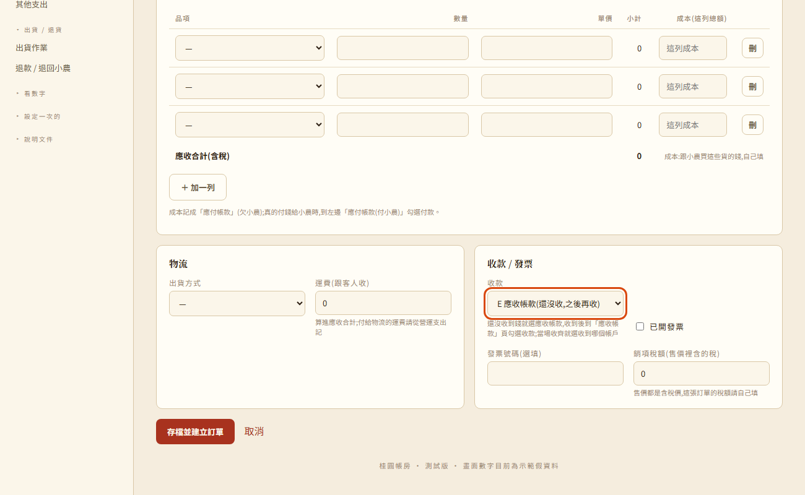
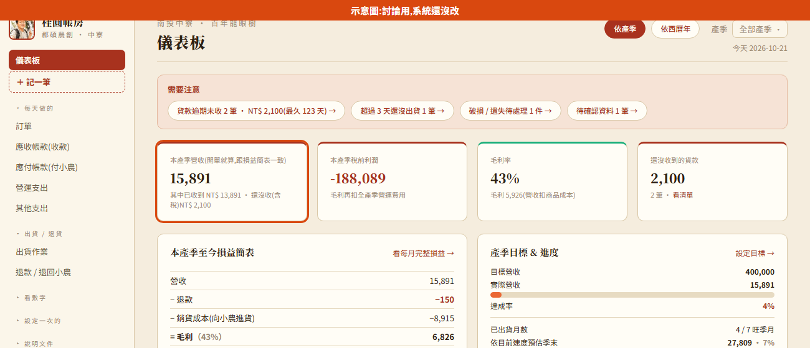
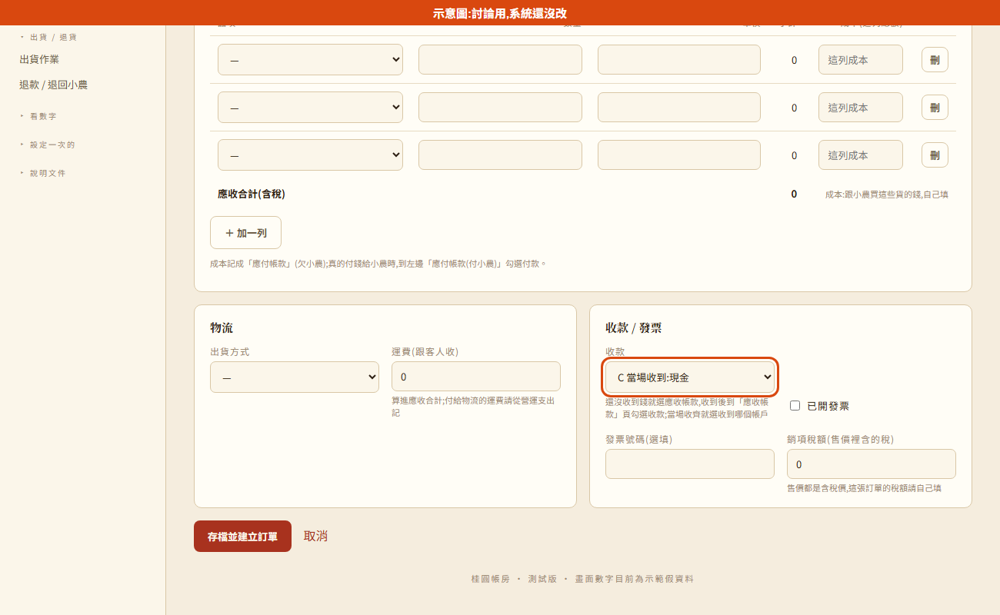
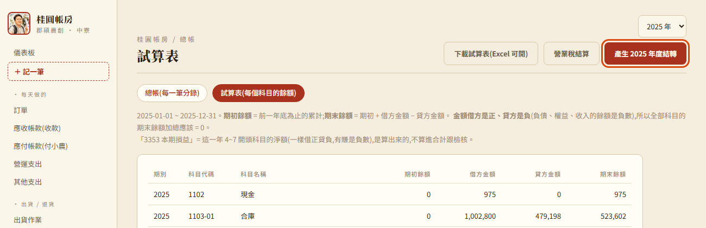
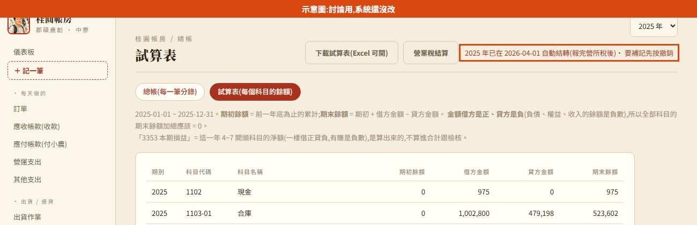
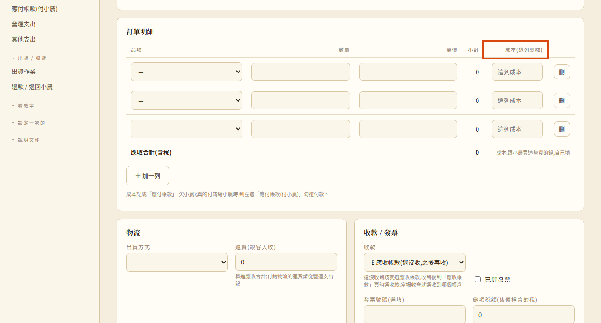
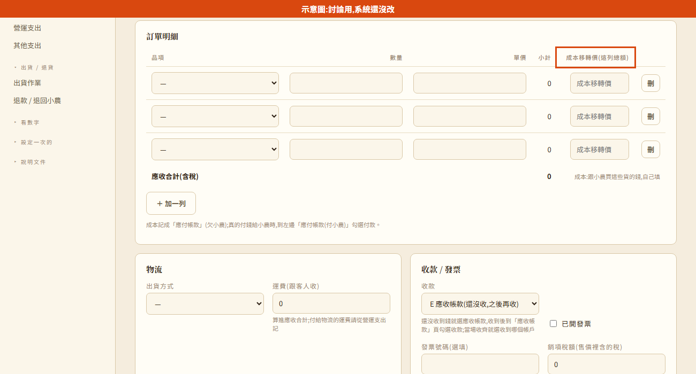
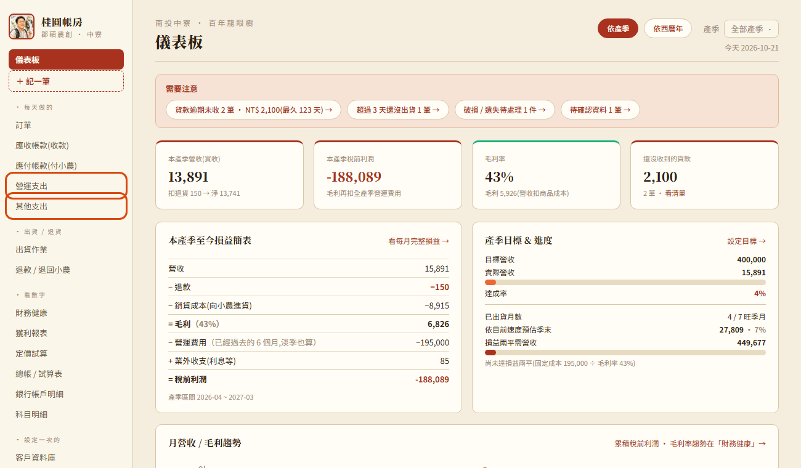
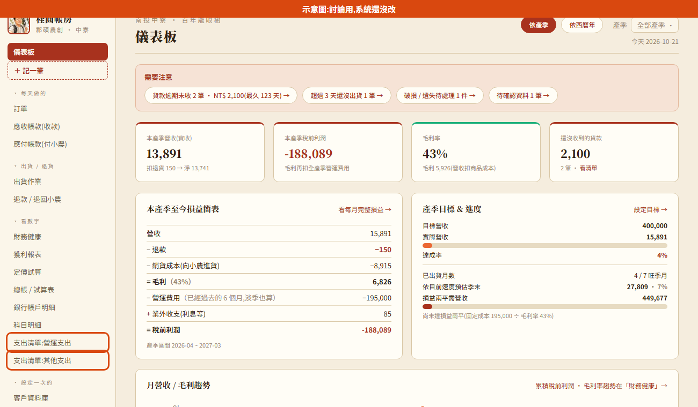

# 待決定事項 — 要請使用者 / 同仁拍板的 5 件事

> 整理日期:2026-10-21。每一題寫:問題、現在系統怎麼做、可以怎麼選、我的建議、改的方向,
> 並附「現在的畫面」跟「改完的示意圖」(示意圖最上面有橘色橫幅「示意圖:討論用,系統還沒改」,
> 是用真的系統畫面改出來給大家看長相用的,**系統本身還沒改**)。
> 決定好之後,把答案回給我就照著改;改完會記進 [工作日誌.md](工作日誌.md)、從 [待辦清單.md](待辦清單.md) 劃掉。

| # | 問題 | 我的建議 | 改起來的份量 |
|---|---|---|---|
| 1 | 營收要「開單就算」還是「收到錢才算」?新增訂單的收款預設要不要改成「當場收到」? | 儀表板營收卡片改成跟損益簡表同一套(開單就算),下面小字列「已收到 / 還沒收」;收款預設看實務 | 小 |
| 2 | 訂單匯入(CSV / Excel)要不要加「銷項稅額」欄位? | 加,選填;沒填的在預覽畫面標黃提醒 | 小 |
| 3 | 年度結轉要不要不用按按鈕、系統自動做? | 維持手動按;要自動的話,延到報完營所稅之後 | 中 |
| 4 | 訂單的「成本」欄要不要改名「成本移轉價」? | 看同仁習慣;要改的話只改名稱,帳不受影響 | 很小 |
| 5 | 「營運支出」「其他支出」頁面要不要隱藏? | 從「每天做的」移到「看數字」,新增照樣從「＋ 記一筆」 | 很小 |

---

## 1. 營收要「開單就算」還是「收到錢才算」?收款預設要不要改?

**問題**:2026-10-20 起「財務健康」跟儀表板的「損益簡表」改從總帳抓,營收是**開單就算**;
但儀表板最上面「本產季營收(實收)」卡片還是**收到錢才算**。所以同一個畫面上有兩個不一樣的營收數字
(示範資料:卡片 13,891、損益簡表 15,891,差的就是還沒收的訂單)。

另外,新增訂單的「收款」預設是「E 應收帳款(還沒收)」;如果郡碩實際上**都是收到錢才開單**,
每次都要改選「C 當場收到」,而且兩個營收數字本來就會一樣。

**可以怎麼選**:
- **A. 一律收到錢才開單** → 收款預設改成「C 當場收到:現金」(要記應收的時候再改選)。
- **B. 常常先出貨、後收款**(批發月結、貨到付款)→ 收款預設維持「E 應收帳款」。
- 不管 A 或 B,**卡片要不要改成跟損益簡表同一套算法**?

**我的建議**:
1. **卡片改成「開單就算」**,跟損益簡表、財務健康、總帳同一套數字,下面小字寫「其中已收到 / 還沒收」,
   這樣同一個畫面不會有兩個營收;「還沒收到的貨款」那張卡片照舊。
2. 收款預設照郡碩實際做法:多半當場收就選 A,常有月結就維持 B。

**改完的示意圖**:

**改的方向**:儀表板卡片改用總帳的營收(`season_finance`)並加一行已收 / 未收;收款預設只改新增訂單畫面的預設選項。
跟帳本身無關,不影響已經記的資料。

---

## 2. 訂單匯入要不要加「銷項稅額」欄位?

**問題**:用 Google 表單 / Excel 匯入的訂單,銷項稅額都是 0,要進每一張訂單補填。

**現在的匯入範本欄位**:

| 時間戳記 | 客戶姓名 | 客戶電話 | 收件地址 | 付款方式 | 備註 | (每個商品一欄,填數量) |
|---|---|---|---|---|---|---|

**可以怎麼選**:
- **A. 範本加一欄「銷項稅額」**(選填):有填就用填的,沒填就是 0。
- **B. 系統自動算**(含稅金額 ÷ 1.05 拆出稅額)——但這跟「銷項稅額一律家易手填」的原則不合。
- **C. 維持現狀**,匯入後一張張補。

**我的建議**:**A**。加在「備註」後面,選填;匯入預覽畫面把「稅額是 0」的訂單標黃,提醒之後要補。

**改完的範本欄位(示意)**:

| 時間戳記 | 客戶姓名 | 客戶電話 | 收件地址 | 付款方式 | 備註 | **銷項稅額(選填)** | (每個商品一欄,填數量) |
|---|---|---|---|---|---|---|---|

**改的方向**:範本下載、匯入解析、預覽畫面各加一欄;舊的範本檔(沒有這欄)照樣能匯入。

---

## 3. 年度結轉要不要自動做?(0921 第 22 條)

**問題**:同仁 0921 第 22 條提到「去年的 3351-03 + 去年的 3353 = 今年的 3351-03」,問要不要不用按按鈕、系統自動結轉。
現在是年底後在試算表按「產生 OOOO 年度結轉」;**2026-10-20 起結轉過的年度會鎖住**,不能再新增、修改那一年的交易。

**要注意**:因為結轉後會鎖年度,如果**一過 1/1 就自動結轉**,去年 12 月的發票如果 1 月才到,就記不進去了
(要先撤銷結轉才能補)。

**可以怎麼選**:
- **A. 維持手動按**(同仁確認去年的帳都記齊了再按)。
- **B. 每年 1/1 自動結轉前一年**。
- **C. 自動,但延到報完營所稅之後**(例如每年 4/1 自動結轉前一年)。

**我的建議**:**A 維持手動**;如果希望不要忘記按,可以在 1 月之後在儀表板「需要注意」提醒「2025 年還沒結轉」。
真的要自動的話選 **C**。

**改完的示意圖(選 C 的樣子)**:

**改的方向**:A 只加一個提醒;C 要加一個「到日期自動結轉」的檢查(開網站時判斷),結轉的分錄跟現在按按鈕一樣。

---

## 4. 訂單的「成本」欄要不要改名「成本移轉價」?(1001 第 6 條)

**問題**:同仁 1001 第 6 條用的詞是「成本移轉價」。現在訂單每列叫「成本(這列總額)」,意思是「這一列的貨跟小農買花多少錢」。

**可以怎麼選**:
- **A. 改名「成本移轉價(這列總額)」**
- **B. 維持「成本(這列總額)」**

**我的建議**:看同仁 / 家易平常怎麼稱呼。這只是名稱,**記帳完全一樣**;家易比較好懂的是「成本」,
同仁會計上習慣「成本移轉價」,選一個大家都看得懂的就好。

**改完的示意圖(選 A)**:

**改的方向**:只改訂單新增 / 明細頁的欄名、提示字跟手冊。

---

## 5. 「營運支出」「其他支出」頁面要不要隱藏?(1019 第 10 條)

**問題**:同仁 1019 第 10 條覺得這兩頁「資訊有點太細」,問要不要隱藏。現在它們在左側「每天做的」裡。

**可以怎麼選**:
- **A. 從選單拿掉**:新增從「＋ 記一筆」進;要查就到總帳用「來源」篩。
- **B. 移到「看數字」**:「每天做的」只留訂單、應收帳款、應付帳款;要看支出清單再去「看數字」找。
- **C. 維持現狀**。

**我的建議**:**B**。家易每天不會去翻支出清單,但偶爾要改一筆、刪一筆還是需要清單頁;移到「看數字」
就不會擠在每天的區塊。新增還是從「＋ 記一筆」。

**改完的示意圖(選 B)**:

**改的方向**:只動左側選單,頁面跟資料都不變。
