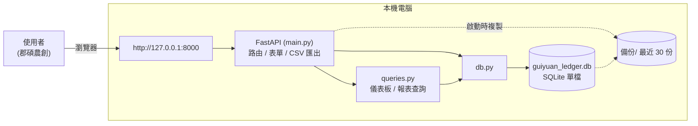
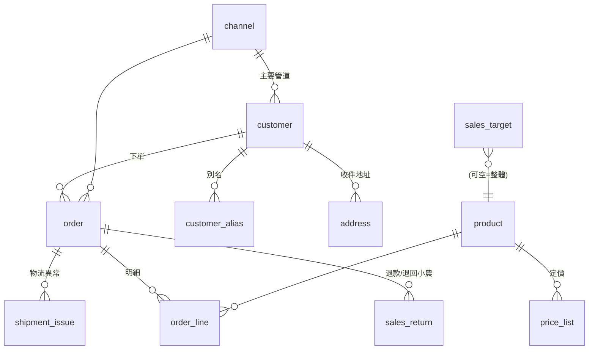

# 桂圓帳房 — 系統文件

南投中寮 · 郡碩農創 桂圓 / 龍眼乾銷售與物流管理平台。
本文件為開發 / 維護用途;操作說明見 [使用手冊.md](使用手冊.md)。

---

## 1. 概觀

| 項目 | 內容 |
|---|---|
| 型態 | 單機本地 Web 應用,資料全部留在使用者電腦 |
| 後端 | Python 3 + FastAPI |
| 樣板 | Jinja2(伺服器渲染)+ 少量原生 JavaScript |
| 資料庫 | SQLite 單檔 `guiyuan_ledger.db` |
| 前端框架 | 無(無打包步驟);CSS 為單一 `static/app.css` |
| 執行 | `啟動.bat`(建立 venv、裝套件、必要時建庫、開瀏覽器、跑 uvicorn) |
| 網址 | http://127.0.0.1:8000 |
| 風格 | 「帳房・宣紙」:米黃底、墨褐明體標題、朱印紅重點(Noto Serif TC / Noto Sans TC) |

### 設計原則
- 人(customer)、貨(product)、單(order / order_line)、錢(收款欄位)、物流(出貨欄位 + shipment_issue)五件事各自獨立。
- 一張原始出貨 = 一張 `order`,底下掛 `order_line`。
- 「贈送 / 樣品 / 理賠重寄」是**訂單種類**(`order_kind`),不是付款方式,可單獨統計成本。
- 產季(4 月開花養果起、到隔年 3 月這批桂圓乾賣完,共 12 個月)是一等公民;分析可切產季或看全部。

### 系統架構圖



全部在同一台電腦,無雲端、無登入、無外部連線。

### 資料模型(關聯)



- **主檔**:channel / product(+ price_list,只用「零售」一個價)/ customer(+ alias + address)/ **account(會計科目表,2026-10-16)**
- **交易**:order(+ order_line)、shipment_issue、sales_return(退款 / 退回小農)、op_expense(營運支出 + 其他支出)、other_income、equity_txn、manual_entry(+ manual_entry_line)、fixed_asset
- **總帳**:ledger_entry(各交易存檔時自動寫入)
- **輔助**:sales_target、review_queue(未與其他表建外鍵關聯)
- **dormant(表還在、UI 已不寫入)**:batch(焙製批次,order_line.batch_id 舊資料保留)、business_unit / product_group(product.product_group_id 舊資料保留)

---

## 2. 目錄結構

```
app/
  啟動.bat            啟動腳本(純英文內容,避免 cmd 中文亂碼)
  requirements.txt    fastapi / uvicorn / jinja2 / python-multipart
  schema.sql          14 張表的 DDL
  seed.py             建庫 + 灌示範假資料(2025、2026 兩個產季)
  guiyuan_ledger.db   SQLite 資料庫(執行後產生)
  備份/               每次啟動自動複製當日 .db,保留最近 30 份
  .venv/              虛擬環境(啟動時建立)

  db.py               SQLite 連線與 q / q1 / execute 三個小工具
  queries.py          儀表板 / 報表的所有查詢
  main.py             FastAPI 應用:路由、CSV 匯出、備份、啟動時 ensure_db / migrate_db
  paths.py            DATA_DIR / RES_DIR 解析(本機 / 雲端兩種);讀 GY_DATA_DIR
  wsgi.py             WSGI 進入點(**dormant,2026-10-02 起沒在用**——給只吃 WSGI 的
                       主機用,a2wsgi 包 ASGI;原本給 PythonAnywhere,那條路已放棄,
                       現在的 Render 直接吃 ASGI,不經過這層)
  manual_export.py    核心手冊 .md 即時轉自包含 HTML(給 /manuals 下載用,見 §4「下載手冊」)

  templates/          Jinja2 樣板(見 §6)
  static/app.css      全站樣式(以 ?v=N 破快取)
  docs/               本文件與使用手冊
```

### 部署 / 執行環境(兩種)
| 環境 | 進入點 | 資料庫位置 | 備註 |
|---|---|---|---|
| 本機開發 | `啟動.bat` → `uvicorn main:app` | `app/guiyuan_ledger.db` | |
| 雲端(Render) | 直接 `uvicorn main:app --port $PORT`(原生 ASGI,**不經過 `wsgi.py`**) | 環境變數 `GY_DATA_DIR` 指定(程式碼目錄外,Render 上是掛載的持久硬碟) | 見 `docs/上雲-render.md`,**目前的主要交付方式** |

> 原本還有第三種「免安裝 exe」(`launch.py` + `打包.bat`,PyInstaller),但這台開發機的 SAC
> 會硬擋未簽章的 exe,從沒成功交付過;2026-10-02 決定改走雲端架站,相關程式與文件
> (`launch.py`/`打包.bat`/`交付說明.md`/`臨時分享.md`)都已拿掉,`paths.py` 也同步簡化。
> **同一天雲端主機本身也換過一次**:一開始選的是 PythonAnywhere 免費版,但它只吃
> WSGI、FastAPI 是 ASGI,兩次部署都在收到請求時整個卡死被 HARAKIRI 砍掉(已知的平台
> 相容性問題,不是設定錯),改用原生支援 ASGI 的 Render(Starter 方案,$7.25 美金/月)
> 才成功。`wsgi.py`/`a2wsgi` 留著但現在是 dormant,詳見上方 §2 的檔案列表。

**環境變數**(只雲端用,本機不設):
- `GY_DATA_DIR` —— 資料庫 + 備份放哪(讓 `git pull` 不會蓋到資料)
- `GY_PASSWORD` —— 設了 → `main.py` 掛一個 middleware,整站要這組共用密碼(Basic Auth,帳號欄隨便打;`/static` 除外)

`ensure_db()`(`main.py` 啟動時):資料庫不存在 → 自動 `seed.py --force` 建示範庫(雲端首次部署的保險)。

### 啟動流程(`啟動.bat`)
1. 找 Python:優先 `py -3.11`,退而求其次 `py`、`python`。
2. `.venv` 不存在 → 建立。
3. `pip install -r requirements.txt`(靜默)。
4. `guiyuan_ledger.db` 不存在 → `python seed.py --force`。
5. 開瀏覽器 `http://127.0.0.1:8000`,啟動 `uvicorn main:app`。

> 沒有 `--reload`。**改完 .py / 樣板要關掉黑視窗、重跑 `啟動.bat`** 才會生效;純粹在畫面上新增 / 修改資料不用重啟。
> `watchfiles`(uvicorn 自動重載所需)在此機器需要 C++ 編譯器,已刻意不採用。

### 區網存取(iPad / 其他裝置)
- uvicorn 綁 `--host 0.0.0.0`,同一個 Wi-Fi 下其他裝置以 `http://<本機區網IP>:8000` 連入。
- `啟動.bat` 會用 `ipconfig` 印出可用的 IPv4 位址。
- `templates/base.html` 帶 `manifest.webmanifest` + `apple-touch-icon` + `apple-mobile-web-app-*` meta,iPad Safari 可「加入主畫面」成獨立視窗 App。圖示為 `static/icon-{180,192,512}.png`(朱紅底白「郡」字,由 Pillow 一次性產生,非執行期相依)。
- `main.SENDER` 常數 = 出貨標籤 / 食品標示上的寄件人(名稱、地區、地址、電話),地址電話目前為 `[寄件地址]` 佔位待填。
- `app.css` `@media print` 隱藏側欄 / 按鈕,供揀貨單、標籤、食品標示列印;`.lbl` / `.foodlbl` 為標籤卡樣式。
- `app.css` `@media (max-width: 900px)` 讓側邊選單轉為頂部橫列、格線收成單欄、寬表格於卡片內橫向捲動。
- 仍無登入 / HTTPS;僅限信任的區網使用。要對外需另加驗證與反向代理。

---

## 3. 資料庫結構

`schema.sql`(v2),`PRAGMA foreign_keys = ON`。金額欄位單位皆為 NT$。

> **v2 改造現況(2026-09)**:原本規劃「一套資料、兩種報表」——A 產品線全成本損益、B 報稅支援。
> **B 層報稅支援已整個取消**(田家易無會計背景,系統不追求報稅產出,見 [報稅參考.md](報稅參考.md))。
> **A 層「各產品線賺不賺」也已從畫面隱藏**(程式碼保留、路由仍在,只是不連導覽列),回合 12f/12g
> 進一步把「產品線」分類欄位從進貨 / 營運費用 / 固定資產表單移除、把「焙製批次」整個拿掉,
> 毛利改用商品自己的 `unit_cost`。詳細沿革見 [開發路線.md](開發路線.md) 回合 12–12g。
>
> **2026-10-08 貿易公司模式(同仁試用回饋)**:郡碩沒有存貨,接單當下才向小農進貨。
> `stock_move`、`supplier`、`purchase` 三張表、`product.low_stock`、`fixed_asset.source_purchase_id`
> 都已從 `schema.sql` 刪除;新增 `order.sales_tax`、`order_line.unit_cost`、`farmer_payment`;
> `sales_return.kind` 改成 退款 / 退回小農;`ledger_entry.source_type` 拿掉 purchase / production_in、加 farmer_payment。
> 舊資料庫因為 CHECK 約束改了,**要整個重建**(`main.migrate_db()` 只會補欄位跟印警告)。
>
> **2026-10-16 ~ 17 依同事 1015 版 Excel 改版**:新增 `account`(會計科目表,取代 `bank_account`)、
> `manual_entry_line`;`farmer_payment` 刪除(接單當天就付小農,併進訂單傳票);`goods_purchase`(進口商品)
> 建了又拿掉,表留著 dormant;`order` 加 `cost_payment_account`、`order_line` 加 `line_cost`(家易每列自己填);
> `customer` 加 `cust_no`、拿掉分級 CHECK;`op_expense` 加 `account_code`、`expense_date`;`other_income` 加
> `account_code`/`doc_type`/`invoice_no`;`fixed_asset` 加 `life_months`/`tax_amount`;`sales_return` 加
> `payment_account`/`cost_account`;`equity_txn`、`manual_entry` 換結構(`migrate_db()` 會自動搬舊資料)。
> **網站上的資料庫部署時要重建**(試用資料不保留)。

### 3.0 business_unit / product_group — 產品線分類

三層:**事業別 `business_unit`** → **產品群組 `product_group`** → **SKU `product`**。
**2026-10-16 起商品表單又可以選「產品線」**:訂單的銷貨收入(`4111-0x`)、採購成本(`5111-0x`)
依商品的產品線拆科目(`ledger.REVENUE_ACCOUNTS` / `COST_ACCOUNTS` 以 `product_group.name` 對照)。
「各產品線賺不賺」分析頁(`/lines`)仍隱藏。

| 表 / 欄位 | 說明 |
|---|---|
| `business_unit`(bu_id, name, sort, note) | 事業別:龍眼(自有果園)/ 蜂蜜(自養蜂)。`name` 唯一。**這兩個命名是回合 1 的舊假設,2026-10-01 已確認郡碩完全沒有自有果園/自養蜂,全部跟小農採購(見開發路線.md §五)——dormant 資料沒有跟著改名,之後重新啟用這套分類時要一併修正** |
| `product_group`(pg_id, bu_id→business_unit, name, tax_class, sort, note) | 產品群組:龍眼鮮果 / 龍眼乾 / 龍眼肉 / 蜂蜜。`UNIQUE(bu_id, name)` |
| `product_group.tax_class` | 報稅稅別欄位,dormant,不再維護 |
| `product.product_group_id` → product_group | SKU 歸屬的產品群組;現在不會有 UI 再寫入,舊資料保留 |

維護畫面 `GET /product-lines` + `POST /product-lines/{bu,group,assign}` 仍在、可直連 URL 進,但已從
`base.html` 導覽列移除。

### 3.1 product — 商品目錄(= SKU / 品項)
| 欄位 | 說明 |
|---|---|
| product_id | PK |
| sku | 品項代碼,唯一;2026-10-16 起系統自動編 `F001`、`F002`…(`main.next_product_code()`),表單不能改 |
| name | 品名 |
| product_type | 型態:單品 / 組合 / 禮盒 / 裸裝 / 試吃包 / 加購贈品 |
| type_code_raw | 對方舊代號(如 `#26`) |
| net_weight_g / gross_weight_g | 內容量 / 毛重(克) |
| package_form | 夾鏈袋 / 罐 / 禮盒 / 真空袋 / 裸裝 |
| uom | 計價單位:包 / 斤 / 盒 / 罐 / 支 |
| grams_per_uom | 1 計價單位 = 幾克(斤↔克換算) |
| shelf_life_days | 保存天數(從製造日起算) |
| storage_condition | 常溫 / 冷藏 / 冷凍 |
| ingredients / origin / allergen / barcode | 標示用 |
| gift_only | 1 = 僅供贈品,不販售 |
| status | 在售 / 停售 |
| unit_cost | **舊欄位,2026-10-16 起不用**(表單拿掉,新商品存 0)。成本改成每張訂單每列由家易填 `order_line.line_cost` |

可從 `/products/{id}/edit` 刪除,`_product_delete_block_reason()` 檢查是否有訂單明細 /
舊焙製批次 / 產季目標引用,有就組成具體的白話原因擋下刪除(例:「有 5 張訂單用過這個商品」)。

### 3.2 price_list — 定價表
| 欄位 | 說明 |
|---|---|
| product_id | FK product |
| customer_segment | 零售 / 批發 / 團購 / 機構 / 內部(**2026-10-16 起只寫「零售」**,表單只有一個「售價」) |
| channel_id | 通路特定價(NULL = 通用);目前 UI 只寫通用價 |
| unit_price | 單價 |
| effective_from / effective_to | 生效區間(UI 存 `2000-01-01` 起) |

> 儲存商品時,該商品的通用定價(channel_id IS NULL)會**整批刪除重寫**,不留歷史。

### 3.3 customer — 客戶主檔
`cust_no`(客戶編號,`C` + 年份 + 3 碼流水號,`main.next_cust_no()` 自動編,2026-10-16)、
`display_name`、`customer_type`(**客戶分類:企業戶 / 個人戶**,`main.CUST_TYPES`)、
`segment`(舊的分級,**不用**,客戶不分級)、`primary_channel_id`、
`phone`、`email`、`contact_person`、`invoice_title`、`tax_id`、
`tax_doc_pref`(電子發票二聯 / 三聯 / 農民收據 / 免開立)、`tags`、`note`、`first_order_date`。

> 開單一律帶 `price_list` 的「零售」價(`main.PRICE_SEGS = ['零售']`,`SEG_MAP = {}`)。

### 3.4 customer_alias — 別名對照
`alias_text`(唯一)→ `customer_id`。歷史各種寫法、暱稱都對到同一人;搜尋與比對都會查這張表。

### 3.5 address — 收件地址
一個客戶可多筆:`label`、`recipient_name`、`recipient_phone`、`zipcode`、`address_full`、`is_default`。
UI 目前只維護一筆預設地址(upsert)。

### 3.6 channel — 銷售管道
`code`(唯一)、`name`、`category`、`commission_pct`(dormant,回合 12 拿掉通路抽成自動試算後
UI 不再讀寫這欄)、`settlement_lag_days`。可從 `/channels/{id}/edit` 刪除,被 `order` / `customer.primary_channel_id`
/ `price_list` 引用時擋下並說明原因。

### 3.7 batch — 焙製批次(**dormant,回合 12g 已從 UI 移除**)
`batch_code`(唯一)、`season`、`product_id`(可 NULL = 多品)、`roast_start/end`、
`raw_source`、`raw_input_kg`、`output_qty`、`output_uom`、`mfg_date`(效期基準)、`unit_cost`。
表與資料保留,但 `/batches` 系列路由、訂單 / 退貨 / 食品標示的批次選擇欄位都已移除。
毛利 / COGS 一律改用 `product.unit_cost`(見 3.1)。`order_line.batch_id`
仍是資料庫欄位(dormant,舊資料不受影響),但新流程都不再寫入。

### 3.8 order — 訂單
| 群組 | 欄位 |
|---|---|
| 識別 | order_no(唯一)、order_date、season、customer_id、channel_id |
| 性質 | order_kind:銷售 / 贈送-公關 / 贈送-捐贈 / 樣品 / 理賠重寄 / 換貨補出 / 內部領用;source_ref(手動新增的訂單是 NULL;訂單匯入寫入的訂單是 `gform:<原始時間戳記>`,當作防止重複匯入的唯一識別,見 3.20) |
| 金額 | discount_total、shipping_fee_charged(**跟客人收的運費**,2026-10-16 起算進 order_total 跟收入)、platform_fee(**dormant**)、order_total(含稅,含運費)、sales_tax(銷項稅額,家易手動填,系統不算,只擋負數或 ≥ 商品金額;複製訂單會帶過去,匯入的訂單是 0)、cost_payment_account(成本付給小農的帳戶,C 組名稱,2026-10-16) |
| 收款 | payment_method(**2026-10-17 起表單不填**,舊資料保留)、payment_account(收款帳戶,C 組名稱)、payment_status(待收款 / 已收款 / 免收款,**由系統推**:非銷售 = 免收款、有收款帳戶 = 已收款、否則待收款)、paid_date、paid_amount(收款一次收齊 = order_total,營收計算的依據) |
| 單據 | tax_doc_type(**dormant,畫面已不用**)、invoiced(0/1,這筆有沒有開發票,單純記錄不算稅,v2 回合 12)、tax_doc_no(發票號碼,選填) |
| 物流 | ship_method、carrier、tracking_no、ship_from、shipped_date、delivered_date、shipping_cost_actual(**唯一的運費欄位,我方實際花費**)、ship_payer(店家吸收 / 客戶付,v2 回合 12 新增;2026-10-03 起「客戶付」會讓運費併入 order_total/應收帳款,總帳同步沖平,詳見下方「運費」一節,不再是純記錄標籤)、ship_status(待出貨 / 已出貨 / 已送達 / 退回 / 遺失 / 破損) |
| 其他 | note、created_at |

`order_total` = Σ(非贈品 line_subtotal) − discount_total + shipping_fee_charged,於建立 / 編輯 / 複製時重算。

新增訂單的「收款」下拉(`receive_account`,2026-10-17):空值 = E 應收帳款(待收款);C 組帳戶名 = 當場收齊
(paid_date = order_date、paid_amount = order_total)。

`POST /orders/{oid}/delete`:刪除訂單,連同 `order_line`、關聯的 `sales_return`、總帳傳票一起刪除,
無法復原。2026-10-08 起「退貨又退款」就是用這個。

### 3.9 order_line — 訂單明細
`product_id`(FK)、`batch_id`(FK,可 NULL,**dormant,回合 12g 起表單不再選批次**)、`qty`、`unit_price`(成交價)、
`list_price`(當下標準價,建立時由 price_list 帶入)、`line_discount`(目前未用)、
`line_subtotal` = qty × unit_price(含稅)、`is_gift`(1 = 搭贈,不計收入)、`expiry_stated`(歷史效期原值,保留欄)、
`line_cost`(**這一列的成本總額**,2026-10-16 起家易每列自己填,系統不算;毛利 / 採購成本分錄都用 `COALESCE(ol.line_cost,0)`)、
`unit_cost`(舊欄位,2026-10-08 ~ 10-16 用過,現在不用)。

> 「賣得比定價低」的折扣**不寫回 discount_total**(避免與整單折讓重複扣);
> 由報表 / 警示以 `(list_price − unit_price) × qty` **即時計算**。

### 3.10 shipment_issue — 物流異常 / 退補
`order_id`(FK)、`issue_type`(遺失 / 破損 / 退貨 / 客訴 / 到期回收)、`issue_date`、
`qty_affected`、`resolution`(重寄 / 退款 / 換貨 / 折讓 / 無)、`linked_reship_order_id`、
`cost_impact`、`reason_note`。

### 3.11 sales_target — 產季目標
`season`、`product_id`(NULL = 整體)、`target_qty`、`target_amount`。
維護畫面:`GET/POST /targets`(每季一筆 `product_id IS NULL` 的整體目標;存檔為先刪後插,
因 SQLite `UNIQUE` 不約束 NULL)。儀表板「產季目標 & 進度」卡與 `queries.season_progress()` 使用。

### 3.12 review_queue — 待確認佇列
`source`(import / form)、`raw_json`、`issue_type`、`status`(待處理 / 已修 / 已忽略)、
`resolved_order_id`、`note`。新增客戶擋重名等情境會寫入。

### 3.13 op_expense — 營運支出 + 其他支出
`expense_date`(交易日期,2026-10-17;傳票日期用這個)、`ym`(YYYY-MM,由日期推;舊資料沒有日期時用 `ym-01`)、
`category`(科目名稱,顯示用)、`account_code`(VD 或 VE 科目,2026-10-16)、`amount`(**不含稅**費用 = 發票金額 − 進項稅額)、
`tax_amount`(進項稅額)、`doc_type`(發票 / 收據)、`invoice_no`、`payment_account`(C 組名稱)、`note`、`updated_at`、
`amortize_months`(**2026-10-17 起表單拿掉,新資料存 NULL**;舊資料的攤提在 `opex_rows` 照舊展開)、
`product_group_id`(dormant)。

- **營運支出** = `account_code` 屬 VD 組;**其他支出** = 屬 VE 組。兩邊共用這張表跟同一個 `POST /finance/expenses`,
  清單分開(`/finance/expenses`、`/other-expenses`),`main.EXP_KINDS` 定義兩邊的標題 / 網址。
- `Q.opex_rows()` / `opex_cats()` **排除 VE**:其他支出不算進財務健康的營運費用。
- 表單一頁三區塊(VD/VE + C + G),同頁 JS 預覽分錄,沒有確認頁(原本的 `/finance/expenses/confirm` 已拿掉)。

**攤提展開**:`Q.opex_rows(lo=None, hi=None)` 把每筆依 `amortize_months` 攤成逐月列(只剩舊資料會有)。

### 3.15 farmer_payment — **已刪除**(2026-10-16)
接單當天就付小農,付款併進訂單的 `order_sale` 傳票(借 `2171` / 貸 `cost_payment_account`)。
之後短暫做過「進口商品」(`goods_purchase`)頁,同一天又併進訂單;`goods_purchase` 表跟 `_goods_purchase_delete`
留著 dormant(總帳刪除時還認得舊資料),沒有任何畫面。

### 3.17 fixed_asset — 固定資產卡(v2 回合 3)
`name`、`category`(機器設備 / 生財器具 / 運輸設備 / 電腦設備 / 房屋建築 / 其他;**只是描述**,全部記 `1616`)、
`acquire_date`、`cost`、`tax_amount`(進項稅額,2026-10-16)、`life_months`(**使用年限月數,最少 120**,
`main.ASSET_MIN_MONTHS`;畫面 `min` 跟存檔都擋)、`life_years`(舊欄位)、`salvage`(一律 0)、`grant_amount`(舊欄位,
2026-10-16 起沒有政府補助欄)、`disposed_date`、`payment_account`(C 組下拉)、`note`。
維護:`GET /assets` · `/assets/new` · `/assets/{id}/edit` · `POST /assets`。

**買入分錄**:借 `1616` + 借 `1423`(有稅)/ 貸付款帳戶。**折舊**:每月 = 無條件進位(成本 ÷ 月數)
(`queries.asset_monthly_dep`),借 `6124` / 貸 `1618`。`queries._asset_dep_rows()` 併入 `opex_rows()`,
財務健康自動含折舊,**不另存 op_expense 列**。

### 3.19 sales_return — 退款 / 退回小農(2026-10-08 起,取代銷貨退回 / 折讓)
`order_id`(FK,原銷售單)、`return_date` + `season`(**認列期間看這個**,不是原單月份)、
`kind`(**退款** = 只退錢不退貨 / **退回小農** = 退貨不退款,貨退給小農、小農退錢)、`amount`(正數)、`reason`、
`payment_account`(退款:錢從哪個帳戶退;退回小農:退回哪個帳戶)、`cost_account`(退回小農扣哪一項 `5111-0x`,2026-10-16)。
原本的 `product_id` / `qty` / `batch_id` / `restock` 欄位、`POST /orders/{oid}/return_all`(整筆退單)都已拿掉;
退貨又退款直接刪訂單。
維護:`POST /orders/{oid}/return`(訂單明細頁表單)、`POST /returns/{rid}/delete`、`GET /returns`(清單)。
分錄見 §4「複式記帳總帳」與 `ledger.compose_sales_return_entries`。

**已接進經營報表**:`queries.RET_REFUND`(退款)沖營收、`RET_COGS`(退回小農)沖銷貨成本——`kpi`、
`season_finance` / `finance_month` / `finance_summary`、`monthly`、`product_line_pnl`(沒有品項,
依原單各線營收佔比分攤)。

### 3.18 pricing_param — 定價試算參數(v2 回合 10)
單一 key-value 表(`key` TEXT PK、`value` REAL)。**只是管理估算的輸入,不進帳本、不影響任何營收 / 成本數字。**
欄位定義(標籤 / 單位 / 預設值 / 分組)在 `queries.PRICING_FIELDS`;`queries.pricing_params()` 讀取(沒設的用預設)。
維護:`GET /pricing`(表單 + 即時試算)· `POST /pricing`(`_reset=1` 清空回預設)。
成本模型與試算邏輯寫在 `templates/pricing.html` 的前端 JS(材料 → 直接人工〔工時 × 時薪〕→ 製造費用 →
單位製造成本 → 分攤共同費用〔% 佔比〕→ 單位總成本 → 對照售價 / 反推建議售價)。背景見 `docs/定價分析.md`。

### 3.20 訂單匯入(Google 表單 / Excel,v2 回合 13)
沒有新資料表,是在既有的 `order`/`order_line`/`customer` 上多開一條寫入路徑,跟手動新增訂單
共用同一套入帳邏輯(`_post_order_ledger()`),差別只在資料來源。匯入的訂單 `sales_tax` 一律 0。

解析/比對邏輯獨立成 `app/order_import.py`(不碰資料庫寫入,純函式):
- **固定欄位規格**(表頭文字要完全相符):`時間戳記`(或 `Timestamp`)、`客戶姓名`、`客戶電話`
  (必填,比對客戶的依據)、`收件地址`、`付款方式`、`備註`。除此之外**任何欄名等於某個
  「在售」商品的品名或 SKU,自動當成那個商品的數量欄**——表單建議用下拉/核取方塊呈現商品,
  這樣欄名由家易自己在表單端設定好,不會有客人手誤打錯字的問題。
- `parse_file(filename, content)`:`.csv` 用內建 `csv`(嘗試 `utf-8-sig`/`cp950`/`utf-8` 解碼);
  `.xlsx` 用 `openpyxl`(`requirements.txt` 新增套件)。
- `match_rows(headers, raw_rows, pay_methods)`:逐列判斷狀態 `ok`(電話比對到既有客戶)/
  `new_customer`(電話比對不到,待人工決定建新客戶或指到既有客戶,**絕不自動模糊比對姓名**)/
  `error`(缺電話、缺時間戳記、或一個商品都沒勾)/`duplicate`(`gform:<時間戳記>` 已經是某張
  訂單的 `source_ref`,自動略過)。電話比對前用 `normalize_phone()` 去掉空格/破折號,
  `_phone_from_cell()` 修正 xlsx 把電話存成數字、開頭 0 不見的問題。

路由(`main.py`,訂單管理區塊內):
- `GET /orders/import`:上傳畫面(選銷售管道 + 選 .csv/.xlsx)。
- `GET /orders/import/template`(2026-10-02 新增):下載範本 .csv——固定欄位(時間戳記/客戶
  姓名/客戶電話/收件地址/付款方式/備註)+ 查詢目前 `status='在售'` 的商品現組出對應欄位,
  附一列範例資料(示範格式,請家易刪掉再填真的資料)。欄位**即時**依商品目錄產生,不是
  存在檔案系統裡的靜態檔,商品改名/新增/下架隔天範本就會跟著變,不用另外維護。沿用
  `csv_response()`(BOM,Excel 中文正常)。
- `POST /orders/import/preview`:解析 + 比對,渲染預覽畫面;整批列資料(含每列明細)用隱藏欄位
  `rows_json` 帶到下一步(沿用 `ledger_confirm.html` 那套「不額外存檔,靠表單隱藏欄位帶資料」
  的既有模式,走 Jinja 自動跳脫,沒有另外的暫存檔或資料表)。
- `POST /orders/import/confirm`:讀 `rows_json` + 每列的 `resolve_i`(`new` 或某個
  `customer_id`)+ `skip_i`(略過整列),建立客戶(需要的話,`segment` 固定給 `零售`)→
  建訂單/明細(單價查 `price_list` 的方式跟手動新增完全一樣)→
  `_post_order_ledger()`。導回 `/orders?imported=N`。

畫面:`templates/orders_import.html`(上傳)、`templates/orders_import_preview.html`
(預覽/確認,KPI 卡顯示可匯入/待確認/有問題/已匯入過四個數字)。

### 3.21 ledger_entry — 總帳(複式記帳,v2 回合「九宮格記帳」,2026-09-21 起)

`voucher_no`(傳票號碼,同一張傳票共用,格式見 §4「複式記帳總帳」)、`entry_date`、`account_code`、
`account_name`、`debit`/`credit`、`source_type`(CHECK 限定 11 種來源:op_expense、order_sale、order_payment、goods_purchase〔dormant〕、other_income、equity、manual_adjustment、asset_acquire、asset_depreciation、sales_return、year_closing)、`source_id`
(對應來源表的 PK)、`note`。`ix_ledger_voucher`、`ix_ledger_source(source_type, source_id)` 兩個索引。

訂單銷售/收款、營運支出 / 其他支出、固定資產買入/折舊、退款 / 退回小農、其他收益、資本異動、
帳務調整、年度結轉——這些來源**各自**存檔時由 `ledger.py` 的 `compose_*_entries()` 組出借貸分錄
(list of legs),再呼叫 `ledger.save_voucher(source_type, source_id, date, legs, note)` 寫入。
大多數來源是「存檔整張重開」(`save_voucher` 內部先刪除該 `source_type`+`source_id` 的舊分錄再整批
插入,改金額/改日期不會留下舊傳票);**折舊是例外**,用 `save_voucher_if_new()`——同一筆資產同一個
月份只補一次,不會因為重複打開 `/assets` 頁而重複入帳。`ledger.delete_voucher_for(source_type,
source_id)` 給各來源刪除時連動刪分錄。科目名稱由 `named_legs()` 依 `account` 表帶出。

畫面:`GET /ledger`(2026-10-16 照 1015 版「總帳」工作表改成**一行一筆**的大表格):欄位 傳票號碼 / 交易日期 /
科目代碼 / 會計項目 / 識別碼(= 發票號碼,`_ledger_invoice_map()`)/ 借方 / 貸方 / 異動金額 / 解釋(`_ledger_explain()`,
依科目正常方向寫「增加 / 減少 $x」)/ 備註。前端 JS 點標題排序、標題下一排篩選(`*`、`?` 萬用字元;科目下拉完全相同)。
`?source=` 篩來源。**刪除**:勾任何一行同一張傳票整張一起勾,`POST /ledger/delete` 收多個 `voucher_no`,
每張找來源呼叫 `_LEDGER_DELETERS` 的刪除函式(連來源資料一起刪);設備取得 / 折舊 / 年度結轉略過。

### 3.22 other_income — 其他收益

`income_date`、`category`(科目名稱,顯示用)、`account_code`(UB 組科目,2026-10-16)、`amount`(**不含稅**收入 =
發票金額 − 銷項稅額,2026-10-17)、`tax_amount`(銷項稅額)、`doc_type`、`invoice_no`、`payment_account`(C 組)、`note`。
表單一頁三區塊(UB + C + P),同頁預覽。存檔呼叫 `ledger.compose_other_income_entries()`。

### 3.23 equity_txn — 資本異動(2026-10-17 換結構)

`txn_date`、`txn_type`(CHECK:增資 / 減資 / 提列法定盈餘公積)、`amount`、`payment_account`(C 組名稱,增減資才有)、
`equity_account`(T 組:增資貸方 / 減資借方 / 提列轉入)、`source_account`(T 組:提列的「從哪裡提」)、`note`。
`ledger.compose_equity_entries(txn_type, amount, payment_account, equity_account, source_account)`。
舊資料庫的 `現金增資` / `盈餘轉列公積` 由 `migrate_db()` 換表時轉成 增資(3110)/ 提列(3351-03 → 3310-03)。

### 3.24 manual_entry + manual_entry_line — 帳務調整(2026-10-17 改多行)

`manual_entry`:`entry_date`、`amount`(借方合計)、`note`。
`manual_entry_line`:`entry_id`、`line_no`、`account_code`、`account_name`、`debit`、`credit`。
表單先選幾項(2 或 3,預設 2),每項選模組(科目分組)→ 科目 → 借 / 貸 → 金額,借貸相等才存;超過 3 行伺服器擋
(`ledger.compose_manual_entries(lines)` 不平衡回空)。舊資料庫一借一貸的資料由 `migrate_db()` 轉成兩行。

### 3.25 account — 會計科目表(2026-10-16,取代 bank_account)

`code`(PK)、`name`、`grp`(帳務設定表分組:C / E / F / G / J / K / N / P / T / UA / VA / VC / VD / UB / VE / 其他)、
`sort`、`active`(0 = 停用)。初值 `chart.DEFAULT_CHART`(63 個科目),`chart.ensure_chart()` 建表 / 補缺。
`chart.accounts(groups, active_only, postable_only)` 給各畫面下拉;`chart.cash_account(name)` 把 C 組名稱轉科目
(找不到會接著編 `1103-NN`);`chart.COMPUTED_CODES = {3353, 5950}` 不能記帳。

畫面:`GET /accounts`(依分組列,可新增 / 改名〔連 `ledger_entry.account_name` 一起改〕/ 停用 / 刪除〔沒記過帳才行〕)、
`GET /bank-accounts`(C 組的 1103 科目,改名 / 併入)。

### 3.26 chain_cost_param — 全鏈路毛利分析估算參數(2026-10,管理視角,不進總帳/不影響報稅)

`season`、`pg_name`(龍眼鮮果/龍眼乾/龍眼肉/蜂蜜,跟 `ledger.REVENUE_ACCOUNTS` 的 key 同一組
字串)、`supply_cost`(供應端生產成本估算,**整季總額**,不是單價)、`note`、`updated_at`,
`PRIMARY KEY(season, pg_name)`。

設計取捨(2026-10-02 定案):原本設想拆「田間管理」/「採收工資」兩欄,比照 `/pricing` 的成本鏈
模型,但郡碩沒有自有果園,公司向老闆(家易)本人或其他小農採購**鮮果或已加工成品皆有可能**,
同一條產品線每季的供應方式都可能不同,系統沒辦法、也不該去猜是哪條路徑——因此簡化成一個不預設
情境的通用欄位,讓家易自己估「這筆採購款裡面大概多少算供應端自己的成本」。查不到當季資料時,
`queries.chain_cost_params(season)` 往回找最近一季的值當**顯示用預設值**(不會自動寫入這一季的
列,使用者沒按儲存前,這一季在資料庫裡仍然沒有對應的行)。

畫面:`GET/POST /chain-margin`(`?season=` 單選,不經過 `_season_ctx`——這頁固定只看產季,
沒有依西曆年切換的選項,跟 `/statements` 相反)。

---

## 4. 關鍵商業邏輯

### 產季(season)
原始 Excel 沒有「產季」概念。這裡定義:**一個產季 = 當年 4 月初 ~ 隔年 3 月底**,以起始年命名。
從 4 月開花養果、7–9 月採收柴焙、9 月~隔年 3 月銷售(旺季在中秋~過年)、隔年春天尾貨出清,剛好一輪不重疊。
所以 `2026 產季` = `2026-04-01 ~ 2027-03-31`。
訂單的 `season` 由訂單日推算:`queries.season_of(date)` —— 月份 ≥ 4 取當年,≤ 3 取前一年;`order_create` / `order_update` 皆自動帶入。
`batch` 表(dormant)的 `season` 曾由表單填;seed 目前留 2 筆舊示範批次(上一季已過期 / 本季快到期各一)。

### 財務健康 · 月份清單
`queries.months_with_data()` = (有訂單的月份) ∪ (有登錄營運費用的月份),並補滿中間的空月。
所以**淡月(4–8 月開花養果期、幾乎沒收入)照樣列出**,`稅前利潤 = −該月營運費用`(純虧),月趨勢會顯示紅條。

`season_finance(season)` 計「整個產季合計」:該季銷售月的實收營收 − 已經過去月份的營運費用。
產季全長是 4 月初~隔年 3 月底共 12 個月,**進行中的產季只算「已經過去的月份」,不會預先把還沒發生的
費用也算進去**(2026-09-14 修正,原本會把整季 12 個月費用都算進去,讓進行中產季的稅前利潤看起來
異常負;已完成的產季不受影響,照樣算整季)。`finance_summary(season)`:單一產季 → `season_finance`;
`season=None` → 各產季相加。`season_progress(season)`:目標達成率、依速度預估季末(實際 ÷ 已出貨旺季
月數比例,旺季 = 9 月~隔年 3 月共 7 月)、損益兩平所需營收(固定成本 ÷ 毛利率)。

### 各產品線損益(`queries.product_line_pnl(season, basis)`)(v2 回合 6,**目前從儀表板 / 導覽列隱藏**)

2026-09 決定先簡化系統,這張表與相關卡片(儀表板「各產品線賺不賺」)已從畫面拿掉,`main.py` 對應的
`pl` 變數與 `dashboard.html` 那段區塊都用註解留著,程式碼與 `/lines` 路由本身沒動,之後要恢復把註解
打開即可。邏輯上仍依賴已 dormant 的 `product_group_id` 分類與 `batch.unit_cost`,如果真的要重新啟用,
要先確認這兩者的資料是否還跟得上(現在的商品 / 費用表單都不再填 `product_group_id` 了)。
2026-10-08 起直接材料只看商品單位成本(拿掉「進貨估算」),營收用 `LINE_NET`(扣掉依佔比分攤的銷項稅額)。

### 結算基準日(as_of)
所有「天數 / 逾期」的基準。**2026-09-09 拿掉「結算日」下拉**:`queries.as_of(asof)` 一律回傳系統今天
(`asof` 參數仍保留、但已忽略,只為相容舊呼叫)。

### 毛利
`毛利 = 營收 − Σ COALESCE(order_line.line_cost, 0)`(僅 `order_kind='銷售'`)。成本是家易每列填的總額。

### 營收(現金基礎)
`kpi()` / `monthly()` / `season_finance()` / `calendar_year_finance()` / `finance_month()` 的「營收」
用 `paid_amount` 扣掉 `sales_tax`(`queries.REV_PAID`),只算已收款的訂單——**只有真的收到錢才算**。
用訂單明細算營收的地方改用 `queries.LINE_NET`(每列含稅小計依佔比扣稅)。
`order_total` 只用在應收帳齡、清單顯示等地方。

### 運費
2026-10-16 起訂單上的 `shipping_fee_charged` 是**跟客人收的運費**:算進 `order_total`、應收帳款,
總帳依各線金額佔比分攤進銷貨收入。實際付給物流的運費由家易從營運支出記(`6114` 運費),
訂單不再自動記運費支出;`shipping_cost_actual` / `ship_payer` 舊欄位不再使用。

### 自動帶價 + 折扣
新增訂單選了品項,單價欄留白時,前端 JS 帶入 `price_list` 的「零售」價(客戶不分級)。
成交價低於標準價的差額 = 折扣,只在報表 / 警示即時算,不改 order_total。

### 儀表板警示規則(`queries.alerts`)
| 警示 | 條件 | 連結 |
|---|---|---|
| 貨款逾期未收 | payment_status='待收款' 且 今天 − order_date > 30 | /orders?filter=overdue |
| 超過 3 天還沒出貨 | ship_status='待出貨' 且 今天 − order_date > 3 | /orders?filter=unshipped |
| 破損 / 遺失待處理 | shipment_issue 中破損/遺失且 resolution 空 | /issues |
| 折扣佔比 | (整單折讓 + 低於定價差額) / 定價基礎 > 3% | /reports |
| 待確認資料 | review_queue 有「待處理」 | /review |

### 客戶合併(`POST /customers/{id}/merge`)
來源客戶的 `order`、`address`(is_default 歸零)、`customer_alias`(含 display_name)全部搬到目標客戶,來源客戶刪除。不能併給自己。無法復原。

### 理賠重寄(`POST /issues/{id}`,勾「一併建立」)
複製原訂單的品項,新開一張 `order_kind='理賠重寄'`、金額 0 的訂單,回填 `shipment_issue.linked_reship_order_id`。

### 複式記帳總帳(v2 回合「九宮格記帳」,2026-09-21 起;見 §3.21)

`source_type` CHECK 約束列舉 11 種:op_expense、order_sale、order_payment、goods_purchase(dormant)、
other_income、equity、manual_adjustment、asset_acquire、asset_depreciation、sales_return、year_closing。

**分錄規則(2026-10-16 起照同事 1015 版「會計場景對應分錄-公司(調整後)」)**:
- `order_sale`:借 `1172`(含稅 + 運費)/ 貸 `2214` + 貸 `4111-0x`(依產品線);借 `5111-0x`(每列 `line_cost`)/ 貸 `2171`;
  接著借 `2171` / 貸 `cost_payment_account`(接單當天付小農,應付帳款歸零)。
- `order_payment`:借 收款帳戶 / 貸 `1172`。
- `op_expense`:借 VD/VE(不含稅)+ 借 `1423` / 貸付款帳戶。
- `other_income`:借收款帳戶 / 貸 UB + 貸 `2214`。
- `asset_acquire`:借 `1616` + 借 `1423` / 貸付款帳戶;`asset_depreciation`:借 `6124` / 貸 `1618`。
- `equity`:增資 借 C / 貸 T;減資反過來;提列 借 T / 貸 T。
- `manual_adjustment`:照使用者填的多行。
- `sales_return` 退款:借 `6188-99`(`ledger.REFUND_LOSS_ACCOUNT`,暫定)/ 貸現金銀行(已收款)或 `1172`(未收款);
  退回小農:借現金銀行 / 貸 `5111-0x`(`cost_account`)。
- `year_closing`:4~7 開頭科目沖平,淨額轉 `3351-03`。

傳票號碼(`ledger.next_voucher_no(date)`)**2026-10-08 起統一格式**:`GL{YYYYMMDD}{當天 3 碼流水號}`,
共 13 碼,例 `GL20260921001`。日期取傳票日期(`entry_date`),同一天所有來源共用一組流水號,
不再依來源分前綴(原本的 P/E/S/R/F/I/Q/M/K/D/T/Y 前綴是同仁試用後回饋要統一而拿掉)。
來源類別一律看 `source_type`,程式裡沒有任何地方靠號碼前綴判斷來源。

**存檔即入帳**,各表單的 `POST` 路由存完主表資料後緊接著呼叫對應的 `ledger.compose_*_entries()` +
`save_voucher()`,使用者不會另外跑一個「過帳」步驟。除了折舊用 `save_voucher_if_new()`(同資產
同月份只補一次,見 §3.21),其餘都是刪舊重寫,金額/日期改了會整張重開傳票。
2026-10-17 起營運支出 / 其他支出 / 其他收益 / 資本異動都在同一頁用 JS 預覽分錄,原本的確認頁拿掉了
(`ledger_confirm.html` 留著沒有路由用)。

**金額正負號顯示**(`queries._is_debit_normal(account_code)` / `_display_balance()`,2026-10-01
整理):借方科目(資產/費用)跟貸方科目(負債/權益/收入)天生餘額方向不同,`/statements` 三個
頁籤(試算表/資產負債表/損益表)原本各自手動喬正負號顯示,容易不一致,已收斂成這兩個共用函式。
**待辦**:`/ledger`、`/cash` 這些非三表的畫面還沒套用同一套規則,目前各頁呈現正負號的方式不完全
統一,之後如果要擴大共用規則的範圍需要留意。

**年度結轉**(`GET/POST /statements`、`ledger.compose_year_closing_entries(year)`,見 §3.21/§5):
把該年所有收入/費用科目餘額結轉進保留盈餘(`EQUITY_RETAINED_ACCOUNT`,`3351-03 累積盈虧`)。
`/statements/reopen-year` 可以撤銷(刪除該年的 `year_closing` 傳票),`queries._unclosed_pnl()`
給**還沒結轉**的年度算暫時損益(讓試算表/資產負債表在結轉前也能呈現當年累積數字,不會空白)——
這個函式修好過一個抓錯科目範圍的 bug,見 `開發路線.md` 2026-09-23 那筆記錄。`/statements` 固定只看
**西曆年**(1–12 月),跟其他報表用的「產季」(4 月–隔年 3 月)是兩套互不影響的時間軸——這是
刻意設計,不是疏漏:三表要跟法定會計年度對齊,其他營運報表要跟桂圓產季對齊。

### 全鏈路毛利分析(`queries.chain_margin(season)`,見 §3.26)

刻意**重用** `product_line_pnl(season)` 算出來的 `revenue`/`qty`/`direct_material`/`ship_cost`
四個欄位,不重寫一套算法;**刻意不用** `product_line_pnl` 的 `profit`/`shared_alloc`(那組含共同
費用分攤與折舊,跟這裡「供應端 vs 公司端」的簡化拆法是兩回事,混進來會讓「供應端估算淨利」這個
數字失去意義)。算法:`supply_profit = direct_material − supply_cost`、
`company_profit = revenue − direct_material − ship_cost`(簡化版,不含共同費用分攤/折舊,避免
跟 `product_line_pnl` 的複雜分攤重複造成混淆——這是本頁故意保持單純換來的代價,見 §9)、
`chain_profit = supply_profit + company_profit`、`chain_margin_pct = chain_profit / revenue`。

### 下載手冊(`manual_export.py`,2026-10-02)

只開放 4 份「給別人看的核心手冊」下載(`manual_export.CORE_MANUALS`:建置資料SOP / 使用手冊 /
功能手冊 / 營運流程SOP),**系統文件.md / 開發路線.md / 工作日誌.md 這些開發用文件不對外**。

每次請求都重新讀 `app/docs/*.md` 現轉(`markdown` 套件,`tables`/`fenced_code`/`toc` 擴充),
不快取、不是部署時就固定好的靜態檔——手冊內容改了,網站上下載到的就是新版本,不用另外觸發
重新產生的動作。圖片用 `_embed_images()` 轉成 base64 `data:` URI 直接內嵌進 HTML,下載下來是
單一自包含檔案,離線雙擊也看得到圖,不用額外帶著 `screenshots/` 資料夾。

**已知限制**:手冊之間互相引用的 Markdown 連結(例如使用手冊.md 裡寫「詳細流程見
營運流程SOP.md」)轉成 HTML 後還是相對路徑連結,下載下來的單一檔案離線開啟時這些連結點了
會失效(找不到同目錄的另一個檔案)——沒有做成把被連到的手冊也自動一起打包或轉絕對網址,
目前視為可接受的小缺陷,不影響手冊本身內容的完整性。

---

## 5. 路由

### 頁面
| 路徑 | 說明 |
|---|---|
| `GET /` | 儀表板;吃 `?season=`(可複選)`?asof=`(已忽略) |
| `GET /orders` | 訂單清單;`?filter=all\|overdue\|unpaid\|unshipped` `?q=` |
| `GET /orders/new` · `POST /orders` | 新增訂單 |
| `GET /orders/import` · `GET /orders/import/template` · `POST /orders/import/preview` · `POST /orders/import/confirm` | 訂單匯入(Google 表單 / Excel,v2 回合 13);`template` 是依商品目錄現組的範本下載(2026-10-02);見 3.20 |
| `GET /orders/{id}` · `POST /orders/{id}` | 訂單明細 / 儲存(含品項重寫、改客戶) |
| `POST /orders/{id}/paid` · `/shipped` · `/copy` · `/delete` | 標記已收款(一次收齊,`payment_account`)/ 已出貨 / 複製(帶稅額)/ 刪除(連品項、退款紀錄、總帳一起刪) |
| `GET /receivables` · `POST /receivables/collect` | 應收帳款(2026-10-16):勾選待收款訂單一次收款 |
| `POST /bulk-delete` | 清單勾選刪除(2026-10-17):`kind`(order / op_expense / other_income / equity / manual_adjustment / sales_return)+ 多個 `id` + `back`;`_BULK_DELETERS` |
| `GET /customers` · `/customers/new` · `POST /customers` | 客戶資料庫 / 新增 / 存(含擋重名;`POST` 可 `_delete=1`,有訂單則擋) |
| `GET /customers/{id}` · `/customers/{id}/edit` | 客戶明細 / 編輯 |
| `GET /customers/{id}/merge` · `POST /customers/{id}/merge` | 合併 |
| `GET /product-lines` · `POST /product-lines/{bu,group,assign}` | 已從導覽列移除;產品線:事業別 / 產品群組 / SKU 歸類(商品表單可直接選產品線) |
| `GET /assets` · `/assets/new` · `/assets/{id}/edit` · `POST /assets` | 固定資產卡 + 折舊;使用年限 ≥ 120 個月、殘值 0、進項稅額 |
| `GET /lines` | **dormant**,已從導覽列/儀表板移除;各產品線損益表(v2 回合 6);`?season=` `?basis=rev\|qty\|dm` |
| `GET /pricing` · `POST /pricing` | 定價試算(v2 回合 10,回合 12g 改造成鮮果→龍眼乾→龍眼肉成本鏈);參數存 `pricing_param`,`_reset=1` 回預設。純估算不進帳本 |
| `GET /returns` · `POST /orders/{id}/return` · `POST /returns/{id}/delete` | 退款 / 退回小農(2026-10-08,見 3.19);認列在 `return_date` 的期間 |
| `GET /products` · `/products/new` · `/products/{id}/edit` · `POST /products` | 商品目錄(品項代碼自動編、單一售價;`POST` 可 `_delete=1`,擋下時附具體原因) |
| `GET /channels` · `/channels/new` · `/channels/{id}/edit` · `POST /channels` | 銷售管道(`_delete=1`,擋下時附具體原因) |
| `GET /reports` | 報表;`?tab=profit\|aging\|compare` `?season=` `?asof=`(已忽略) |
| `GET /shipping` | 出貨作業首頁 |
| `GET /shipping/picklist` · `/shipping/labels` | 揀貨單(含 SKU 彙總)/ 出貨標籤;`?date=` 指定訂單日,否則全部『待出貨』 |
| `GET /shipping/foodlabel` | 食品標示;`?product_id=&copies=`(v2 回合 12g 起不再選批次,製造日期 / 有效日期留白手寫) |
| `GET /manuals` · `GET /manuals/{key}/download` | 下載手冊(2026-10-02,見 §4「下載手冊」);`key` 限 `manual_export.CORE_MANUALS` 的 4 個 |
| `GET /finance` | 財務健康 · 月損益;`?ym=YYYY-MM` |
| `GET /finance/expenses` · `/finance/expenses/new` · `/finance/expenses/{id}/edit` · `POST /finance/expenses` | 營運支出(VD);`POST` 也收其他支出;`_delete=1` |
| `GET /other-expenses` · `/other-expenses/new` | 其他支出(VE,2026-10-17),存檔走 `POST /finance/expenses` |
| `GET /targets` · `POST /targets` | 產季營收目標維護(每季一筆整體目標) |
| `GET /review` · `POST /review/{id}` | 待確認 / 更新狀態 |
| `GET /issues` · `POST /issues/{id}` | 物流異常 / 處理(可產生重寄單) |
| `GET /entry` | 9 宮格記帳入口頁(`ENTRY_CARDS` 常數,純導覽,不寫資料) |
| `GET /other-income` · `/other-income/new` · `/other-income/{id}/edit` · `POST /other-income` | 其他收益(9 宮格 B 類,見 3.22);`_delete=1` |
| `GET /equity` · `/equity/new` · `/equity/{id}/edit` · `POST /equity` | 資本異動(9 宮格 B 類,見 3.23);`_delete=1` |
| `GET /adjustments` · `/adjustments/new` · `/adjustments/{id}/edit` · `POST /adjustments` | 帳務調整(多行,見 3.24);`_delete=1` |
| `GET /ledger` · `POST /ledger/delete` | 總帳(一行一筆,見 §3.21);`?source=`;刪除收多個 `voucher_no` |
| `GET /accounts` · `POST /accounts` · `POST /accounts/{code}/rename` · `/toggle` · `/delete` | 會計科目設定(2026-10-16,見 3.25) |
| `GET /bank-accounts` · `POST /bank-accounts` · `POST /bank-accounts/merge` | 銀行帳戶(C 組 1103 科目);改名會回溯更新既有 `ledger_entry.account_name`,無刪除 |
| `GET /account-ledger` | 科目明細(2026-10-16):`?code=&lo=&hi=`,逐筆 + 本次餘額 |
| `GET /statements/trial.csv` | 試算表下載(2026-10-08);`?year=`,列出所有科目 |
| `GET /statements` · `POST /statements/close-year` · `/statements/reopen-year` | 財務報表(試算表/資產負債表/損益表)+ 年度結轉(2026-09-23,見 §4「複式記帳總帳」);固定看西曆年,不受產季切換影響 |
| `GET /cash` | 銀行帳戶明細(逐筆進出 + 餘額);`?account=code\|name` |
| `GET /chain-margin` · `POST /chain-margin` | 全鏈路毛利分析(2026-10,見 3.26/§4);`?season=` 單選,管理視角估算,不進總帳 |

> `/batches`(焙製批次 CRUD)系列路由已於 v2 回合 12g **整個移除**(不是 dormant,main.py 裡已無這些
> 路由定義);`templates/batches.html` / `batch_form.html` 還在檔案系統裡但沒有路由會用到它們。

### API(給前端 JS)
| 路徑 | 回傳 |
|---|---|
| `GET /api/customers?q=` | 客戶搜尋(名稱 / 別名 / 電話);空 q 回最近開單的 8 位 |
| `GET /api/customers/{id}` | 客戶明細 + 預設地址 + 最近 3 筆訂單 + 累計消費 |

### CSV 匯出(BOM,Excel 中文正常)
| 路徑 | 內容 |
|---|---|
| `GET /export/order_lines.csv?season=` | 每列一筆訂單明細 |
| `GET /export/orders.csv?season=` | 每列一筆訂單 |
| `GET /export/customers.csv` | 全部客戶 + 訂單數 + 累計 |
| `GET /export/report.csv?tab=&season=&asof=` | 依報表頁籤匯出對應表 |

---

## 6. 檔案職責

| 檔 | 內容 |
|---|---|
| `db.py` | `DB` 路徑常數;`q(sql,args)` 回 list[dict]、`q1` 回單筆、`execute` 回 lastrowid。每次呼叫開新連線。 |
| `queries.py` | `seasons()`、`as_of()`(一律回今天)、`_S(season,alias)`(產季 WHERE 片段 + 參數,`season` 可傳清單);`kpi / alerts / monthly / by_channel / ar_aging / product_mix / new_vs_repeat / top_customers`(營收皆用實收 `paid_amount`);`orders_filter / orders_list / order_get / review_list / issues_list`;報表 `profit_by_product / season_compare`;退款 / 退回小農 `_returns_agg / _returns_month / returns_list`;
SQL 片段常數 `REV_PAID`(實收扣運費代收、扣稅)/ `LINE_NET`(明細未稅營收)/ `RET_REFUND` / `RET_COGS`;
正式三表 `trial_balance(as_of, all_accounts)` / `balance_sheet` / `income_statement`;財務 `finance_month / finance_trend / season_finance(進行中產季只算已過去月份) / finance_summary / cumulative_trend / opex_rows(攤提展開 + 折舊) / asset_list / season_progress / sales_target_get / sales_target_set`;`product_line_pnl`(各產品線損益,dormant,畫面已隱藏);`season_of(date)`(訂單日→產季)。 |
| `main.py` | FastAPI 應用、全部路由、`backup_db()`、`csv_response()`、Jinja 過濾器 `money` / `pct`、下拉選項常數(PAY_METHODS / SHIP_STATUS / PROD_TYPES …)。 |
| `order_import.py` | 訂單匯入(v2 回合 13)的解析/比對邏輯:`parse_file`(.csv / .xlsx → 原始列)、`match_rows`(逐列比對客戶電話 + 商品欄名,判斷 ok / new_customer / error / duplicate)。不碰資料庫寫入,寫入在 `main.py` 的 `/orders/import/confirm`。 |
| `manual_export.py` | 下載手冊(2026-10-02,見 §4「下載手冊」):`CORE_MANUALS`(4 份核心手冊的檔名/標題/說明)、`export_html(key)` 即時讀 `.md` 轉 HTML(`markdown` 套件)+ `_embed_images()` 把圖片轉 base64 內嵌,回傳自包含單檔。 |
| `chart.py` | 會計科目表(2026-10-16):`GROUPS`、`DEFAULT_CHART`、`ensure_chart()`、`accounts()`、`name_of()`、`cash_account()`、`COMPUTED_CODES`。 |
| `ledger.py` | 組分錄函式(見 §3.21/§4)。固定科目常數(`AR_ACCOUNT`、`AP_ACCOUNT`、`REVENUE_ACCOUNTS`、`COST_ACCOUNTS`、`REFUND_LOSS_ACCOUNT`〔6188-99,暫定〕、`EQUITY_*`…)、`RETURN_KINDS`、`EQUITY_TYPES`;
`compose_*_entries()` 系列(各來源一個,組出借貸分錄 list);`_cash_account()`(C 組名稱→科目);`next_voucher_no()`、`save_voucher()`(刪舊重寫)、`save_voucher_if_new()`(只用於折舊,同資產同月份只補一次)、`delete_voucher_for()`。 |
| `seed.py` | 會計科目表(`chart.ensure_chart`,`--empty` 也灌)→ 通路 → 商品(F001~F007,單一售價)→ 客戶(C2026001~004,企業戶 / 個人戶)→ 訂單(2025/2026 兩產季;每列成本 = 數量 × 示範成本,銷項稅額 = 含稅總額 ÷ 1.05 拆出來,宅配單收運費 100,成本當天從合庫付小農)→ 退款 1 筆 + 退回小農 1 筆 / 產季目標 /
營運支出(VD 科目,每月 1 號)/ 固定資產卡 2(120 個月、殘值 0、有進項稅額)/ 其他收益 / 資本異動(增資)/ 帳務調整(兩行)/ `chain_cost_param` 估算示範(4 條產品線,刻意留「龍眼鮮果」不填示範「沒填過」的情境)→ 逾期 / 物流異常 / 待確認 示範資料。`--force` 建 schema + 灌全部示範資料(清空重建);`--empty` 只建 schema、完全不灌資料(給交付前 / 教學截圖用,見 `建置資料SOP.md`)。 |
| `templates/base.html` | 版面骨架、左側選單、載入 `app.css?v=N` |
| `templates/_season_msel.html` | 產季複選下拉(儀表板 / 財務健康 / `/lines` 共用;`?season=` 可帶多值,預設最新一季) |
| `templates/_filterbar.html` | 產季單選下拉(`/reports` 用,無結算日) |
| 其餘 `templates/*.html` | 各頁面,命名對應路由 |
| `static/app.css` | 設計 token(`--paper` `--seal` …)、卡片 / 表格 / 藥丸 / 搜尋下拉 樣式 |

---

## 7. 備份

`main.py` 匯入時執行 `backup_db()`:
- 複製 `guiyuan_ledger.db` → `備份/guiyuan_ledger_YYYYMMDD.db`
- 同一天只備一次
- 只保留最近 30 份,更舊的自動刪
- 失敗只印訊息,不影響啟動

還原:關掉 App → 把 `備份/` 內某個檔複製回 `app/` 並改名為 `guiyuan_ledger.db` → 重新啟動。
另建議定期把整個 `app/` 資料夾(或至少 `.db` 與 `備份/`)複製到隨身碟 / 雲端資料夾。

---

## 8. 維護指引

- **改程式後**:關黑視窗、重跑 `啟動.bat`。改 `app.css` 時把 `base.html` 的 `?v=N` +1。
- **手動查 / 改資料**:用 DB Browser for SQLite 開 `guiyuan_ledger.db`。
- **重建示範資料**:`python seed.py --force`(會清空現有資料)。
- **加一個欄位**:改 `schema.sql` → 若已有正式資料,用 DB Browser 執行 `ALTER TABLE ... ADD COLUMN ...`(SQLite 支援);純示範階段直接 `seed.py --force`。
- **新增下拉選項**:改 `main.py` 對應常數(如 `SHIP_METHODS`),CHECK 約束在 `schema.sql`。
- **多機 / 多人**:目前不支援;SQLite 單檔、無登入,設計為單人本機。

---

## 9. 已知限制 / 待辦

- **匯入歷史 2024 / 2025 真實資料**:尚未做;需先對照商品 / 客戶 / 通路。
- **現金水位 / 現金流 / 跑道**:尚未做(第二批規劃)。應付帳款接單當天就沖掉,永遠是 0。
- 客戶合併後可能沒有預設地址(is_default 全歸零)。
- `line_discount` 欄位保留未用。
- 報表「物流商異常」不隨產季篩(異常量少,顯示全期)。
- **報稅相關**:系統不追求任何報稅產出,`tax_doc_type` / `tax_amount` / `tax_deductible` / `doc_type` /
  `product_group.tax_class` 等欄位皆 dormant,不會再接進任何畫面(見 [報稅參考.md](報稅參考.md))。
- **焙製批次**:已從畫面拿掉(見 §3.7),表與資料保留。產品線分類 2026-10-16 起商品表單又可以選(總帳拆科目用)。
- **訂單匯入(§3.20)**:程式已完成並驗證過,但 Google 表單的實際欄位(商品用下拉還是核取
  方塊、哪些設必填)還沒跟家易一起設計出來,也還沒交給他試用過。
- **待同仁確認的問題**集中在 [待同仁確認.md](待同仁確認.md)(退款科目、粉紅區塊、租金 / 包裝費科目、資產類別、營業稅結算、攤提)。
- **金額正負號規則待統一**(見 §4「複式記帳總帳」):`/statements` 三個頁籤已經收斂成
  `queries._is_debit_normal()` / `_display_balance()` 共用規則,`/ledger`、`/cash` 等其他畫面
  還沒套用,各自呈現正負號的方式不完全一致。
- **使用者決定先不做的**:自動年度結轉(0921 第 22 條)、訂單成本欄改名「成本移轉價」(1001 第 6 條);
  訂單匯入範本加銷項稅額欄位(還沒決定)。
- **全鏈路毛利分析的「公司端毛利」是簡化版**(§3.26/§4):`company_profit` 只扣付給小農的成本跟運費,
  不含共同費用分攤與折舊(那是 `product_line_pnl()` 在做的事),兩個頁面的「毛利」數字口徑不同,
  不能直接拿來比較或相加。
