# 驗證報告 — 同仁修改意見逐條對照

> 對照的檔案:專案資料夾裡的「【修改意見】桂圓帳房_功能手冊_有調.xlsx」,
> 工作表 **0921**(2026-09-21,23 條)跟 **1001**(2026-10-01,7 條),共 30 條;
> 再加上同仁 **2026-10-19** 給的問題清單 13 條(最後一段「1019」)。
> 注意:1019 清單有幾條把 0921 / 1001 的做法改掉了(帳務調整、資產負債表 / 綜合損益表、成本付款方式),
> 以 1019 為準,前面舊的段落有標註。
> 每一條寫:同仁的原文 → 系統現在怎麼做 → 佐證(哪一版改的、自己怎麼驗、截圖)。
>
> 報告日期:2026-10-19。截圖用示範資料(`seed.py --force`)拍的,數字是假的,看「畫面長怎樣、有沒有照意見做」就好。
> 「版本」是程式存檔的編號(git commit),可以在 GitHub 或 `git show 編號` 看當次改了哪些檔案。

## 怎麼確認這份報告屬實

2026-10-19 用瀏覽器自動操作工具(agent-browser)在全新的示範資料上,**照同仁的角度實際點選、填表、存檔**,
再直接查資料庫裡記下的分錄,逐條核對報告寫的內容:

- 會計科目:系統 63 個科目跟 Excel 帳務設定表逐一比對代碼與名稱,完全一致。
- 總帳:傳票號碼格式、預設排序、點標題排序、科目下拉篩選、`*` / `?` 萬用字元、異動金額 = 借 − 貸、
  解釋文字的方向、勾一行整張傳票一起勾、刪除連來源資料一起刪,都實際操作過。
- 記帳畫面:營運支出、其他支出、其他收益、增資 / 減資、提列法定盈餘公積、帳務調整(2 項 → 3 項)各存一筆,
  分錄跟報告寫的一樣;其他支出不會出現在營運支出、不算營運費用。
- 訂單:當場收款、成本付小農、銷項稅額、退款、退回小農、刪除訂單,分錄都對。
- 設備:年限填 100 個月,畫面跟伺服器都擋下;殘值固定 0;付款帳戶是下拉。
- 財務報表:預設試算表、全部科目、可下載、固定欄寬;損益表分段;年度結轉實際跑過一次。

核對時發現並已更正的地方:原本寫綜合損益表有「營業利益」一段,實際照檔案規格沒有這一段(系統是對的,報告寫錯);
0921 第 21、22 條引用的版本號改成真正做出來的那一版。

## 總覽

| 狀態 | 條數 | 說明 |
|---|---|---|
| ✅ 已完成 | 27 | 照意見做好了 |
| ◐ 部分完成 | 3 | 0921 第 22、23 條,1001 第 6 條:有一部分照使用者決定先不做,下面逐條說明 |

| 日期 | 序號 | 問題(簡述) | 狀態 | 版本 |
|---|---|---|---|---|
| 09-21 | 1 | 會計項目名稱、編號照檔案,不變更、不猜 | ✅ | `442482b` |
| 09-21 | 2 | 傳票號碼 GL + 年月日 + 流水號,13 碼 | ✅ | `50d123b` |
| 09-21 | 3 | 多個模組的共用欄位只填一次 | ✅ | `9d232b6` |
| 09-21 | 4 | 發票類型 / 號碼放在 G 或 P 模組 | ✅ | `9d232b6` |
| 09-21 | 5 | 交易類型照檔案順序 | ✅ | `6eb3afe` |
| 09-21 | 6 | 銷售收款用 C / E 下拉,刪收款狀態 | ✅ | `8bd8d92` |
| 09-21 | 7 | 銷售少了 P 銷項稅額 | ✅ | `3ad78d7` |
| 09-21 | 8 | 進貨帳戶用 C 下拉,不可打字 | ✅ | `fd6bb68` |
| 09-21 | 9 | 費用沒有攤提,只套 VD、C、G | ✅ | `9d232b6` |
| 09-21 | 10 | 費用:日期、項目下拉、發票金額、發票欄位 | ✅ | `9d232b6` |
| 09-21 | 11 | 業外收益分 UB、C、P | ✅ | `9d232b6` |
| 09-21 | 12 | 業外支出改名其他支出、獨立功能、VE、C、G | ✅ | `9d232b6` |
| 09-21 | 13 | 資本:先選增減資或提列法定盈餘公積 | ✅ | `e0cfa20` |
| 09-21 | 14 | 其他(帳務調整):先選幾項(預設 2、最多 3) | ✅ | `e0cfa20`、`d5cba27` |
| 09-21 | 15 | 沒有折讓;退貨退款刪單、只退款算其他支出、退貨不退款退小農 | ✅ | `3ad78d7`、`fd6bb68` |
| 09-21 | 16 | 改名「總帳」、照檔案規格、依傳票號碼排、點標題排序 | ✅ | `ea773b7`、`0a2182b` |
| 09-21 | 17 | 刪除傳票要整筆 | ✅ | `0a2182b`、`8bd8d92` |
| 09-21 | 18 | 篩選的科目用下拉 | ✅ | `6eb3afe` |
| 09-21 | 19 | 傳票號碼篩選可用 * 和 ? | ✅ | `6eb3afe` |
| 09-21 | 20 | 新增「財務報表」,可選報表類型(預設試算表) | ✅ | `6eb3afe`、`f3f8a91` |
| 09-21 | 21 | 財務報表數字直接取自總帳 | ✅ | `0c9f527` |
| 09-21 | 22 | 3 開頭科目的特殊算法 | ◐ | `7236b6b`、`0c9f527` |
| 09-21 | 23 | 銀行明細、存貨管理(較不重要) | ◐ | — |
| 10-01 | 1 | 設備年限最少 10 年,防呆 | ✅ | `46c09cd`、`6cf1497` |
| 10-01 | 2 | 殘值 0、付款帳戶可以選 | ✅ | `46c09cd`、`6cf1497` |
| 10-01 | 3 | 總帳加「異動金額」「解釋」欄 | ✅ | `0a2182b`、`6eb3afe` |
| 10-01 | 4 | 試算表列出所有科目、可下載 | ✅ | `75a5859`、`442482b` |
| 10-01 | 5 | 財務報表欄寬 | ✅ | `70fec78` |
| 10-01 | 6 | 訂單要有成本移轉價,連動產生分錄 | ◐ | `6c1423a`、`fd6bb68` |
| 10-01 | 7 | 傳票頁面科目代碼、名稱分開 | ✅ | `7f85451`、`0a2182b` |

---

## 0921(2026-09-21)

### 0921-1 會計項目名稱、編號照檔案

> **同仁原文**:/0全域/ 所有的會計項目名稱、編號,應按照檔案記載,不可變更,也不需要新增或猜測

**解法**:會計科目改成存在資料庫,初始內容**完全照**「郡碩農創_記帳系統_1015.xlsx」帳務設定表的 63 個科目、16 組
(C、E、F、G、J、K、N、P、T、UA、VA、VC、VD、UB、VE、其他),系統不再自己編科目。
新增的「會計科目設定」頁可以看全部科目;日後要加科目由使用者自己加,系統不猜。
檔案裡沒寫到的情況(例如租金、包裝費要記哪個科目),**沒有自己新增科目**,而是列進 [待同仁確認.md](待同仁確認.md) 等同仁回答。

**佐證**:版本 `442482b`。左側「設定一次的 → 會計科目設定」,對照帳務設定表逐組比對代碼與名稱。

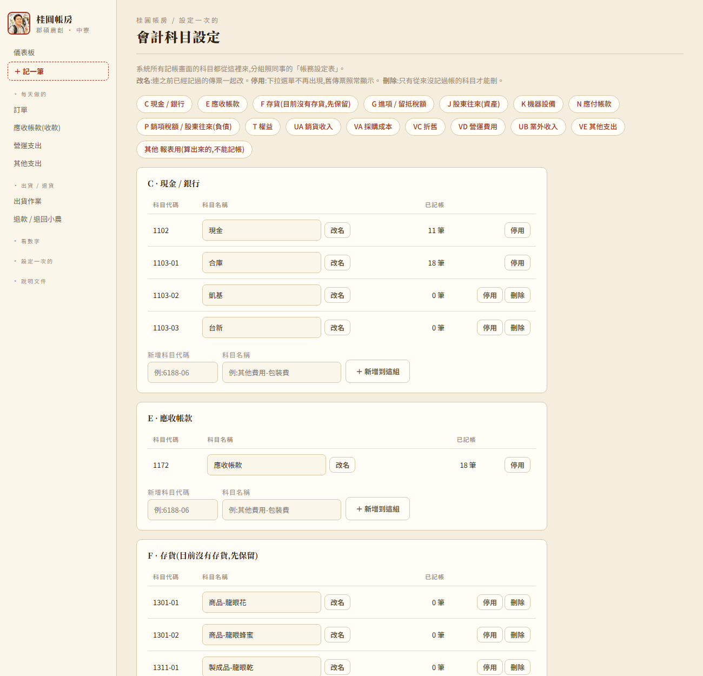

### 0921-2 傳票號碼 GL + 年月日 + 流水號

> **同仁原文**:總帳傳票號碼統一以"GL"文字開頭,串當天年月日,例如GL20260921001,共13碼(不需要拆分不同字母開頭的編號)

**解法**:所有來源(訂單、費用、設備、調整…)共用同一組編號:`GL` + 傳票日期 8 碼 + 當天流水號 3 碼。
原本依來源分 P/E/S… 開頭的編號拿掉。

**佐證**:版本 `50d123b`。「看數字 → 總帳」第一欄(紅框)。

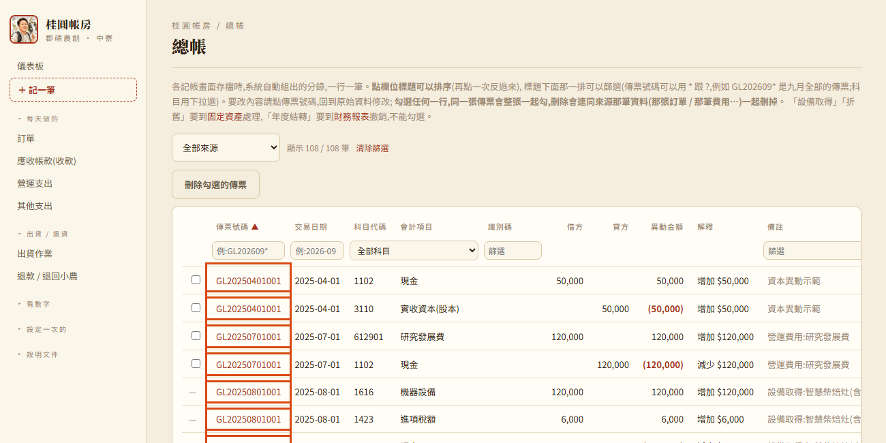

### 0921-3 多模組共用欄位只填一次

> **同仁原文**:假設一個葉面需要多個下拉選單模組(例如費用需要VD、C、G),那這些模組除金額以外的共用欄位只需要給使用者填寫一次就好,其他兩個模組自動代入同欄位

**解法**:營運支出、其他支出、其他收益、資本異動都改成一頁:最上面一塊放共用欄位(**日期、備註**,只填一次),
下面每個模組一個區塊,只放各自的欄位。

**佐證**:版本 `9d232b6`。「每天做的 → 營運支出 → ＋ 新增一筆」,紅框是共用欄位。

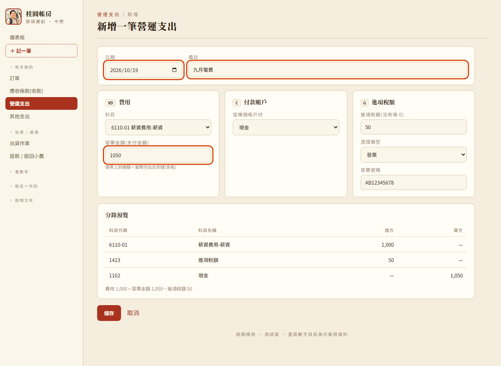

### 0921-4 發票類型 / 號碼放在 G 或 P 模組

> **同仁原文**:假設同一個葉面已有G或P,發票類型與發票號碼就放在這個模組,其他模組簡化顯示

**解法**:營運支出 / 其他支出的「憑證類型、發票號碼」放在 **G 進項稅額**區塊;其他收益的放在 **P 銷項稅額**區塊。
其他區塊只剩科目跟金額 / 帳戶。憑證類型選「發票」時發票號碼必填。

**佐證**:版本 `9d232b6`。營運支出(G 區塊)、其他收益(P 區塊)新增畫面。

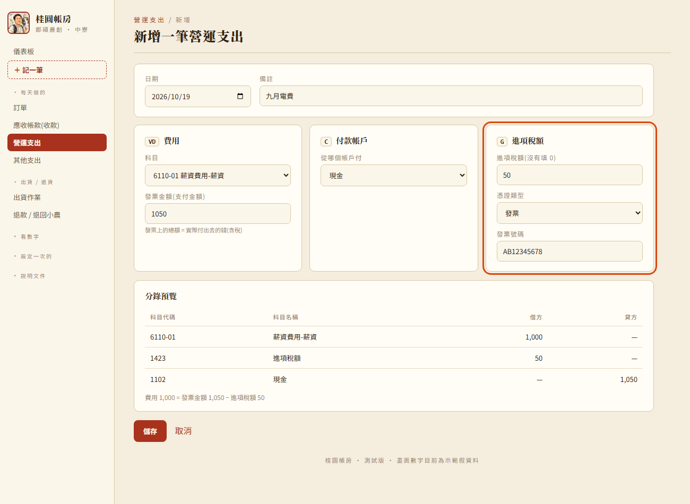
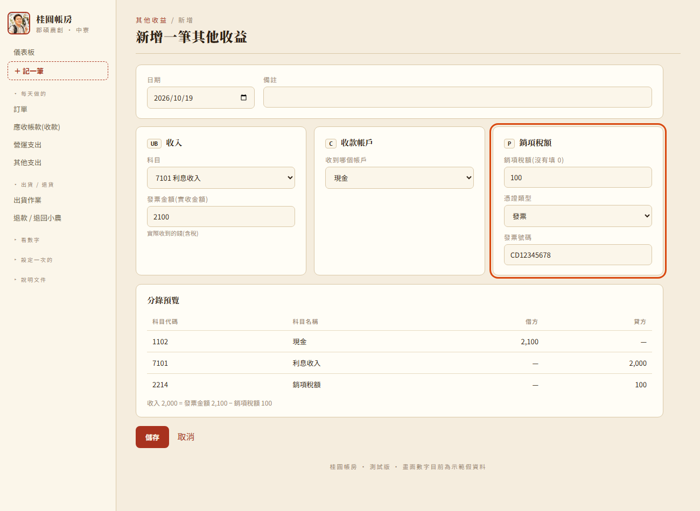

### 0921-5 交易類型照檔案順序

> **同仁原文**:交易類型9種的排列順序請依照檔案的順序

**解法**:「記一筆」頁的卡片照 1015 版帳務設定表的交易類型順序:銷售商品、營運支出、其他收益、其他支出、
設備相關、資本異動、帳務調整。1015 版裡的「進口商品」後來依使用者決定併進訂單(接單當天就付小農,見 0921-8),
所以現在是 7 張。

**佐證**:版本 `6eb3afe`(順序)、`fd6bb68`(拿掉進口商品)。左側「＋ 記一筆」。

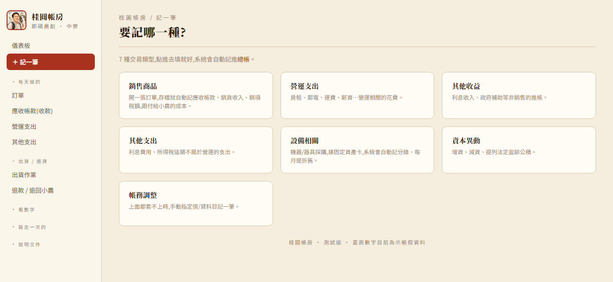

### 0921-6 銷售收款用 C / E 下拉,刪收款狀態

> **同仁原文**:/1銷售/ 銷售時的收款方式應該給他C和E模組的下拉選單,然後刪除收款狀態欄位,實收金額改成"發票金額(實收金額)"

**解法**:
- 新增訂單**拿掉「付款方式」「收款狀態」**,換成一個「收款」下拉:**E 應收帳款(還沒收,之後再收)**,
  或 **C 當場收到:現金 / 合庫 / 凱基 / 台新**。訂單明細頁的收款帳戶下拉也一樣有 E、C。
- 收款狀態改由系統自己判斷(選 E = 待收款、選 C = 已收款、贈送樣品 = 免收款),不讓人選。
- 「實收金額」欄位**整個拿掉**:使用者決定收款一定一次收齊,金額就是訂單的應收合計(含稅),
  不用再另外填,所以沒有需要改名的欄位。

**佐證**:版本 `8bd8d92`。「訂單 → ＋ 新增訂單」,下方「收款 / 發票」區塊(紅框把下拉展開來看)。

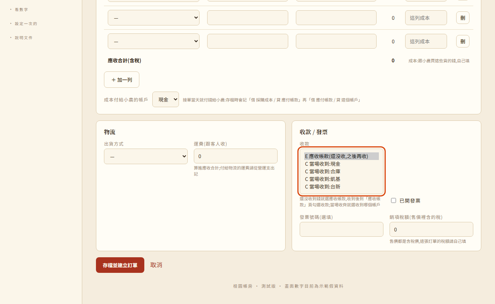

### 0921-7 銷售少了 P 銷項稅額

> **同仁原文**:少了P模組的銷項稅額區

**解法**:訂單新增「銷項稅額」欄位(售價含稅,家易自己填,系統不算),放在「收款 / 發票」區塊。
存檔時總帳記「貸 2214 銷項稅額」,收入扣掉這個稅額。

**佐證**:版本 `3ad78d7`。新增訂單畫面紅框;總帳裡訂單的傳票會有一行 `2214 銷項稅額`(見 1001-6 的截圖)。

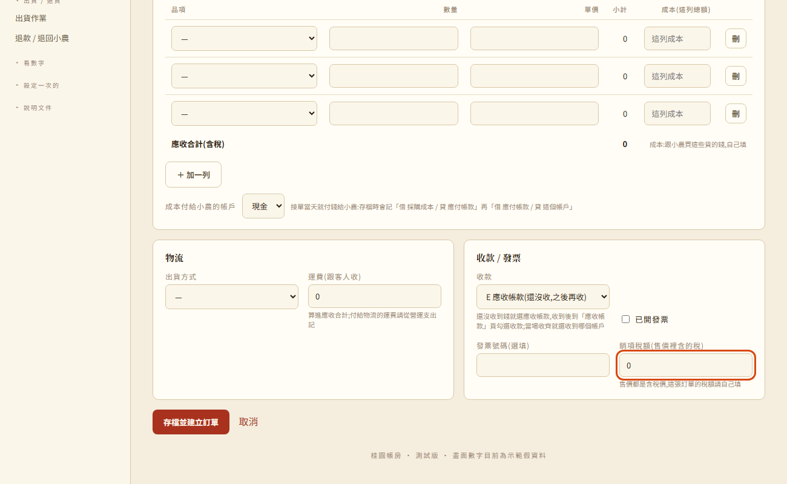

### 0921-8 進貨帳戶用 C 下拉,不可打字

> **同仁原文**:進貨的帳戶選擇也要套用C模組下拉清單,不可讓使用者輸入文字

**解法**:使用者決定郡碩是貿易公司、沒有存貨、**接單當天就付錢給小農**,所以「進貨 / 進口商品」頁拿掉,
付小農的錢在訂單上選「**成本付給小農的帳戶**」,是 C 組下拉選單,不能打字。
其他所有付款 / 收款帳戶(費用、收益、設備、資本、退款)也都改成 C 組下拉。

**佐證**:版本 `fd6bb68`(訂單)、`6cf1497`(其他畫面)。新增訂單畫面紅框(下拉展開)。

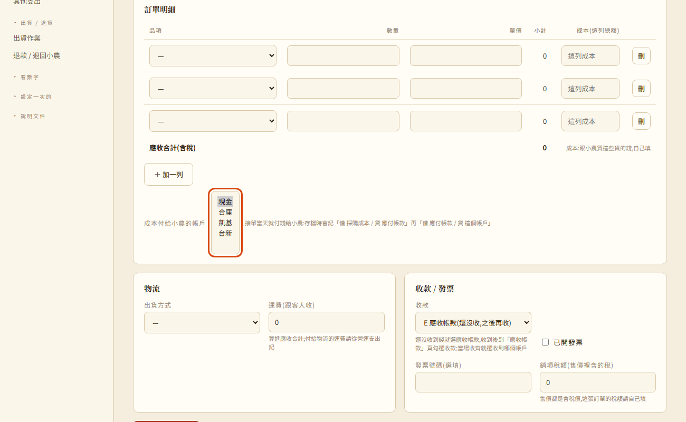

### 0921-9 費用沒有攤提,只套 VD、C、G

> **同仁原文**:/3費用/ 沒有甚麼叫做攤提月數的東西,費用要套的模組只有VD、C、G

**解法**:「攤提月數」欄位拿掉;營運支出畫面只有 **VD 費用、C 付款帳戶、G 進項稅額**三個區塊(紅框是模組標籤)。
原本存檔前的「確認分錄」頁也拿掉,改成同一頁下方即時顯示分錄。

**佐證**:版本 `9d232b6`。
(拿掉攤提後,一次性大支出整筆算在付款那個月;同仁 2026-10-20 回覆確認:依法規不論金額大小都在當月全額認列。)

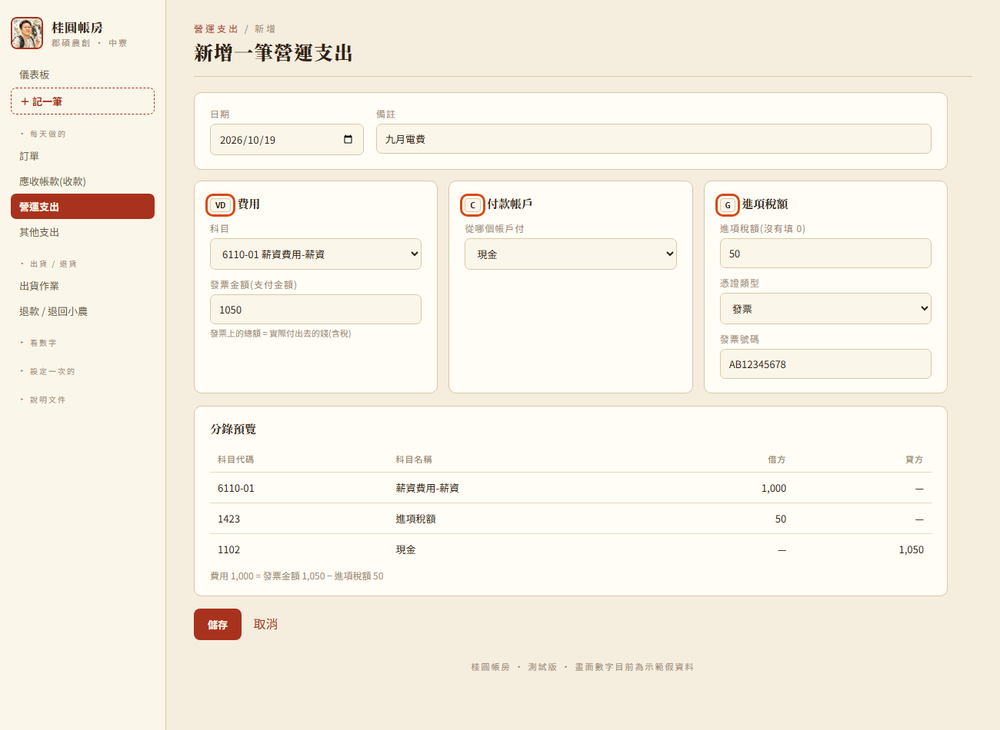

### 0921-10 費用:日期、項目下拉、發票金額、發票欄位

> **同仁原文**:日期就是日期、項目是下拉選單、金額改成發票金額(支付金額)、缺少發票欄位

**解法**:
- 「月份」改成**日期**,總帳傳票日期就是這一天。
- 項目是 **VD 科目下拉選單**(截圖把下拉展開)。
- 金額改名「**發票金額(支付金額)**」= 含稅實付;系統自動算「費用 = 發票金額 − 進項稅額」。
- 補上**憑證類型、發票號碼**(在 G 區塊)。

**佐證**:版本 `9d232b6`。紅框:日期、科目下拉、發票金額、發票號碼。

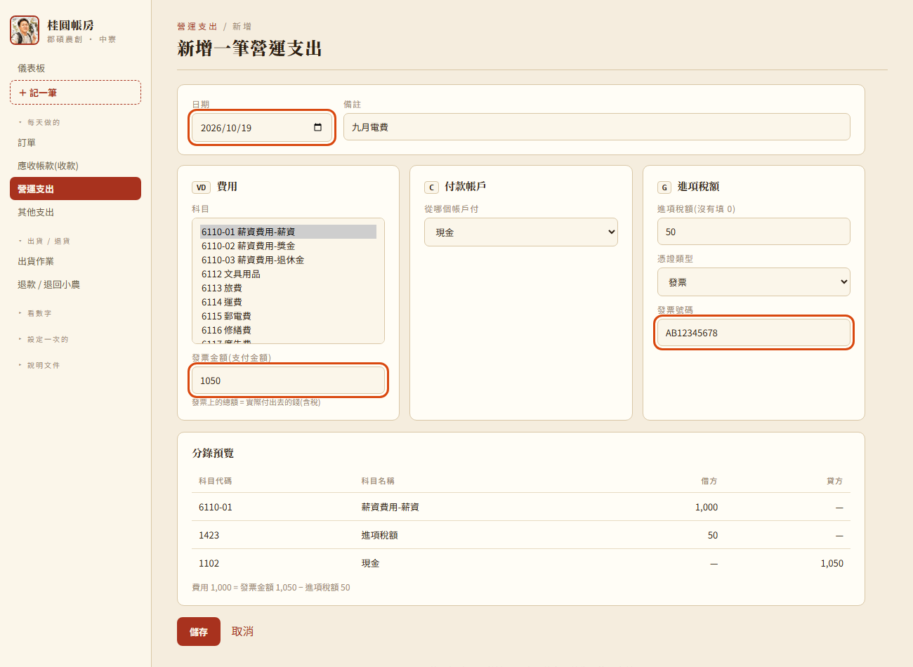

### 0921-11 業外收益分 UB、C、P

> **同仁原文**:/6業外收益/ 包含UB、C、P模組,分開來

**解法**:其他收益畫面分成 **UB 收入、C 收款帳戶、P 銷項稅額**三個區塊。

**佐證**:版本 `9d232b6`。「＋ 記一筆 → 其他收益」。

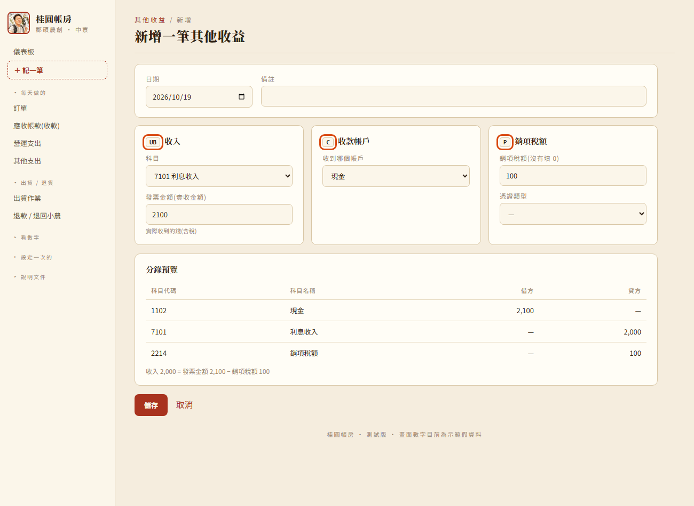

### 0921-12 業外支出改名其他支出、獨立功能

> **同仁原文**:/7業外支出/ 改名為其他支出,獨立功能,不可以併入營運費用,放進VE、C、G

**解法**:「其他支出」有**自己的清單頁、新增頁、左側選單入口**,畫面是 **VE、C、G** 三個區塊;
不會出現在營運支出清單,財務健康的營運費用也不算它。

**佐證**:版本 `9d232b6`。左側「每天做的 → 其他支出」。

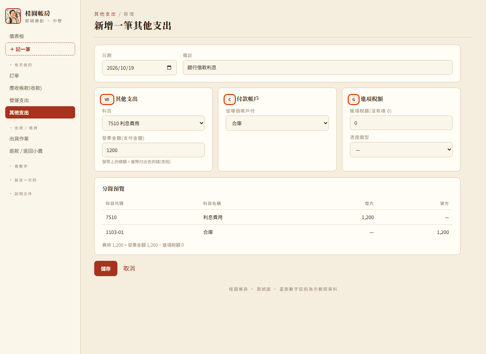
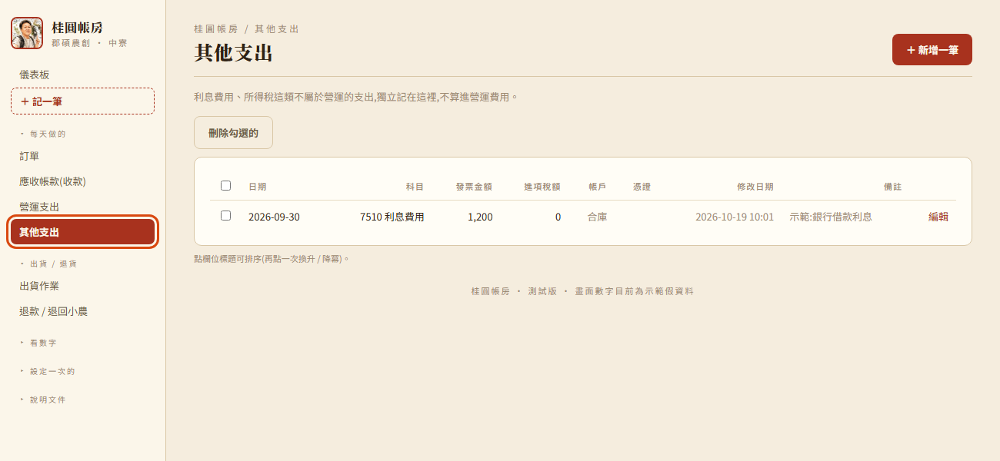

### 0921-13 資本:先選增減資或提列法定盈餘公積

> **同仁原文**:/8資本/ 進入畫面後先選要增減資或提列法定盈餘公積,前者給C、T,後者給T、T

**解法**:進畫面先選「要做什麼」:
- **增資 / 減資** → 顯示 **C 現金 / 銀行** + **T 權益**(選增加或減少、選科目)。
- **提列法定盈餘公積** → 顯示 **T 從哪裡提** + **T 轉入**,兩個不能同一科目。

**佐證**:版本 `e0cfa20`。「＋ 記一筆 → 資本異動」,兩種選法各一張。

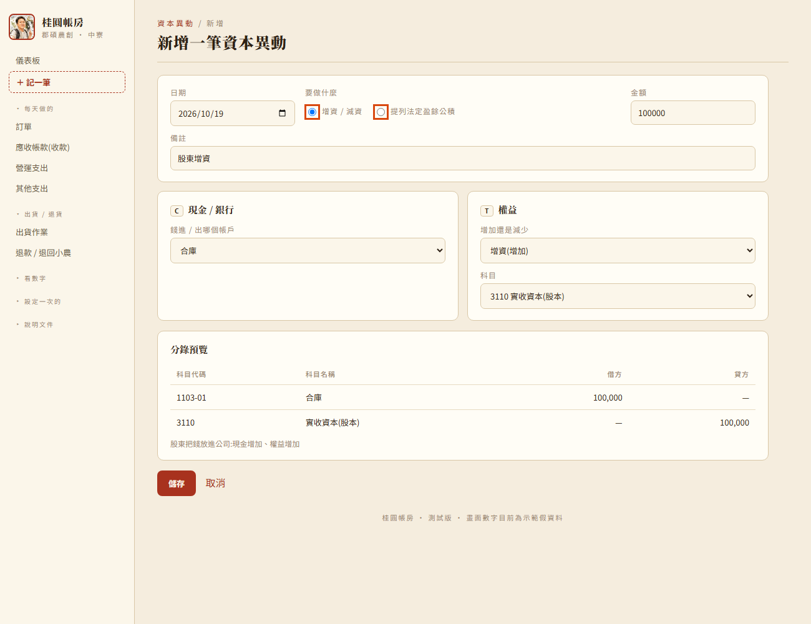
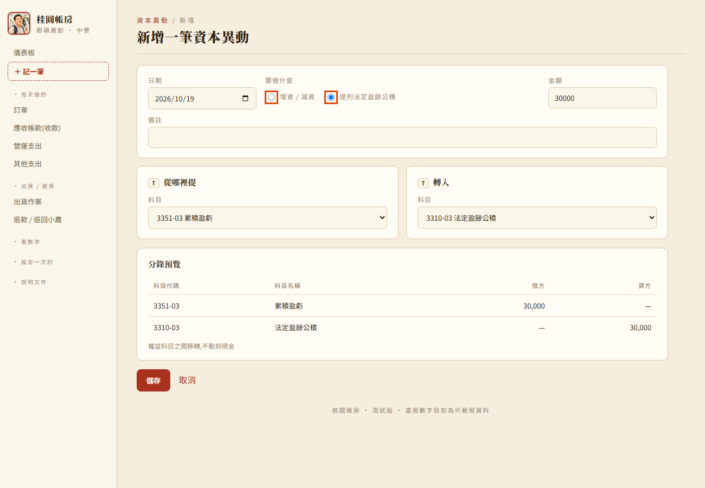

### 0921-14 其他(帳務調整):先選幾項

> **2026-10-20 更新**:依 1019 問題清單,帳務調整改回「預設 3 列,每列可刪、下面可加,不限幾列」,見 1019-8。

> **同仁原文**:/9其他/ 進入畫面後再最上方選取要調整幾項科目(默認2,最多3),依據選取的數額再下方呈現對應數量的空白模組區塊。區域內必須先點下拉選單選模組,然後給予使用者該模組的填寫欄位

**解法**:最上方「**要調整幾項科目**」下拉(2 項 / 3 項,**預設 2**),下面顯示對應數量的區塊;
每個區塊**先選模組**,科目下拉才會出現該模組的科目,再填借 / 貸、金額。借貸不平衡不能存,畫面會顯示差多少。

**佐證**:版本 `e0cfa20`(多行)、`d5cba27`(2026-10-19 做這份報告時發現原本是「預設 3 行、可無限加」,
改成照原文的「預設 2、最多 3」)。

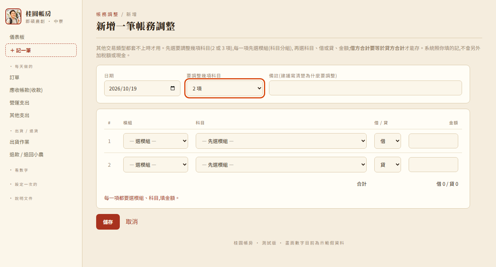
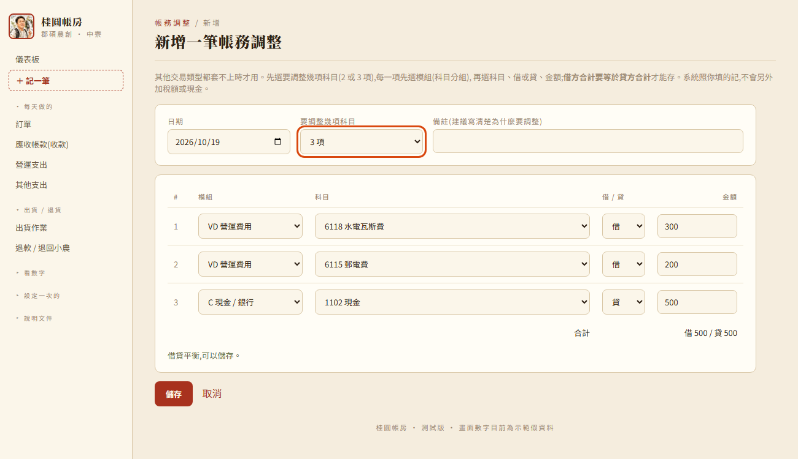

### 0921-15 沒有折讓;三種退貨情況

> **同仁原文**:我們建立的系統沒有折讓的問題。若退貨退款,屬於刪單,直接到銷售明細刪除訂單(系統要自動刪除總帳明細)。若不退貨退款,無論退多少都是其他支出。若退貨不退款,退到小農。

**解法**:
- 銷貨退回 / 折讓功能整個拿掉。
- **退貨又退款** → 訂單頁「刪除訂單」(或訂單清單勾選刪除),總帳傳票自動一起刪。
- **只退款不退貨** → 訂單頁「退款 / 退回小農」選「退款」,不管多少都記其他支出。
  1015 版科目表沒有「其他支出」這個費用科目,原本暫記 `6188-99`;同仁 2026-10-20 回覆改記新科目 **`5111-2150-03 原料報廢損失`**,已改好。
- **退貨不退款** → 選「退回小農」,小農退回的錢記「借 現金 / 貸 採購成本」。

**佐證**:版本 `3ad78d7`(三種情況)、`fd6bb68`(退回小農分錄)。訂單明細最下方、左側「退款 / 退回小農」。

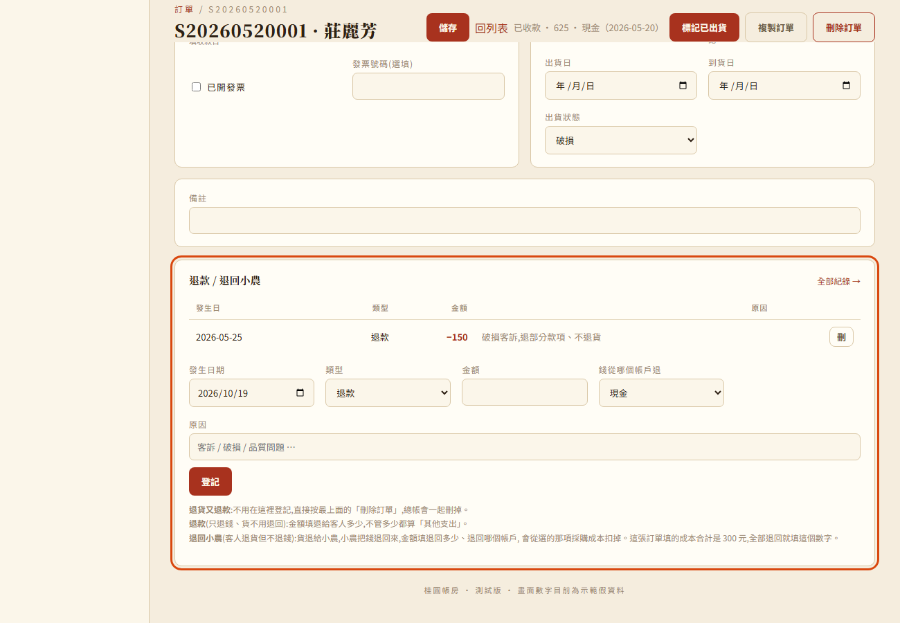
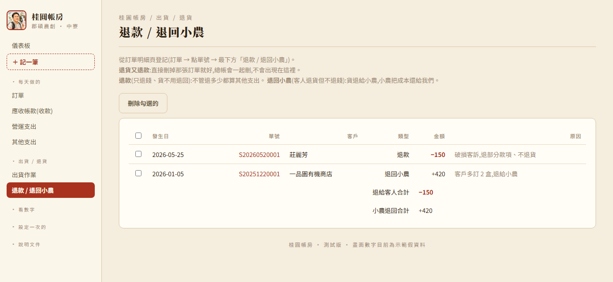

### 0921-16 總帳:改名、照規格、排序

> **同仁原文**:總帳明細改名"總帳",且檔案內有指定規格不能改。排列方式默認按傳票號碼小到大,標題處要可以點擊,點擊後改為依照該欄位排序,再點一次為反向。

**解法**:頁面叫「總帳」,照 1015 版「總帳」工作表改成**一行一筆分錄**的大表格(傳票號碼、交易日期、科目代碼、
會計項目、識別碼、借方、貸方、異動金額、解釋、備註)。預設依傳票號碼由小到大;點標題依那欄排,再點一次反過來。

**佐證**:版本 `ea773b7`(改名、預設排序)、`0a2182b`(新格式、點標題排序)。截圖是「借方」點兩下,變成由大到小(▼)。

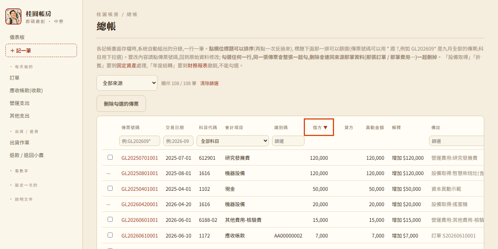

### 0921-17 刪除傳票要整筆

> **同仁原文**:若傳票要刪除或編輯,必須先篩選指定日期的指定傳票才能一次刪除整筆傳票。

**解法**:10/08 先照原文做成「選日期 + 傳票號碼篩出一張才能刪」(`6efd20d`)。10/16 照 1015 版「總帳」工作表的說明
改成**勾選刪除**:勾任何一行,**同一張傳票整張一起勾**,不能只刪其中一行;刪除會連同來源資料(那張訂單 / 那筆費用)
一起刪。要編輯就點傳票號碼,回到原始資料修改。10/17 使用者確認各清單(訂單、營運支出、其他支出、其他收益、
資本異動、帳務調整、退款)也比照用勾選刪除。

**佐證**:版本 `0a2182b`(總帳)、`8bd8d92`(各清單)。截圖:勾一行,同一張傳票兩行都被勾(紅框)。

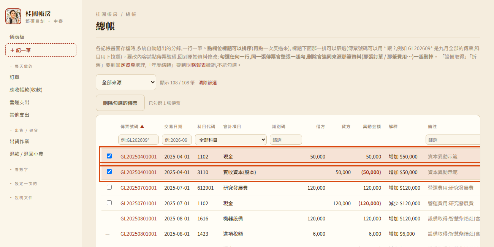
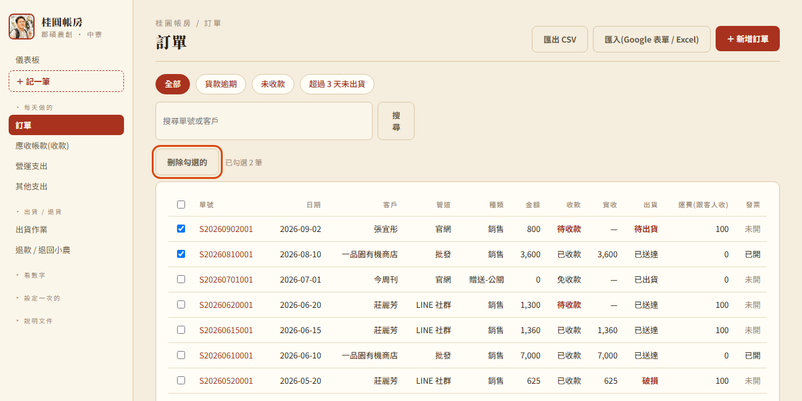

### 0921-18 篩選的科目用下拉

> **同仁原文**:篩選的科目也要是下拉選單

**解法**:總帳標題下的科目篩選是下拉選單(代碼 + 名稱),選了只顯示那個科目,下面合計跟著變。

**佐證**:版本 `6eb3afe`。截圖選 `1172 應收帳款`。

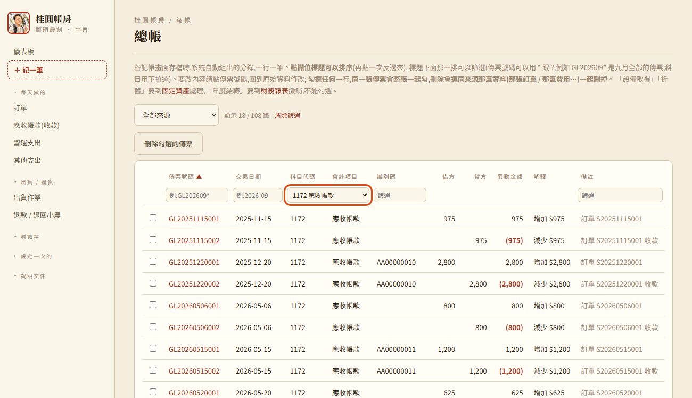

### 0921-19 傳票號碼篩選可用 * 和 ?

> **同仁原文**:篩選框要多一個輸入傳票號碼的地方。可以使用萬用字元"*"和"?"。例如搜尋GL202609*會出現所有九月傳票。

**解法**:總帳「傳票號碼」欄下有篩選框,`*` = 任意多個字、`?` = 一個字。

**佐證**:版本 `6eb3afe`。截圖輸入 `GL202609*`,只剩九月的傳票(上方顯示「顯示 11 / 108 筆」)。

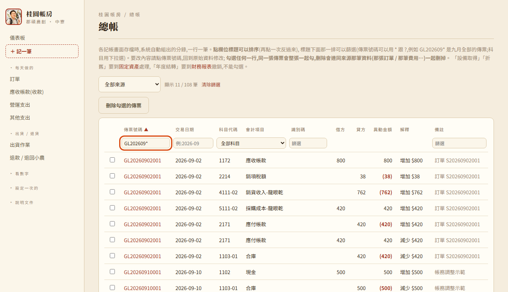

### 0921-20 新增「財務報表」,可選報表類型

> **2026-10-20 更新**:依 1019 問題清單,總帳跟試算表合併成一頁,**資產負債表、綜合損益表拿掉**,見 1019-7。

> **同仁原文**:新增一頁叫做財務報表。上方可以選擇報表類型(默認是試算表)。檔案內有規格

**解法**:「看數字 → **財務報表**」,上方「報表類型」可選試算表 / 資產負債表 / 綜合損益表,**預設試算表**。
綜合損益表照檔案規格分段小計(營業收入 − 營業成本 = 營業毛利;營業毛利 − 營業費用 + 業外收入 − 業外支出 = 本期損益)。

**佐證**:版本 `6eb3afe`(改名、報表類型)、`f3f8a91`(分段小計)。

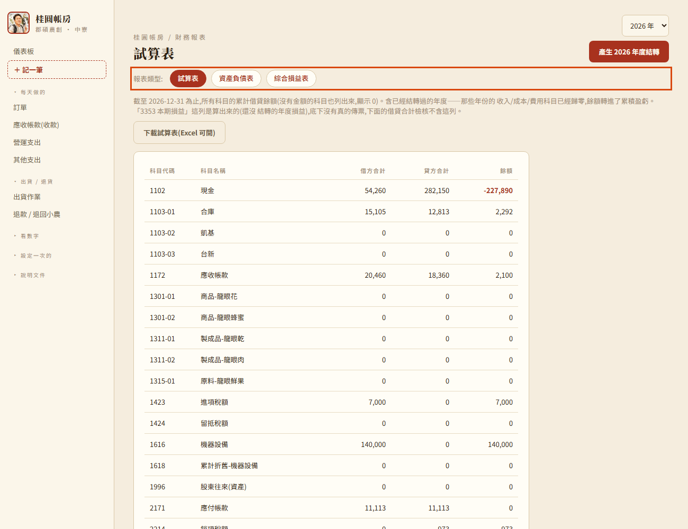

### 0921-21 財務報表數字直接取自總帳

> **同仁原文**:財務報表數字來源直接取自總帳,隨時更新

**解法**:三張表都是每次打開時直接從總帳加總,沒有另外存一份數字;任何記帳畫面存檔或刪除後,重新整理就是最新的。

**佐證**:版本 `0c9f527`(2026-10-01 建立三表時就是直接從總帳算)。自己驗:記一筆營運支出 → 打開綜合損益表,對應的營業費用科目金額會增加
(2026-10-19 實測:記一筆 6115 郵電費 2,000,損益表 6115 馬上跟著變)。

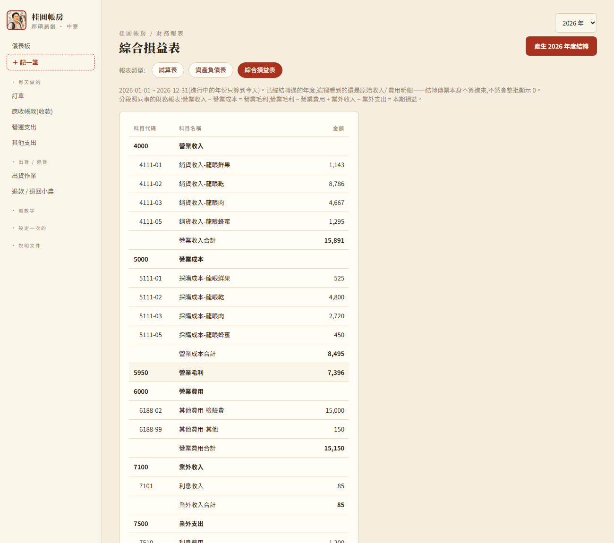

### 0921-22 3 開頭科目的特殊算法 ◐

> **2026-10-20 更新**:依 1019 問題清單,「3353 本期損益」改成當年 4~7 開頭淨額、隨時跟著變,見 1019-5。

> **同仁原文**:3開頭科目計算較特殊,再檔案內

**已做**:
- `3353 本期損益` 是**算出來的**(所有還沒結轉年度的損益),在試算表、資產負債表顯示,不能拿來記帳。
- 財務報表右上「產生 OOOO 年度結轉」:把那一年的收入、成本、費用歸零,淨額轉進 `3351-03 累積盈虧`。

**沒做(使用者 2026-10-17 決定先不做)**:檔案的「今年 3351-03 = 去年 3351-03 + 去年 3353」**不用按按鈕、系統自動滾**。
目前要在年度結束後按一次「產生年度結轉」。

**佐證**:版本 `7236b6b`(本期損益列)、`0c9f527`(年度結轉)。資產負債表紅框是 3353 本期損益。
2026-10-19 實測按「產生 2025 年度結轉」:2025 年 4~7 開頭科目全部歸零,淨額轉進 `3351-03`。

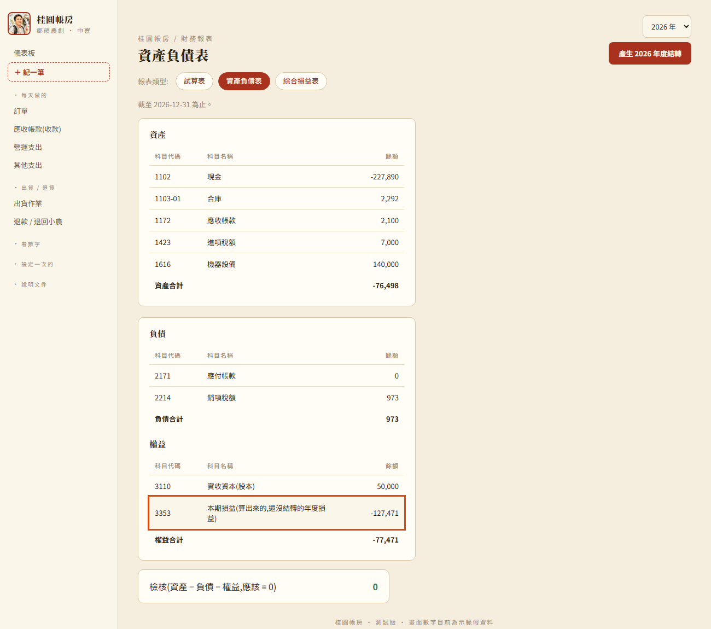

### 0921-23 銀行明細、存貨管理 ◐

> **同仁原文**:<銀行明細、存貨管理較不重要,等有時間再看看>

**已做**:「看數字 → 銀行帳戶明細」可以看現金 / 各銀行帳戶逐筆進出跟累計餘額;另外新增「科目明細」,任何科目都能這樣看。

**沒做**:存貨管理。使用者 2026-10-08 確認郡碩是貿易公司、**沒有存貨**,存貨科目(F 組)保留但沒有存貨功能。

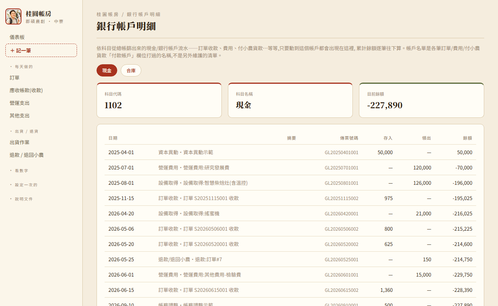

---

## 1001(2026-10-01)

### 1001-1 設備年限最少 10 年,防呆

> **同仁原文**:設備年限>最低至少要預設10年、可以同步給他防呆,禁止設定低於10年的數字

**解法**:使用年限用「月」填(1015 版規格),**預設 120 個月,低於 120 存不進去**(畫面跟伺服器都擋),會顯示紅色提示。

**佐證**:版本 `46c09cd`(10 年防呆)、`6cf1497`(改用月)。截圖填 100 個月被擋。

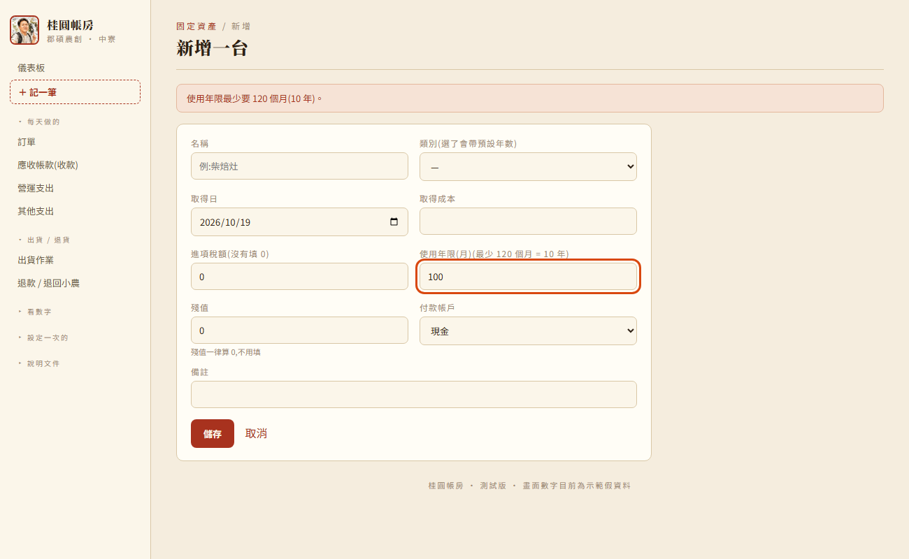

### 1001-2 殘值 0、付款帳戶可以選

> **同仁原文**:設備殘值默認=0,不可以有數值。付款帳戶應該要可以選擇

**解法**:殘值固定顯示 0、**不能改**;付款帳戶是 C 組下拉選單(現金 / 合庫 / 凱基 / 台新)。

**佐證**:版本 `46c09cd`、`6cf1497`。紅框:殘值(灰色不能填)、付款帳戶(下拉展開)。

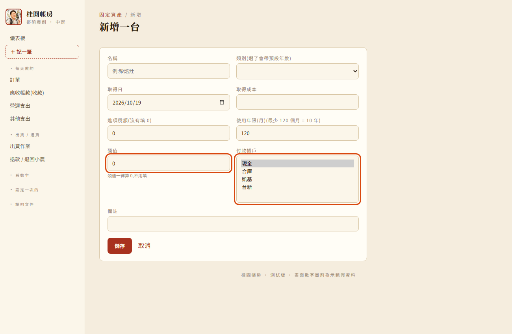

### 1001-3 總帳加「異動金額」「解釋」欄

> **同仁原文**:總帳後面多"異動金額"欄位和類似解釋文字的欄位。異動金額=借方-貸方。解釋文字欄位就是依據科目方向,以中文說明科目的變化,例如現金DR$10,就說明"增加$10"。收入CR$5,就說明"增加$5"

**解法**:
- **異動金額** = 借方 − 貸方(負數用括號、紅字)。
- **解釋** = 依科目方向寫「增加 $x」或「減少 $x」:資產 / 成本 / 費用借方是增加;負債 / 權益 / 收入貸方是增加。

**佐證**:版本 `0a2182b`(異動金額)、`6eb3afe`(解釋)。截圖第二行 `3110 實收資本` 貸 50,000 → 解釋「增加 $50,000」。

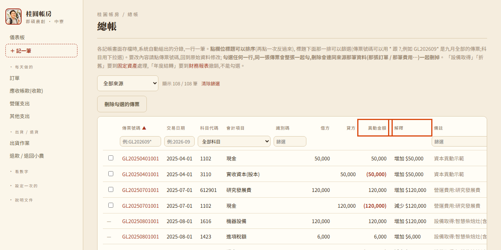

### 1001-4 試算表列出所有科目、可下載

> **同仁原文**:試算表:所有科目均應列出,無論是否為0,且要可下載

**解法**:試算表列出會計科目表**全部科目**(沒有金額的顯示 0;`5950 營業毛利`是損益表的小計、不是記帳科目,不列在試算表);
上方「下載試算表(Excel 可開)」,下載的檔案 Excel 打得開、中文不亂碼。

**佐證**:版本 `75a5859`(列全部、下載)、`442482b`(科目改照 1015 版)。紅框是下載按鈕。

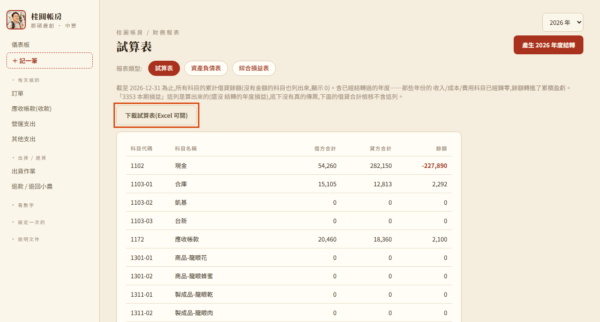

### 1001-5 財務報表欄寬

> **同仁原文**:財務報表的欄位寬度要調整一下,使之足夠寬就好

**解法**:三張表改成固定欄寬(科目代碼 / 科目名稱 / 金額),視窗拉大不會被撐開。

**佐證**:版本 `70fec78`。

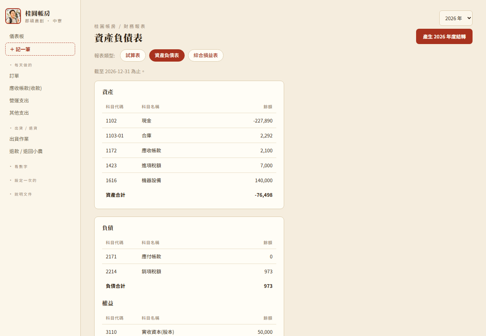

### 1001-6 訂單成本移轉價、連動分錄 ◐

> **2026-10-20 更新**:依 1019 問題清單,成本的對方科目一律記應付帳款,付小農改到「應付帳款(付小農)」頁,見 1019-1。

> **同仁原文**:訂單新增時,要有成本移轉價可以填,然後連動的直接產生存貨分錄

**已做**:
- 訂單每一列多一欄「**成本(這列總額)**」,家易自己填;再選「成本付給小農的帳戶」。
- 存檔時連動產生分錄,照「郡碩農創_會計場景對應分錄表_1015.xlsx」〈會計場景對應分錄-公司(調整後)〉:
  **借 5111-0x 採購成本 / 貸 2171 應付帳款**,接著(接單當天就付小農)**借 2171 / 貸 現金或銀行**。

**跟原文不同的地方**:
- 使用者確認郡碩**沒有存貨**,所以不產生「存貨」分錄,成本直接進採購成本(依產品線拆 5111-01~05)。
- 欄位名稱維持「成本」,**沒有改叫「成本移轉價」**(使用者 2026-10-17 決定先不改)。

**佐證**:版本 `6c1423a`(每列成本)、`fd6bb68`(當天付小農)。訂單明細紅框;總帳篩這張訂單的傳票,紅框是成本那三行。

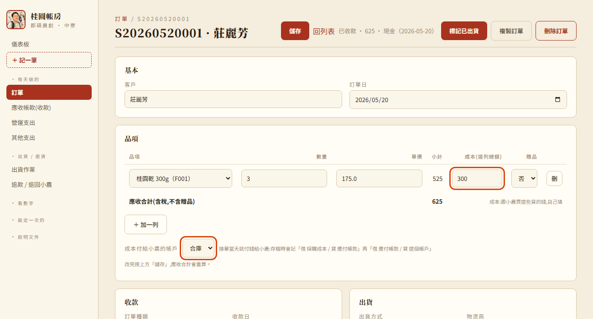
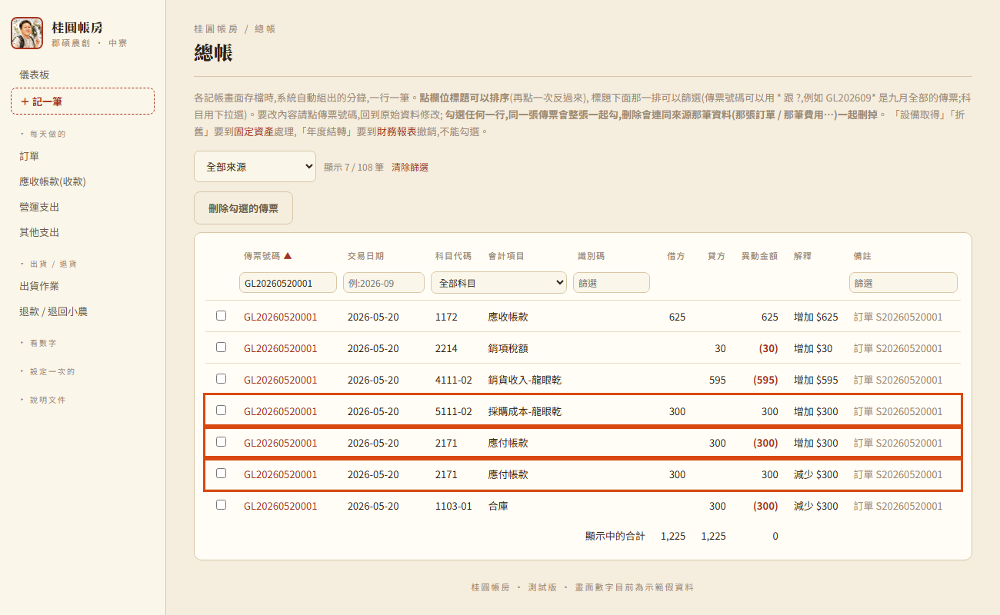

### 1001-7 傳票頁面科目代碼、名稱分開

> **同仁原文**:傳票頁面,科目代碼和科目名稱要分開

**解法**:總帳、財務報表、科目明細、銀行帳戶明細、各畫面的分錄預覽,科目代碼跟科目名稱都是兩欄。

**佐證**:版本 `7f85451`、`0a2182b`。紅框:科目代碼、會計項目兩欄。

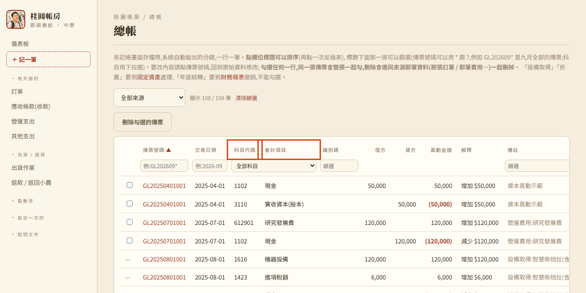

---

## 1019(2026-10-19 同仁問題清單)

| 序號 | 問題(簡述) | 狀態 | 版本 |
|---|---|---|---|
| 1 | 認列成本時對象不能是現金,要記應付帳款,並新增應付帳款頁 | ✅ | `573f16d` |
| 2 | 試算表要有期初 / 期末餘額(如左頁表格格式) | ◐ | `4db7405` |
| 3 | 試算表科目方向:負債是負數,以此類推 | ✅ | `4db7405` |
| 4 | 營運支出改備註後,總帳沒跟著改 | ✅ | `c1ad26e` |
| 5 | 試算表「本期損益」要隨時變化,但不計入驗算 | ✅ | `4db7405` |
| 6 | 已結轉的年度不能再從任何頁面輸入交易 | ✅ | `573f16d` |
| 7 | 總帳要能下載;總帳跟試算表合併一頁,刪除資產負債表 / 綜合損益表 | ✅ | `4db7405` |
| 8 | 帳務調整不限 2 或 3 項:預設 3 列,每列可刪、下方可增 | ✅ | `c1ad26e` |
| 9 | 財務報表預設年度 = 當下的年度 | ✅ | `c1ad26e` |
| 10 | 營運支出 / 其他支出頁面應該可隱藏,資訊有點太細? | 未做 | — |
| 11 | 全鏈路毛利刪掉 | ✅ | `c1ad26e` |
| 12 | 結帳時進項 / 銷項互抵,做出留抵稅額或應付稅捐 | ✅ | `5541c30` |
| 13 | 財務健康還沒抓總帳數字 | ✅ | `573f16d` |

11 條完成;第 2 條欄位先用一般會計格式(同仁說的「左頁」那張表還沒拿到);第 10 條使用者決定先記下、不做。

這 13 條是用測試程式在全新示範資料上送真的存檔 / 刪除請求、再查資料庫的分錄逐項驗證(共 70 多項檢查),另外拿舊資料庫的複本測「舊訂單自動轉換」(每個科目餘額轉換前後完全一樣),再截圖確認畫面。

### 1019-1 成本記應付帳款,新增應付帳款頁

> **同仁原文**:認列成本時,對象科目不能直接是現金,應該是應付帳款,並新增應付帳款頁面(與應收款同頁)

**解法**:
- 開訂單時成本只記「借 採購成本 / 貸 **應付帳款**」;訂單畫面拿掉「成本付給小農的帳戶」。
- 新增左側「**應付帳款(付小農)**」頁,版面比照應收帳款:上面是還沒付的訂單(成本 / 已付 / 退回小農 / 未付),
  勾選、按「付款」選帳戶跟日期 → 記「借 應付帳款 / 貸 現金或銀行」;下面是付款紀錄,可勾選刪除。
- 退回小農:還沒付小農 → 直接少欠(借 應付帳款);已付過 → 小農退錢回帳戶。
- **舊資料**(10/16~10/19 用「接單當天付」記的訂單)開機時自動拆成「訂單 + 一筆付小農紀錄」,
  實測每個科目餘額轉換前後完全一樣。

**佐證**:版本 `573f16d`。

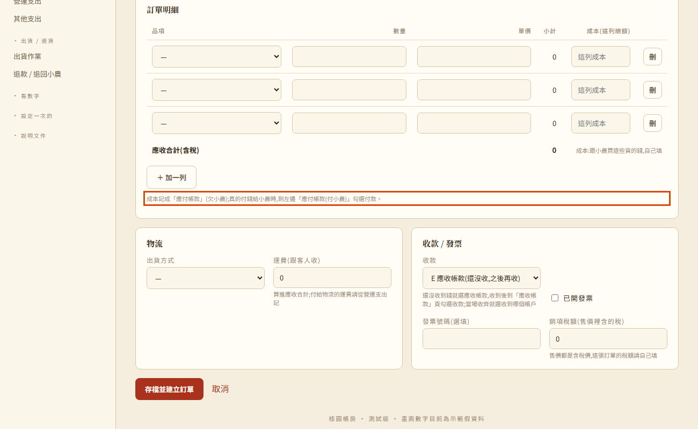
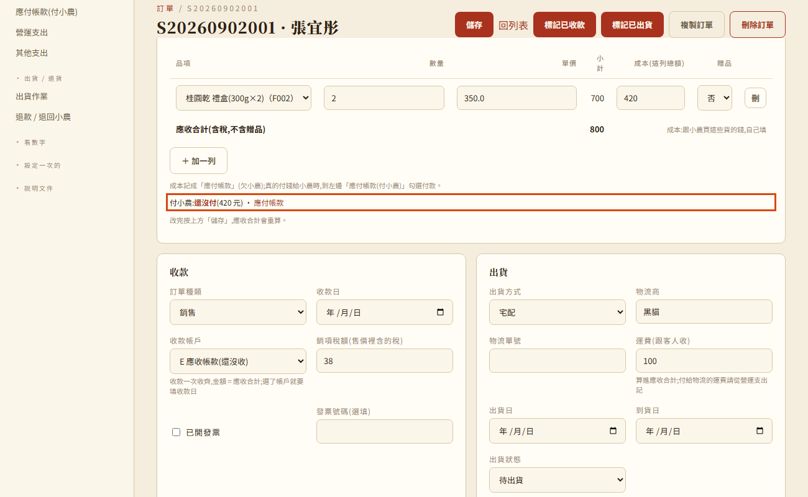
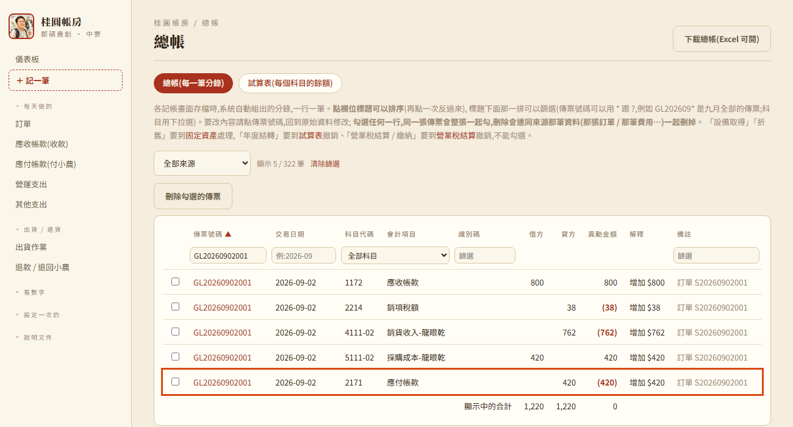
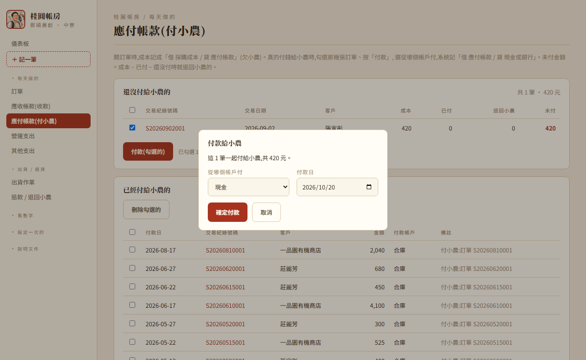

### 1019-2 試算表期初 / 期末 ◐

> **同仁原文**:試算表要有期初期末餘額(如左頁表格格式)

**解法**:試算表改成每個科目一列:**期初餘額**(前一年底為止)、**本期借方**、**本期貸方**、**期末餘額** = 期初 + 借 − 貸。
2026 年的期初 = 2025 年的期末(實測一致)。

**還沒完全照原文的地方**:原文說「如左頁表格格式」,專案資料夾裡的 Excel 沒有這張表,
目前先用一般會計的排法;拿到那張表再照它調欄位。

**佐證**:版本 `4db7405`。

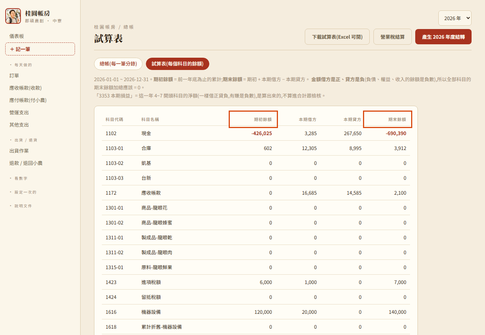

### 1019-3 試算表科目方向

> **同仁原文**:試算表科目方向錯誤,負債應該是負數,以此類推。

**解法**:試算表金額一律**借方是正、貸方是負**:負債、權益、收入的餘額是負數,資產、成本、費用是正數。
全部科目期末加總 = 0 就是檢核(實測 2025、2026 都是 0)。

**佐證**:版本 `4db7405`。紅框:應付帳款、銷項稅額、股本是負數;累積盈虧(累積虧損)是正數。

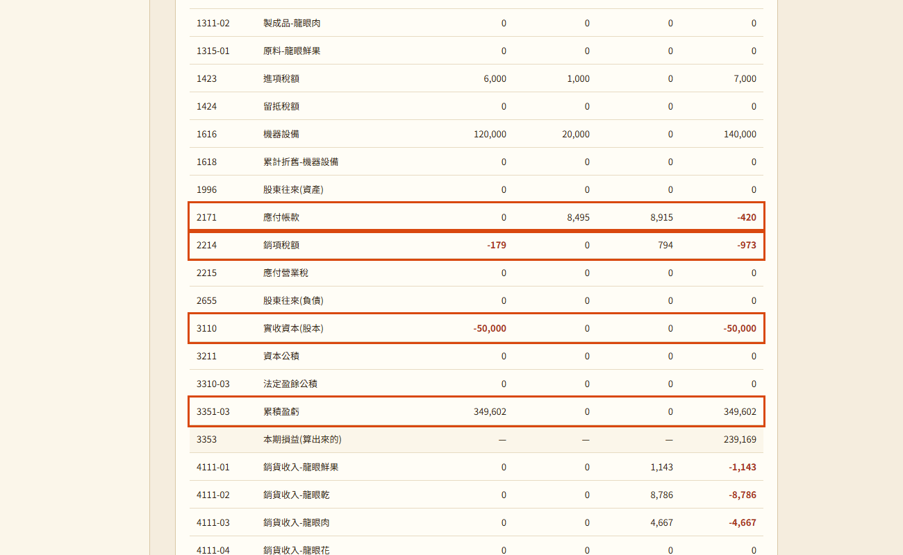

### 1019-4 營運支出改備註,總帳跟著改

> **同仁原文**:營運支出傳票修改備註之後,總帳並未跟隨修改。

**解法**:營運支出、其他支出、其他收益、資本異動存檔時,總帳備註帶入使用者填的備註(「營運支出:郵電費 郵票」),
改備註後總帳一起更新。

**佐證**:版本 `c1ad26e`。截圖:備註從「郵票」改成「郵票(改過的備註)」後,總帳那張傳票的備註。

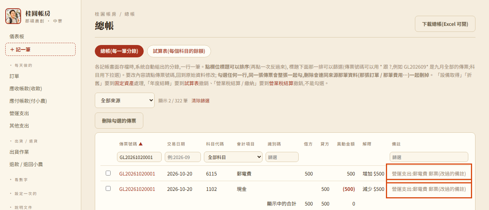

### 1019-5 本期損益隨時變化、不計入驗算

> **同仁原文**:試算表的"本期損益"科目金額應該要隨時變化,但不記入驗算或其他計算。

**解法**:原本「3353 本期損益」是「所有還沒結轉的年度」加總,結轉後就變 0。改成**當年 4~7 開頭科目的淨額**
(同事 Excel:4~7 開頭按規則加總 = 3353),每記一筆就跟著變;不含年度結轉傳票,所以結轉後也看得到當年損益;
不算進合計跟檢核。實測:2025 年結轉前後都是同一個數字,2026 年 = 4~7 加總。

**佐證**:版本 `4db7405`。

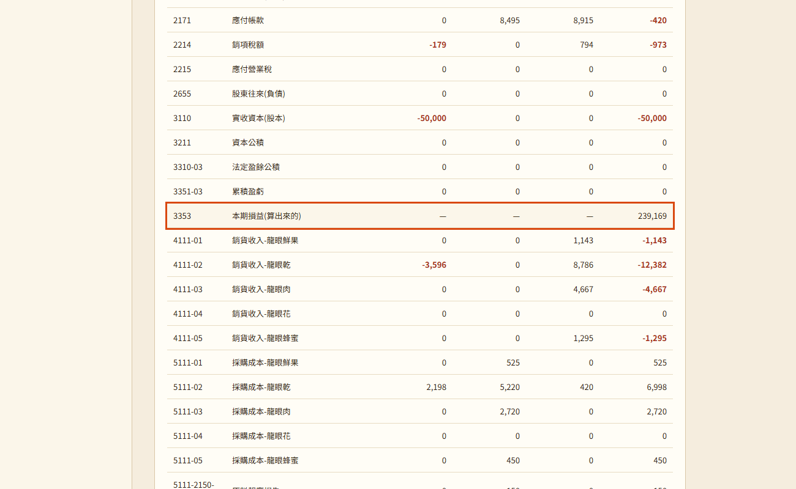

### 1019-6 已結轉年度不能再輸入交易

> **同仁原文**:已由系統產生結轉分錄的年度(以2026為例),不可以再接受從任何頁面輸入交易。(例如小日曆鎖住2026年度不給選、或系統偵測到是2026年就不可以"儲存分錄")

**解法**:兩種都做:
- **小日曆鎖住**:結轉過的年度,所有記帳畫面的日期都選不到那一年。
- **存檔擋下**:就算硬送出,系統偵測到日期在已結轉年度就不存,回上一頁顯示提示。修改、刪除那一年的舊資料也一樣擋
  (訂單、費用、收益、資本、調整、設備、退款、付小農、總帳 / 清單勾選刪除、營業稅結算)。
- 要改那一年的資料:先到試算表「撤銷結轉」。

**佐證**:版本 `573f16d`。實測:結轉 2025 後,新增 / 修改 / 刪除 2025 的費用、調整、訂單、營業稅結算都被擋,2026 照常可以記。

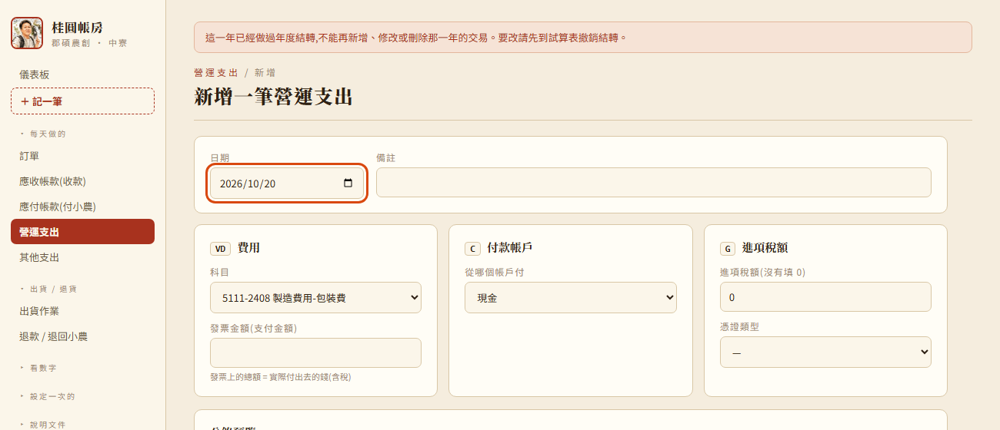
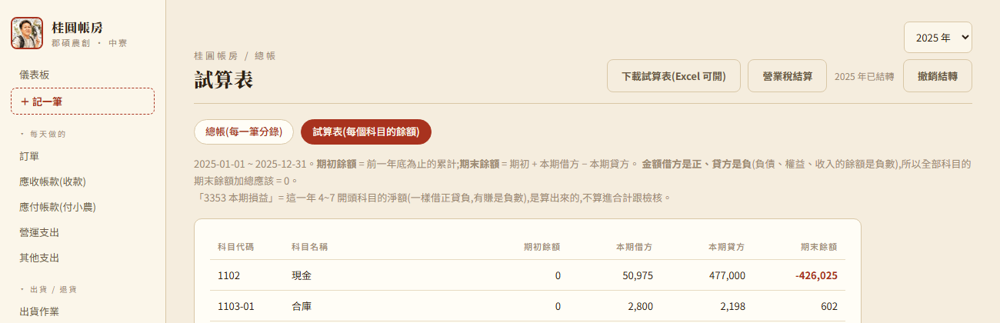

### 1019-7 總帳下載;總帳 + 試算表合併;拿掉兩張報表

> **同仁原文**:總帳也要能下載。總帳或許可跟試算表合併為一頁,並刪除資產負債表/綜合損益表。

**解法**:左側選單「**總帳 / 試算表**」一頁兩個分頁;總帳右上「下載總帳(Excel 可開)」、試算表右上「下載試算表」。
「財務報表」選單、資產負債表、綜合損益表拿掉(舊網址自動轉到試算表)。

**佐證**:版本 `4db7405`。

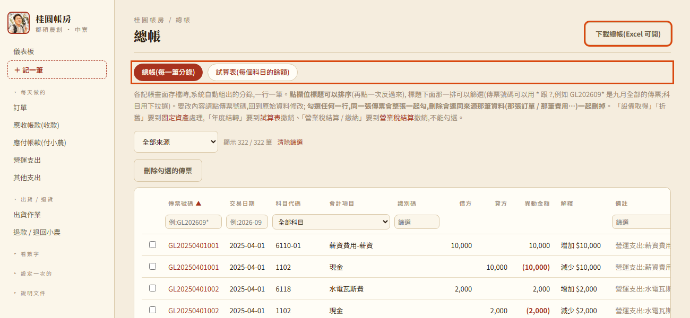

### 1019-8 帳務調整預設 3 列、可增刪

> **同仁原文**:"帳務調整"不須限制2或3項,而是由系統先預設3列。使用者可針對每一列單獨刪除、或可於下方新增列。其餘部分不動。

**解法**:預設 3 列,每列右邊「✕」刪掉、下面「＋ 再加一行」,不限幾列;借貸要平衡才能存(不變)。實測 4 列可以存。

**佐證**:版本 `c1ad26e`。

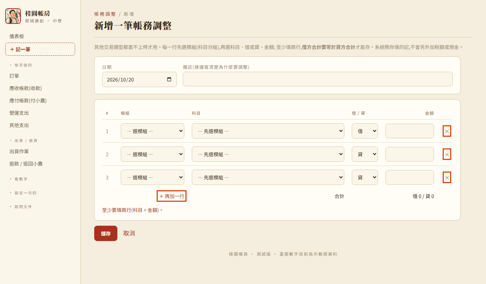

### 1019-9 預設今年

> **同仁原文**:財務報表頁面的預設年度為操作者當下的時間會比較好。

**解法**:試算表一打開就是今年(就算今年還沒有資料)。

**佐證**:版本 `c1ad26e`、`4db7405`。

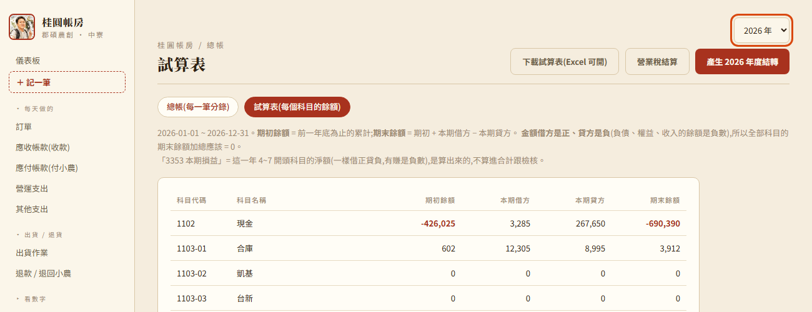

### 1019-10 營運支出 / 其他支出頁面可隱藏?(未做)

> **同仁原文**:"營運支出"和"其他支出"頁面應該可隱藏,資訊有點太細?

**狀態**:使用者 2026-10-20 決定**先記下、不做**(記在待辦清單)。

### 1019-11 刪掉全鏈路毛利

> **同仁原文**:全鏈路毛利是不是可以刪掉?好像沒用到

**解法**:使用者決定刪掉:選單、頁面、示範資料都拿掉(資料表留著不用)。

**佐證**:版本 `c1ad26e`。「看數字」選單已經沒有全鏈路毛利。

### 1019-12 進銷項互抵,做出留抵或應付稅捐

> **同仁原文**:結帳時,把進項稅額和銷項稅額互抵,做出留底稅額或應付稅捐。

**解法**:2026-10-20 回覆「待同仁確認」第 6 題時已經做好的「**營業稅結算**」(試算表右上):每兩個月一期,
按「結算」:本期應納 = 銷項 − 進項 − 上期留抵;正的記「2215 應付營業稅」(可再按「繳納」),負的留到下期(1424 留抵稅額)。

**佐證**:版本 `5541c30`。

### 1019-13 財務健康抓總帳數字

> **同仁原文**:"財務健康"還沒抓總帳數字

**解法**:財務健康(跟儀表板的損益簡表)改成從總帳抓:營收 = 銷貨收入(開單就算、不含稅)、退款 = 原料報廢損失、
銷貨成本 = 其他 5 開頭、營運費用 = 6 開頭依科目(含折舊)、業外收支 = 7 開頭(不含所得稅);年度結轉傳票不算。
實測:某個月的營收跟總帳 4 開頭科目加總一致。

**注意**:儀表板最上面「本產季營收(實收)」卡片還是「收到錢才算」,跟損益簡表口徑不同。

**佐證**:版本 `573f16d`。

---

## 驗證時要知道的幾件事

1. **示範資料的現金是負數**(資產負債表 `1102 現金` −227,890):示範資料把一整年的營運支出都記成現金付,
   收款多半進合庫,所以現金被扣成負的。是示範資料不合理,不是系統算錯;檢核值是 0,借貸平衡。
2. [待同仁確認.md](待同仁確認.md) 的 7 題同仁已在 2026-10-20 回覆,系統已照答案改(新增 5 個科目、退款科目、營業稅結算按鈕)。
3. 要自己操作驗證:在 `app` 資料夾執行 `.venv\Scripts\python seed.py --force` 灌示範資料,再雙擊 `啟動.bat`。
   每個截圖都是照上面寫的選單位置拍的。
